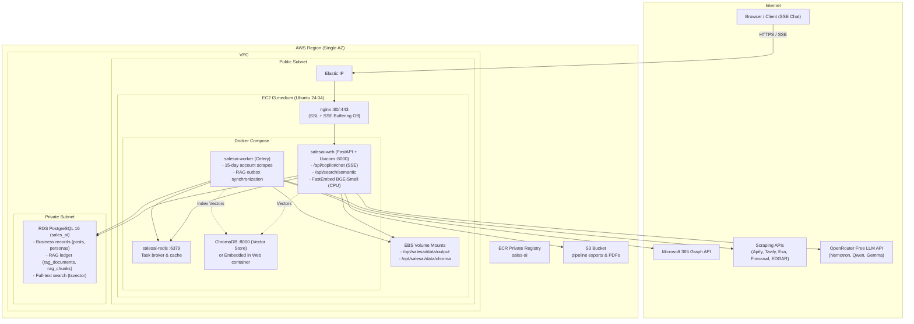

# Deploying Sales AI Agent to AWS (Docker + ECR + EC2 + RDS) with GitHub Actions

```
GitHub (push to main / "Run workflow" with a selected branch)
   ↓  GitHub Actions: build Docker image → push to ECR → SSH to EC2 → pull + start → health check
   ↓
Amazon ECR (private image registry)
   ↓  image pulled by the server
   ↓
EC2 (Ubuntu 24.04, Docker)                                   RDS PostgreSQL 16 (private)
 ├─ nginx :80/:443 ─── container "web" (uvicorn) :8000             ↑
 ├─ container "worker" (celery) ──────────────────────────────────┤  port 5432, EC2 SG only
 ├─ container "redis" :6379 ─── task broker & cache                │  (Business DB + RAG Ledger)
 ├─ persistent volume: /opt/salesai/data/chroma (ChromaDB vectors) ┘
 └─ optional: container "chroma" :8010 (client/server mode)
                                              S3 bucket ← pipeline output + PDF exports
```

---

## Requirements Comparison: AVIR AI vs. Sales AI Agent

> This section maps every architectural element from the reference AVIR AI deployment to the
> Sales AI Agent, highlighting what is shared, what differs, and why the Sales AI Agent requires
> an enterprise RAG subsystem not present in the reference project.

| Component | AVIR AI (Reference) | Sales AI Agent | Status & Architectural Rationale |
|---|---|---|---|
| **Language** | Python 3.12 | Python 3.12 | ✅ Same |
| **Web Framework** | Flask + Gunicorn | **FastAPI + Uvicorn** | ⚠️ Different — Uvicorn ASGI event loop handles streaming SSE chat and async external APIs |
| **Database** | PostgreSQL 16 (RDS), schema `social_media_agent` | PostgreSQL 16 (RDS), database `sales_ai` | ✅ Same engine, different DB name |
| **ORM** | SQLAlchemy 2.x | SQLAlchemy 2.x | ✅ Same |
| **Task Queue** | APScheduler (in-process thread) | **Celery + Redis** (15-day pipeline refresh cycles) | ⚠️ Different — requires Redis container for scheduled account scrapes |
| **RAG Pipeline** | ❌ **None** (simple prompt-completion) | **Full Hybrid RAG** (`apps/sales_copilot/`) | 🆕 **Major Architecture Addition** — ChromaDB + FastEmbed + Postgres Ledger + Hybrid RRF Retrieval |
| **Vector Database** | None | **ChromaDB 1.5.9** (self-hosted embedded or container) | 🆕 Local HNSW cosine vector index in `output/chroma` |
| **Embedding Model** | None | **FastEmbed (`BAAI/bge-small-en-v1.5`, 384 dims)** | 🆕 Local CPU ONNX inference; zero API cost, zero rate limits |
| **Retrieval Engine** | None | **Reciprocal Rank Fusion (RRF, k=60)** | 🆕 Hybrid Vector + Postgres Full-Text Search (`tsv`) with strict Account ACL |
| **LLM Gateway** | HeyRoute Gateway | **OpenRouter Free Tier / Gemini Gateway** | ⚠️ Different provider; includes token & request quota governor with no-LLM extractive fallback |
| **Auth** | Flask-Login + sessions | **JWT (PyJWT) + Argon2 password hashing** | ⚠️ Different — stateless JWT tokens |
| **External APIs** | HeyRoute, S3 | **Apify, Tavily, Exa, Firecrawl, Serper, Finnhub, Diffbot, FullEnrich, Monid.ai, SEC EDGAR** | ⚠️ Many more API keys needed |
| **Media Storage** | S3 (generated images/videos) | S3 (pipeline output, PDF exports) | ✅ Same pattern |
| **Container Count** | 3 (web, scheduler, redis) | **3 or 4** (web, worker, redis, optional standalone chroma) | ✅ Same core topology + persistent vector volume |
| **Health Check** | `GET /login` → 200 | `GET /login` → 200 | ✅ Same |
| **Docker Base** | `python:3.12-slim` | `python:3.12-slim` | ✅ Same |
| **Reverse Proxy** | nginx | nginx | ✅ Same |
| **CI/CD** | GitHub Actions + OIDC → ECR → EC2 SSH | GitHub Actions + OIDC → ECR → EC2 SSH | ✅ Same pipeline |

---

## RAG Pipeline Architecture & Hosting Methodology

In the uploaded AVIR reference document, **no RAG pipeline existed**. In the Sales AI Agent, the RAG subsystem is the core intelligence engine powering the **Sales Copilot** (`/api/copilot/*`), **Semantic Search** (`/api/search/semantic`), and the **Admin Pipeline Inspector** (`/copilot-pipeline`).

```
┌──────────────────────────────────────────────────────────────────────────────────────────────────┐
│                                   POSTGRESQL (Source of Truth)                                   │
│  posts, linkedin_jobs, personas, accounts, lobs, digests, opportunity_signals, cxo_movements      │
└────────────────────────────────────────────────┬─────────────────────────────────────────────────┘
                                                 │ SQL triggers on content modification
                                                 ▼
                                       ┌───────────────────┐
                                       │    rag_outbox     │
                                       └─────────┬─────────┘
                                                 │ Polled every 5 mins (sync.py)
                                                 ▼
                               ┌───────────────────────────────────┐
                               │ 5-LAYER DE-DUPLICATION & CHUNKER  │
                               │ - L0: Junk & stub filter (<80 ch) │
                               │ - L1: Document URL normalization  │
                               │ - L2: Content hash verification   │
                               │ - L3: Chunk-level deduplication   │
                               │ - L4: Deterministic vector IDs    │
                               └─────────────────┬─────────────────┘
                                                 │
                      ┌──────────────────────────┴──────────────────────────┐
                      ▼                                                     ▼
           ┌──────────────────────┐                              ┌──────────────────────┐
           │   rag_chunks (PG)    │                              │ FastEmbed ONNX (CPU) │
           │ - SHA-256 chunk_hash │                              │ - BAAI/bge-small     │
           │ - tsvector index     │                              │ - 384 dimensions     │
           └──────────────────────┘                              └──────────┬───────────┘
                                                                            │ 384-dim floats
                                                                            ▼
                                                                 ┌──────────────────────┐
                                                                 │   ChromaDB Server    │
                                                                 │ id: {hash}:{acc_id}  │
                                                                 └──────────────────────┘

════════════════════════════════════════════════════════════════════════════════════════════════════
                                      QUERY TIME (HYBRID RAG)
════════════════════════════════════════════════════════════════════════════════════════════════════

  Salesperson / User Question
               │
               ▼
  FastAPI Copilot Route (/api/copilot/chat)
               │
               ├─► Intent & Entity Resolution (Persona, Account, Topic identification)
               │
               ├─► LEG 1: ChromaDB Vector Query (Cosine nearest-neighbors, filtered by User ACL)
               ├─► LEG 2: PostgreSQL Keyword Query (Coverage-based ts_rank_cd on rag_chunks.tsv)
               │
               ▼
  Reciprocal Rank Fusion (RRF, k=60)
               │
               ▼
  Postgres ACL & Freshness Verification (Verify is_current=TRUE, deleted_at IS NULL, account access)
               │
               ▼
  Quota Check (llm_usage table)
         ├── Quota Available ──► OpenRouter Free LLM (Streaming SSE with markdown [#1], [#2] citations)
         └── Quota Depleted ───► Extractive Fallback (Structured facts + sources synthesized without LLM)
```

### 1. Division of Responsibility
- **PostgreSQL (RDS):** Remains the single source of truth and index ledger. It holds raw scraped business records, canonical rendered documents (`rag_documents`), unique text chunks (`rag_chunks`), full-text search indexes (`tsv`), entity mappings (`rag_document_entities`), and transactional outbox events (`rag_outbox`).
- **ChromaDB:** Operates as a **derived, rebuildable cache**. Chroma holds only the 384-dimensional vector embeddings, HNSW graph index, and basic scalar metadata filters (`account_id`, `published_ts`). If the Chroma data directory is deleted, the entire vector store is regenerated from PostgreSQL via `python -m apps.sales_copilot.cli sync` without data loss.
- **FastEmbed:** Handles vector embedding locally on CPU using ONNX Runtime. No calls to OpenAI or cloud embedding APIs are made; embedding is 100% free, private, and immune to rate limits.
- **OpenRouter Free Tier:** Provides generative answer synthesis. Quota is preserved using a strict request governor; if exhausted, the pipeline seamlessly degrades to an extractive factual summary mode.

### 2. Five-Layer De-duplication Architecture
Scraped sales data contains severe repetition (e.g., a single BNY 8-K SEC filing scraped 135 times across 135 executive profiles). Naive embedding would waste 70% of storage and flood answers with duplicate filings. The pipeline enforces 5 defensive layers:
1. **L0 Junk Filter:** Discards stubs, SEC filings under 80 characters, and empty notifications.
2. **L1 Document URL De-duplication:** Documents sharing canonical URLs are unified; entity links are updated in `rag_document_entities` rather than duplicating document text.
3. **L2 Content Hashing:** `SHA-256` hashing on rendered documents ensures that unchanged accounts or personas are never re-chunked or re-embedded.
4. **L3 Chunk-Level De-duplication:** Chunking produces windows of 280 words (40-word overlap). Identical text yields identical `chunk_hash`. **Each chunk text is embedded only once per index version.**
5. **L4 Deterministic Chroma IDs:** Vector IDs are formatted as `"{chunk_hash_hex}:{account_id}"`. Chroma `upsert` operations are completely idempotent, preventing duplicate vectors even during backfills or repeated syncs.

### 3. ChromaDB Deployment Options on AWS
You can run ChromaDB in one of two supported modes:

#### Option A: Embedded Persistent Storage (Default & Simplest)
- Uses `chromadb.PersistentClient(path="output/chroma")`.
- Chroma runs inside the `salesai-web` container process, saving SQLite/HNSW data to `/app/output/chroma`.
- The directory is mounted from `/opt/salesai/data/output/chroma` on the EC2 host's EBS volume so vectors persist across container redeployments.
- Ideal for single-instance EC2 deployments (`t3.medium`).

#### Option B: Dedicated ChromaDB Container (Production Scalable)
- Runs a standalone `chromadb/chroma:latest` container alongside the web and worker containers in `docker-compose.prod.yml`.
- The web and worker containers communicate over Docker's internal bridge network via `COPILOT_CHROMA_URL=http://chroma:8000`.
- Isolates vector index memory from the Uvicorn HTTP worker processes.

### 4. Two-Leg Hybrid Retrieval & Reciprocal Rank Fusion (RRF)
To ensure the Copilot never misses acronyms (e.g., "EDGAR", "LOB") while retaining deep semantic matching:
- **Vector Search (ChromaDB):** Embeds the query via FastEmbed and queries Chroma using cosine distance:
  ```python
  where = {"account_id": {"$in": user_accessible_account_ids}}
  ```
- **Lexical Keyword Search (PostgreSQL):** Queries `rag_chunks.tsv` using `ts_rank_cd` and term coverage across all non-stopword query tokens.
- **Reciprocal Rank Fusion (RRF):** Merges both ranked lists with smoothing constant $k=60$:
  $$\text{Score}(d) = \sum_{m \in \{\text{vector}, \text{keyword}\}} \frac{1}{60 + \text{rank}_m(d)}$$
- **Security & Multi-Tenant Isolation:** Before evidence reaches the prompt, PostgreSQL validates that every chunk belongs to a current, non-deleted document that matches the caller's explicit permissions in `user_account_access`.

### 5. Quota Governor & Fallback Mode
OpenRouter free tier provides 50 requests/day per API key. The quota governor in `apps/sales_copilot/llm.py`:
- Tracks consumption per feature and per user in the `llm_usage` table.
- Enforces a 1-request-per-question limit (no costly multi-turn agent loops).
- **Extractive Fallback:** When the quota limit is reached, instead of throwing an error or failing the user request, the copilot formats the top-ranked hybrid retrieval evidence into structured facts, timeline entries, and clickable citations, returning a factual answer directly with **zero LLM calls**.

---

## Production Architecture Diagram



---

## Deployment Files

| Piece | Where it lives | Purpose |
|---|---|---|
| Workflow | `.github/workflows/deploy.yml` | GitHub Actions CI/CD pipeline |
| Image definition | [`Dockerfile`](file:///c:/Users/LENOVO/OneDrive%20-%20STRADIT/Desktop/_Sales_AI_Agent_/sales_agent-ai/Dockerfile), [`.dockerignore`](file:///c:/Users/LENOVO/OneDrive%20-%20STRADIT/Desktop/_Sales_AI_Agent_/sales_agent-ai/.dockerignore) | Multi-stage production container with FastEmbed & ChromaDB |
| Containers on server | `deploy/docker-compose.prod.yml` | Web (FastAPI), Worker (Celery), Redis, and Chroma volumes |
| Server bootstrap | `deploy/setup_server.sh` | Docker, nginx, swap, data folders, permissions |
| Per-deploy script | `deploy/remote_deploy.sh` | Healthchecks, rollback, migrations |
| nginx site | `deploy/nginx/salesai.conf` | Reverse proxy with SSE streaming configuration |
| RAG Core | `apps/sales_copilot/` | Ingest, embed, retrieve, store, guardrails, quota governor |
| CLI Administration | `apps/sales_copilot/cli.py` | Sync, rebuild-index, stats, models, evaluation commands |
| DB table creation | [`db/create_tables.py`](file:///c:/Users/LENOVO/OneDrive%20-%20STRADIT/Desktop/_Sales_AI_Agent_/sales_agent-ai/db/create_tables.py) | PostgreSQL business and RAG tables bootstrap |

---

## Step 1 — Security Groups (AWS Console → EC2 → Security Groups)

Create two groups in the same VPC:

**`salesai-ec2-sg`**

| Type | Port | Source | Purpose |
|---|---|---|---|
| HTTP | 80 | `0.0.0.0/0` | Let's Encrypt renewal & HTTP redirect |
| HTTPS | 443 | `0.0.0.0/0` | User browser traffic & SSE streaming |
| SSH | 22 | `0.0.0.0/0` | GitHub Actions deployment runner (key-only) |

**`salesai-rds-sg`**

| Type | Port | Source |
|---|---|---|
| PostgreSQL | 5432 | `salesai-ec2-sg` (Security Group reference only) |

---

## Step 2 — RDS PostgreSQL 16 Setup

RDS → Create database:
- **Engine:** PostgreSQL 16, template **Dev/Test** or **Free tier**.
- **Identifier:** `salesai-db`, master user `saadmin`.
- **Instance class:** `db.t4g.micro` (starter) or `db.t4g.small` (production).
- **Storage:** 20 GB gp3 with storage autoscaling enabled up to 50 GB.
- **Connectivity:** Same VPC as EC2, **Public access: No**, SG `salesai-rds-sg`.
- **Additional configuration → Initial database name:** `sales_ai`.
- **Extensions:** Ensure `pg_trgm` can be created (used by persona entity resolution).

Connection string format:
```
DATABASE_URL=postgresql://saadmin:<password>@<rds-endpoint>:5432/sales_ai?sslmode=require
```

---

## Step 3 — EC2 Instance Provisioning

EC2 → Launch instance:
- **AMI:** Ubuntu Server 24.04 LTS (x86_64).
- **Instance Type:** `t3.medium` (2 vCPU, 4 GB RAM) recommended. FastEmbed ONNX inference and ChromaDB require ~500 MB RAM; Uvicorn web workers take ~400 MB each; Celery worker takes ~300 MB.
- **Storage:** **40 GB gp3 SSD** (accommodates Docker images, ONNX model weights, and Chroma vector indices).
- **Elastic IP:** Allocate and associate with the instance.

### Memory & Resource Breakdown

| Component | RAM Allocation | CPU Utilization | Notes |
|---|---|---|---|
| Uvicorn Web (2 workers) | ~800 MB | Low, spikes on chat query | Handles API requests & SSE streams |
| Celery Worker | ~300 MB | Moderate during scrapes | Background data gathering & outbox sync |
| FastEmbed ONNX Runtime | ~200 MB | Burst CPU on new chunks | Embedded in web process; `bge-small` |
| ChromaDB (Vector Store) | ~300 MB | Burst on nearest-neighbor search | Embedded in web or dedicated container |
| Redis 7 | ~50 MB | Minimal | Celery broker & response cache |
| Linux + Docker + Nginx | ~500 MB | Minimal | Host OS baseline |
| **Total Resident** | **~2.15 GB / 4.0 GB** | **Fits comfortably on `t3.medium` with 4 GB swap** |

---

## Step 4 — S3 Bucket & EC2 IAM Role

1. **S3 → Create bucket:** `salesai-data-<account-id>`, keep **Block all public access** checked.
2. **IAM → Roles → Create role:** Trust entity *EC2*, name `salesai-ec2`. Attach policy granting `s3:PutObject`, `s3:GetObject`, `s3:ListBucket` on the bucket.
3. Attach role to EC2 instance and set **Metadata response hop limit = 2**.

---

## Step 5 — ECR Repository & GitHub OIDC Authentication

1. **ECR Repository:** Create private repository named `sales-ai`.
2. **GitHub OIDC Role:** Configure AWS IAM Identity Provider for `token.actions.githubusercontent.com` and create role `salesai-github-deploy` with ECR push and EC2 SSH authorization.

---

## Step 6 — Production Environment Configuration

In GitHub Repository → **Settings → Environments → `production`**, add the `ENV_FILE` secret with the following production template:

```bash
# ══════════════════════════════════════════════════════════════
# Sales AI Agent — Production Environment Configuration
# ══════════════════════════════════════════════════════════════

# ── Database (RDS PostgreSQL) ─────────────────────────────────
DATABASE_URL=postgresql://saadmin:<password>@<rds-endpoint>:5432/sales_ai?sslmode=require

# ── Authentication & Security ─────────────────────────────────
JWT_SECRET_KEY=<generate-via-secrets-token_urlsafe-64>
JWT_ACCESS_TOKEN_EXPIRE_MINUTES=15
JWT_REFRESH_TOKEN_EXPIRE_DAYS=14

# ── Sales Copilot RAG Pipeline & Vector Store ─────────────────
COPILOT_EMBED_MODEL=BAAI/bge-small-en-v1.5
COPILOT_EMBED_DIMS=384
# Leave blank to use embedded persistent store (/app/output/chroma)
# Or set http://chroma:8000 if using standalone container
COPILOT_CHROMA_URL=
COPILOT_AUTOSYNC=1
COPILOT_SYNC_INTERVAL_SECONDS=300
COPILOT_FULL_RECONCILE_HOURS=24

# ── LLM Gateway & Quota Management ────────────────────────────
LLM_API_BASE=https://openrouter.ai/api/v1
OPENROUTER_API_KEY=<your-openrouter-key>
COPILOT_LLM_MODELS=nvidia/nemotron-3-super-120b-a12b:free,qwen/qwen3.8-27b:free,google/gemma-4-31b-it:free
OPENROUTER_DAILY_LIMIT=50
LLM_USER_DAILY_TOKENS=90000

# ── Google Gemini Gateway (Call-Prep & Deal Room) ─────────────
GEMINI_API_KEY=<your-gemini-api-key>
LLM_BASE_URL=https://generativelanguage.googleapis.com/v1beta/openai
LLM_DEFAULT_MODEL=gemini-flash-latest

# ── Microsoft 365 Activity Capture ────────────────────────────
MS_CLIENT_ID=
MS_CLIENT_SECRET=
MS_TENANT_ID=
CAPTURE_TOKEN_KEY=<generate-via-fernet-generate_key>

# ── Scraping & External Intelligence APIs ─────────────────────
APIFY_TOKEN=<your-primary-token>
APIFY_BACKUP_TOKENS=<token2>,<token3>
MONID_API_KEY=<your-monid-key>
TAVILY_API_KEY=<your-tavily-key>
EXA_API_KEY=<your-exa-key>
FIRECRAWL_API_KEY=<your-firecrawl-key>
SERPER_API_KEY=<your-serper-key>
FINNHUB_API_KEY=<your-finnhub-key>
DIFFBOT_TOKEN=<your-diffbot-token>
FULLENRICH_API_KEY=<your-fullenrich-key>

# ── Storage & Paths ───────────────────────────────────────────
OUTPUT_DIR=output
S3_MEDIA_BUCKET=salesai-data-<account-id>
AWS_REGION=ap-south-1
APP_BASE_URL=https://your.domain.com
SEC_USER_AGENT=CompanyName admin@company.com
```

---

## Step 7 — Production Docker Compose (`deploy/docker-compose.prod.yml`)

```yaml
services:
  web:
    image: ${APP_IMAGE}
    container_name: salesai-web
    restart: unless-stopped
    ports:
      - "8000:8000"
    env_file:
      - /opt/salesai/.env
    environment:
      - CELERY_BROKER_URL=redis://redis:6379/0
      - CELERY_RESULT_BACKEND=redis://redis:6379/0
      - REDIS_URL=redis://redis:6379/0
    command: >
      uvicorn api:app
      --host 0.0.0.0
      --port 8000
      --workers ${WEB_CONCURRENCY:-2}
      --timeout-keep-alive 120
      --limit-concurrency 100
    volumes:
      - /opt/salesai/data/output:/app/output
    depends_on:
      - redis
    healthcheck:
      test: ["CMD", "python", "-c", "import urllib.request; urllib.request.urlopen('http://localhost:8000/login')"]
      interval: 30s
      timeout: 10s
      retries: 3
      start_period: 30s

  worker:
    image: ${APP_IMAGE}
    container_name: salesai-worker
    restart: unless-stopped
    env_file:
      - /opt/salesai/.env
    environment:
      - CELERY_BROKER_URL=redis://redis:6379/0
      - CELERY_RESULT_BACKEND=redis://redis:6379/0
      - REDIS_URL=redis://redis:6379/0
    command: >
      celery -A celery_app worker
      --loglevel=info
      --concurrency=2
      --max-tasks-per-child=50
    volumes:
      - /opt/salesai/data/output:/app/output
    depends_on:
      - redis

  redis:
    image: redis:7-alpine
    container_name: salesai-redis
    restart: unless-stopped
    command: redis-server --maxmemory 128mb --maxmemory-policy allkeys-lru
    volumes:
      - redis_data:/data

volumes:
  redis_data:
```

> [!NOTE]
> The host directory `/opt/salesai/data/output` is mounted directly into `/app/output`. Because ChromaDB writes to `output/chroma/`, its SQLite index and HNSW vector files are persistently stored on the host EBS disk and survive container rebuilds and redeployments.

---

## Step 8 — Nginx Reverse Proxy with Server-Sent Events (SSE)

Create `deploy/nginx/salesai.conf`. Notice the **`proxy_buffering off;`** setting, which is mandatory for real-time token streaming from the Copilot RAG chat:

```nginx
upstream salesai {
    server 127.0.0.1:8000;
}

server {
    listen 80;
    server_name _;

    client_max_body_size 50M;

    proxy_read_timeout    600s;
    proxy_connect_timeout 60s;
    proxy_send_timeout    600s;

    # Copilot SSE streaming endpoints require buffering to be disabled
    location /api/copilot/chat {
        proxy_pass         http://salesai;
        proxy_set_header   Host              $host;
        proxy_set_header   X-Real-IP         $remote_addr;
        proxy_set_header   X-Forwarded-For   $proxy_add_x_forwarded_for;
        proxy_set_header   X-Forwarded-Proto $scheme;
        proxy_http_version 1.1;
        proxy_buffering    off;
        proxy_cache        off;
        chunked_transfer_encoding on;
    }

    location / {
        proxy_pass         http://salesai;
        proxy_set_header   Host              $host;
        proxy_set_header   X-Real-IP         $remote_addr;
        proxy_set_header   X-Forwarded-For   $proxy_add_x_forwarded_for;
        proxy_set_header   X-Forwarded-Proto $scheme;
        proxy_http_version 1.1;
        proxy_set_header   Upgrade    $http_upgrade;
        proxy_set_header   Connection "upgrade";
    }
}
```

---

## Step 9 — Day-to-Day Operations & RAG Administration

### RAG Maintenance CLI Commands
Run these commands inside the `salesai-web` container via SSH:

```bash
# 1. Check RAG Index Statistics (documents, chunks, vectors, duplicates)
sudo docker exec salesai-web python -m apps.sales_copilot.cli stats

# 2. Trigger Outbox Drain and Incremental Vector Sync
sudo docker exec salesai-web python -m apps.sales_copilot.cli sync

# 3. Nightly Maintenance (Sync + Outbox Drain + Retention Garbage Collection)
sudo docker exec salesai-web python -m apps.sales_copilot.cli maintain

# 4. Verify OpenRouter Models are Still Free and Responsive
sudo docker exec salesai-web python -m apps.sales_copilot.cli models

# 5. Full Vector Re-indexing (Zero Downtime Blue/Green Collection Swap)
sudo docker exec salesai-web python -m apps.sales_copilot.cli rebuild-index

# 6. Run Golden-Set Evaluation (Precision, Citation Accuracy, Zero LLM Calls)
sudo docker exec salesai-web python -m apps.sales_copilot.cli eval
```

### Checking Application & RAG Logs
```bash
# Live copilot sync and RAG activity
sudo docker logs -f --tail 100 salesai-web | grep -E "\[copilot\]|\[retrieval\]"

# Celery long-running task logs
sudo docker logs -f --tail 100 salesai-worker

# Check vector directory on host
ls -lah /opt/salesai/data/output/chroma
```

---

## Troubleshooting Guide

### 1. ChromaDB Vectors Not Matching Ledger
If the admin inspector warns that Chroma has fewer vectors than the `rag_index_entries` ledger:
```bash
sudo docker exec salesai-web python -m apps.sales_copilot.cli rebuild-index
```
This builds a fresh blue/green Chroma collection directly from `rag_chunks` and swaps it cleanly once indexing is complete.

### 2. Copilot Falling Back to Non-LLM Extractive Mode
Check whether your OpenRouter free-tier daily quota was consumed:
```bash
sudo docker exec salesai-web python -c "
from db.connection import get_session
from apps.sales_copilot import llm
s = get_session()
print(llm.quota_summary(s))
"
```
If exhausted, responses continue to function accurately in extractive summary mode until the 24-hour UTC reset.

### 3. Permissions Error on `/opt/salesai/data/output`
Ensure the container user has write permissions to the persistent volume:
```bash
sudo mkdir -p /opt/salesai/data/output/chroma
sudo chown -R 1000:1000 /opt/salesai/data/output
sudo chmod -R 775 /opt/salesai/data/output
```
