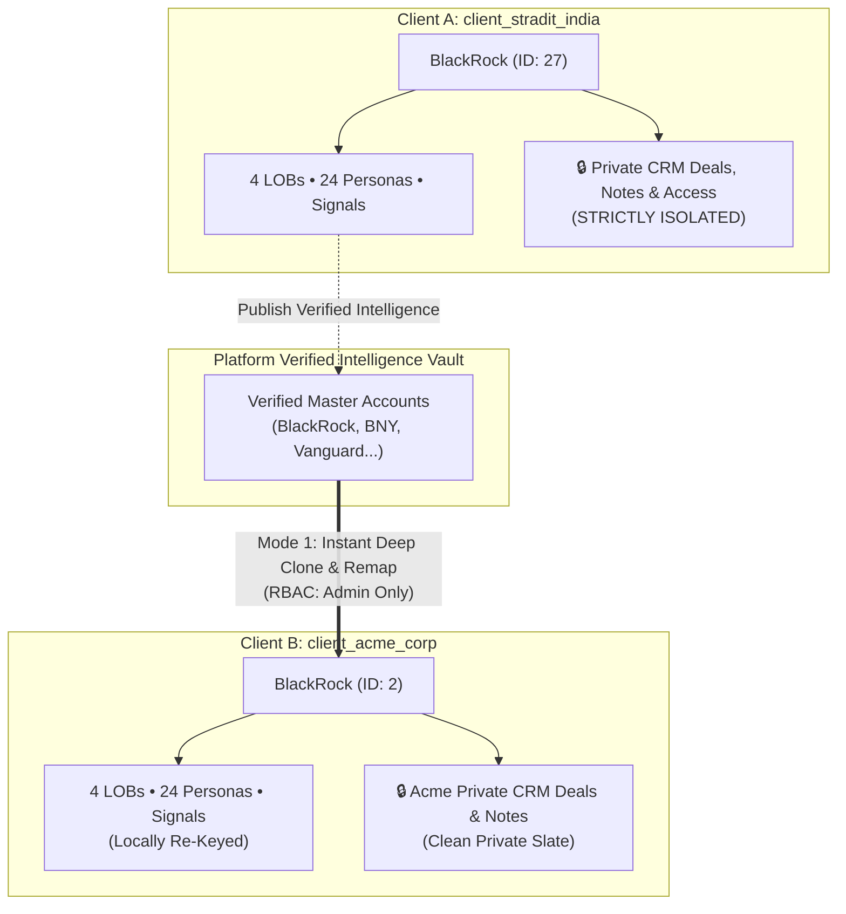

# Cross-Tenant Account Assignment & Verified Intelligence Sharing Architecture
**Specification & Implementation Plan**  
*Document Version: 1.0.0 • Date: November 2026 • Status: Ready for Review*

---

## 1. Executive Summary & Problem Definition

In our multi-tenant PostgreSQL architecture, each client workspace runs within a dedicated database schema (e.g., `client_stradit_india`, `client_acme_corp`). Each schema maintains its own canonical 58-table structure containing accounts, lines of business (LOBs), personas, and intelligence feeds.

### The Business & Technical Problem
When Client A (`stradit_india`) has already enriched a major enterprise target such as **BlackRock** (consisting of 89 firmographic attributes, 4 LOBs, 24 verified personas, executive social posts, and buying signals), and Client B (`acme_corp`) targets the exact same company:
1. **Inefficient Re-Scraping**: Running a full external scraping pipeline from scratch wastes 5–10 minutes of crawling latency and consumes 20–50 billable third-party API credits (ProxyCrawl, Google, Perplexity, Hunter, LinkedIn).
2. **Rate-Limit & Anti-Bot Exposure**: Redundantly hitting external vendor endpoints for identical public corporate data increases risk of anti-bot friction.
3. **Cross-Tenant Data Privacy Boundaries**: In a multi-tenant system, Client B must **never** see Client A’s private sales activities (CRM deals, private sales notes, buyer room links, or team user permissions).

### The Solution: Verified Account Intelligence Vault & Dual-Mode Engine
We implement an enterprise-grade **Two-Way Dual-Mode Provisioning Engine**:
* **Mode 1 (Instant Verified Assignment)**: Admins can clone pre-verified public intelligence (Account + LOBs + Personas + Public Signals) into the target client's schema in **< 200ms** with **0 external API credit burn**.
* **Mode 2 (Fresh Independent Ingestion)**: Admins can trigger a ground-up live web scrape when a client explicitly needs freshly crawled real-time data.

---

## 2. High-Level System Architecture & Data Flow



---

## 3. Four-Iteration Refinement & Architectural Specifications

### Iteration 1: Ingestion Mode Choice (The Dual-Mode UI)
When an authorized Admin adds an account in Client B's workspace:
1. Autocomplete detects whether the domain or company name matches an existing verified account.
2. If matched, the system renders a **Verified Intelligence Badge**:
   > ⚡ **Verified Intelligence Available**: BlackRock is already mapped with 4 Lines of Business, 24 Personas, and 62 Signals.
3. The Admin is presented with two explicit actions:
   * **`[⚡ Assign Verified Account (Instant • 0 Credits)]`**: Immediately provisions the verified intelligence into Client B.
   * **`[🌐 Perform Fresh Deep Scrape (Full Pipeline Run)]`**: Consumes normal client credits and launches an asynchronous scraping pipeline.

### Iteration 2: Relational Integrity & Schema-Safe ID Remapping
Copying an account between schemas requires re-keying all relational primary and foreign keys inside a single atomic database transaction:

| Entity | Cloning Action | Foreign Key Remapping | Privacy Filter |
| :--- | :--- | :--- | :--- |
| **`accounts`** | Insert row into `target_schema.accounts` | New primary key generated (`target_account_id`) | Preserves 89 canonical firmographics. |
| **`lobs`** | Insert rows into `target_schema.lobs` | `account_id = target_account_id` | Stores `old_lob_id -> new_lob_id` map. |
| **`sub_lobs`** | Insert rows into `target_schema.sub_lobs` | `account_id = target_account_id`, `lob_id = new_lob_id` | Maintains division hierarchy. |
| **`personas`** | Insert rows into `target_schema.personas` | `account_id = target_account_id`, `lob_id = new_lob_id` | Copies public executive contacts. |
| **`opportunity_signals`** | Insert rows into `target_schema.opportunity_signals` | `account_id = target_account_id` | Copies public buying/expansion signals. |
| **`posts` & `cxo_movements`**| Insert rows into `target_schema.posts` | Re-keyed to `target_key` | Social leadership activity. |
| **CRM Deals, Intros & Notes** | **OMITTED (100% EXCLUDED)** | None | **Never copied across tenant schemas.** |

### Iteration 3: Strict RBAC & Governance Matrix

To ensure absolute regulatory compliance and prevent unauthorized cross-tenant intelligence sharing:

| Role | Catalog Search | Assign to Own Workspace | Cross-Client Direct Assignment | Fresh Scrape Trigger |
| :--- | :---: | :---: | :---: | :---: |
| **`super_admin`** | ✅ Full Access | ✅ Allowed | ✅ Allowed (Between any 2 clients) | ✅ Allowed |
| **`client_admin`** | ✅ Verified Catalog Only | ✅ Allowed (Subject to quota) | ❌ Denied (Cannot pull from private clients) | ✅ Allowed |
| **`sales_manager`** | ❌ Denied | ❌ Denied | ❌ Denied | ❌ Denied |
| **`user` / `analyst`** | ❌ Denied | ❌ Denied | ❌ Denied | ❌ Denied |
| **`viewer` / `partner`**| ❌ Denied | ❌ Denied | ❌ Denied | ❌ Denied |

*Unauthorized attempts return `403 Forbidden` with an explicit security detail message.*

### Iteration 4: Quota, Credit Telemetry & Audit Trails
1. **Target Account Quota Enforcement**:
   * Before cloning, the service verifies `SELECT count(*) FROM target_schema.accounts`.
   * If `current_count >= client.max_accounts`, the operation aborts with `HTTP 403 (Quota Exceeded)`.
2. **API Credit Accounting**:
   * Mode 1 (Verified Assignment): Costs **0 credits** (or a configurable platform handling fee, e.g., 1 credit).
   * Mode 2 (Fresh Scrape): Deducts standard pipeline credits (e.g., 25–50 credits) from `client.api_credits_total`.
3. **Audit Ledger Logging**:
   * An immutable audit record is committed to `public.audit_log`:
     ```json
     {
       "event_type": "account.assigned_from_catalog",
       "actor_id": 1,
       "client_slug": "acme_corp",
       "details": {
         "account_key": "blackrock",
         "source_client": "stradit_india",
         "target_client": "acme_corp",
         "lobs_cloned": 4,
         "personas_cloned": 24
       }
     }
     ```

---

## 4. REST API Endpoint Specifications

### 1. Discover Verified Accounts in Catalog
* **Endpoint**: `GET /api/clients/catalog/accounts/search?q={query}`
* **Auth**: `require_role("super_admin", "client_admin")`
* **Response**:
  ```json
  {
    "matches": [
      {
        "key": "blackrock",
        "display_name": "BlackRock",
        "primary_domain": "blackrock.com",
        "lobs_count": 4,
        "personas_count": 24,
        "signals_count": 62,
        "source_client_slug": "stradit_india",
        "verified_at": "2026-11-10T12:00:00Z"
      }
    ]
  }
  ```

### 2. Assign Account from Catalog to Client Workspace
* **Endpoint**: `POST /api/clients/{slug}/accounts/assign-from-catalog`
* **Auth**: `require_role("super_admin", "client_admin")`
* **Request Body**:
  ```json
  {
    "account_key": "blackrock",
    "source_client_slug": "stradit_india"
  }
  ```
* **Response (`201 Created`)**:
  ```json
  {
    "status": "success",
    "target_client": "acme_corp",
    "account": {
      "id": 2,
      "key": "blackrock",
      "display_name": "BlackRock",
      "lobs_cloned": 4,
      "personas_cloned": 24
    },
    "quota_remaining": 18
  }
  ```

---

## 5. Implementation Roadmap & Testing Plan

1. **Service Layer**:
   * Implement `AccountAssignmentService.assign_account_between_clients()` in `services/account_assignment_service.py`.
   * Enforce atomic transaction rollback on any foreign key error.
2. **API Routes**:
   * Add catalog search and assignment endpoints to `routes/client_router.py`.
3. **Frontend UI**:
   * Add Verified Badge & Dual-Mode buttons to `#addAccountModal` in `frontend/pipline/`.
4. **Automated Test Suite**:
   * `tests/test_account_assignment_rbac.py`:
     - Test complete deep-copy and ID remapping across two client schemas.
     - Test quota blocking when `current_accounts == max_accounts`.
     - Test RBAC blocking for non-admin roles.
     - Test verification that private deals and access grants are not copied.
