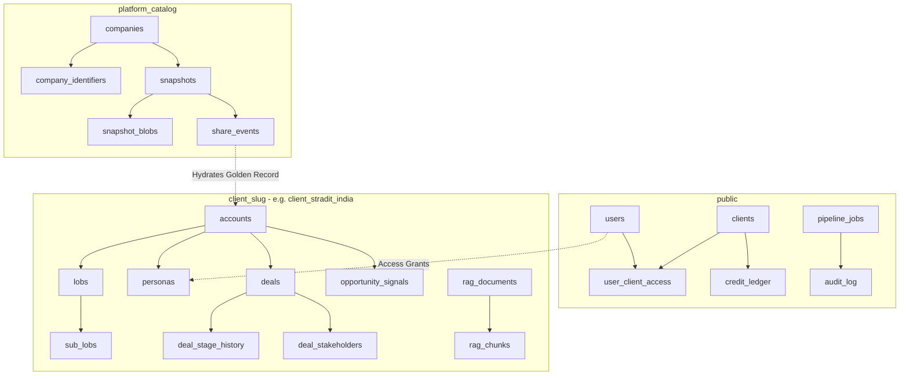

# Enterprise Sales Intelligence Database Architecture & Schema Catalog
> **Generated Date:** 2026-11-12 | **Target Environment:** Multi-Tenant PostgreSQL (sales_ai)
> **Architecture Style:** Multi-Tenant Schema-Isolated Hybrid Architecture with Centralized Platform Catalog
> **Tenant Skeleton Version:** `T0003` (59 Replicated Canonical Tables)

---
## 1. Architectural Overview & Schema Topology
The database is structured into three distinct operational tiers to guarantee absolute tenant isolation, centralized administrative governance, and instant cross-tenant intelligence reuse:

| Schema Tier | Schema Name(s) | Isolation Scope | Purpose & Responsibilities |
| :--- | :--- | :--- | :--- |
| **Platform Tier** | `public` | Shared Infrastructure | Global users, workspace registry (`clients`), credit billing ledger, background task queue (`pipeline_jobs`), system cron, and platform security audits. |
| **Catalog Tier** | `platform_catalog` | Central Golden Record | Immutable, deduplicated enterprise accounts, verified snapshots, compressed JSON graphs, and cross-tenant reuse provenance tracking. |
| **Tenant Workspaces** | `client_stradit_india` `client_acme_corp` `client_inactive_test` *(Dynamic)* | Strict Tenant Isolation | Complete 59-table business skeleton per client workspace. Stores proprietary accounts, LOBs, executive personas, CRM deals, buying signals, and custom RAG vectors. |

---
## 2. Table of Contents & Quick Navigation

- [1. Architectural Overview & Schema Topology](#1-architectural-overview--schema-topology)
- [2. Table of Contents & Quick Navigation](#2-table-of-contents--quick-navigation)
- [3. Tier 1: Platform & Governance Schema (`public`)](#3-tier-1-platform--governance-schema-public)
- [4. Tier 2: Golden Record Catalog Schema (`platform_catalog`)](#4-tier-2-golden-record-catalog-schema-platform_catalog)
- [5. Tier 3: Tenant Client Workspace Skeleton (`client_<slug>`)](#5-tier-3-tenant-client-workspace-skeleton-client_slug)
  - [5.1 Core Account & Organizational Hierarchy](#51-core-account--organizational-hierarchy)
  - [5.2 Executive Directory & Buying Committee Intelligence](#52-executive-directory--buying-committee-intelligence)
  - [5.3 CRM Pipeline, Deals & Commercial Execution](#53-crm-pipeline-deals--commercial-execution)
  - [5.4 Warm Introductions & Relationship Graph](#54-warm-introductions--relationship-graph)
  - [5.5 Opportunity Signals & Market OSINT](#55-opportunity-signals--market-osint)
  - [5.6 Autonomous AI Copilot & Memory System](#56-autonomous-ai-copilot--memory-system)
  - [5.7 RAG Knowledge Base & Vector Indexing](#57-rag-knowledge-base--vector-indexing)
  - [5.8 Integrations, Connectors & Pipeline Auditing](#58-integrations-connectors--pipeline-auditing)
- [6. Multi-Tenant Provisioning & Integrity Contract (`T0003`)](#6-multi-tenant-provisioning--integrity-contract-t0003)

---
## 3. Tier 1: Platform & Governance Schema (`public`)
The `public` schema hosts core shared infrastructure, security authentication, workspace administration, and cross-tenant billing ledgers.

### Table: `public.clients`
**Purpose:** Multi-tenant workspace registry. Defines tenant slug, isolation tier, schema name, subscription status, and billing quota.

| Column Name | Data Type | Nullable | Key / Constraint | Default Value | Notes / Description |
| :--- | :--- | :---: | :---: | :--- | :--- |
| `id` | `INTEGER` | **NO** | `PK` | `nextval('"public".clients_id_seq'::regclass)` | Surrogate primary key identifier. |
| `name` | `VARCHAR(500)` | **NO** | — | — | — |
| `slug` | `VARCHAR(100)` | **NO** | `INDEX` | — | — |
| `legal_name` | `VARCHAR(500)` | YES | — | — | — |
| `schema_name` | `VARCHAR(120)` | **NO** | `INDEX` | — | — |
| `plan_tier` | `VARCHAR(50)` | **NO** | — | `'standard'::character varying` | — |
| `is_active` | `BOOLEAN` | **NO** | — | `true` | Boolean operational flag. |
| `max_accounts` | `INTEGER` | **NO** | — | `20` | — |
| `api_credits_total` | `INTEGER` | **NO** | — | `0` | — |
| `api_credits_used` | `INTEGER` | **NO** | — | `0` | — |
| `created_by_id` | `INTEGER` | YES | FK &rarr; `public.users.id` | — | Foreign key reference to `public.users.id`. |
| `created_at` | `TIMESTAMP` | **NO** | — | `now()` | System audit timestamp tracking creation and mutation. |
| `updated_at` | `TIMESTAMP` | **NO** | — | `now()` | System audit timestamp tracking creation and mutation. |
| `status` | `VARCHAR(50)` | **NO** | `INDEX` | `'active'::character varying` | — |
| `skeleton_version` | `VARCHAR(32)` | **NO** | — | `'T0001'::character varying` | — |
| `provisioned_at` | `TIMESTAMP` | YES | — | — | — |
| `suspended_at` | `TIMESTAMP` | YES | — | — | — |
| `deleted_at` | `TIMESTAMP` | YES | — | — | — |
| `refresh_cron` | `VARCHAR(64)` | **NO** | — | `'0 0 * * *'::character varying` | — |
| `max_concurrent_jobs` | `INTEGER` | **NO** | — | `3` | — |
| `last_error` | `TEXT` | YES | — | — | — |
| `catalog_publish` | `BOOLEAN` | **NO** | — | `false` | Boolean operational flag. |
| `catalog_consume` | `BOOLEAN` | **NO** | — | `false` | Boolean operational flag. |
| `reuse_requires_approval` | `BOOLEAN` | **NO** | — | `true` | Boolean operational flag. |

**Foreign Key Constraints:**
- (`created_by_id`) &rarr; `public.users` (`id`)

**Secondary Indexes:**
- `clients_schema_name_key` (UNIQUE): on (`schema_name`)
- `clients_slug_key` (UNIQUE): on (`slug`)
- `ix_clients_slug`: on (`slug`)
- `ix_clients_status`: on (`status`)

---

### Table: `public.users`
**Purpose:** Global platform user directory. Manages authentication credentials, role-based access (super_admin, partner, manager, viewer), and profile data.

| Column Name | Data Type | Nullable | Key / Constraint | Default Value | Notes / Description |
| :--- | :--- | :---: | :---: | :--- | :--- |
| `id` | `INTEGER` | **NO** | `PK` | `nextval('"public".users_id_seq'::regclass)` | Surrogate primary key identifier. |
| `email` | `VARCHAR(255)` | **NO** | `INDEX` | — | — |
| `hashed_password` | `VARCHAR(255)` | **NO** | — | — | — |
| `full_name` | `VARCHAR(255)` | YES | — | — | — |
| `role` | `VARCHAR(50)` | **NO** | — | — | — |
| `is_active` | `BOOLEAN` | **NO** | — | — | Boolean operational flag. |
| `failed_login_count` | `INTEGER` | **NO** | — | — | — |
| `locked_until` | `TIMESTAMP` | YES | — | — | — |
| `created_by_id` | `INTEGER` | YES | FK &rarr; `public.users.id` | — | Foreign key reference to `public.users.id`. |
| `last_login_at` | `TIMESTAMP` | YES | — | — | — |
| `created_at` | `TIMESTAMP` | YES | — | — | System audit timestamp tracking creation and mutation. |
| `updated_at` | `TIMESTAMP` | YES | — | — | System audit timestamp tracking creation and mutation. |
| `has_command_center_access` | `BOOLEAN` | **NO** | — | `true` | Boolean operational flag. |
| `has_dashboard_access` | `BOOLEAN` | **NO** | — | `true` | Boolean operational flag. |
| `has_tasks_access` | `BOOLEAN` | **NO** | — | `true` | Boolean operational flag. |
| `has_pipeline_access` | `BOOLEAN` | **NO** | — | `true` | Boolean operational flag. |
| `manager_id` | `INTEGER` | YES | FK &rarr; `public.users.id` `INDEX` | — | Foreign key reference to `public.users.id`. |

**Foreign Key Constraints:**
- (`created_by_id`) &rarr; `public.users` (`id`)
- (`manager_id`) &rarr; `public.users` (`id`)

**Secondary Indexes:**
- `ix_users_email` (UNIQUE): on (`email`)
- `users_manager`: on (`manager_id`)

---

### Table: `public.user_client_access`
**Purpose:** Many-to-many security bridge mapping users to client workspaces with role overrides and granular permissions.

| Column Name | Data Type | Nullable | Key / Constraint | Default Value | Notes / Description |
| :--- | :--- | :---: | :---: | :--- | :--- |
| `id` | `INTEGER` | **NO** | `PK` | `nextval('"public".user_client_access_id_seq'::regclass)` | Surrogate primary key identifier. |
| `user_id` | `INTEGER` | **NO** | FK &rarr; `public.users.id` `INDEX` | — | Foreign key reference to `public.users.id`. |
| `client_id` | `INTEGER` | **NO** | FK &rarr; `public.clients.id` `INDEX` | — | Foreign key reference to `public.clients.id`. |
| `role` | `VARCHAR(50)` | **NO** | — | `'analyst'::character varying` | — |
| `granted_by_id` | `INTEGER` | YES | FK &rarr; `public.users.id` | — | Foreign key reference to `public.users.id`. |
| `granted_at` | `TIMESTAMP` | **NO** | — | `now()` | — |

**Foreign Key Constraints:**
- (`client_id`) &rarr; `public.clients` (`id`)
- (`granted_by_id`) &rarr; `public.users` (`id`)
- (`user_id`) &rarr; `public.users` (`id`)

**Secondary Indexes:**
- `ix_user_client_access_client_id`: on (`client_id`)
- `ix_user_client_access_user_id`: on (`user_id`)
- `uq_user_client_access` (UNIQUE): on (`user_id`, `client_id`)

---

### Table: `public.credit_ledger`
**Purpose:** Centralized metered billing ledger. Tracks credit additions, consumption, batch runs, and remaining workspace balances.

| Column Name | Data Type | Nullable | Key / Constraint | Default Value | Notes / Description |
| :--- | :--- | :---: | :---: | :--- | :--- |
| `id` | `BIGINT` | **NO** | `PK` | `nextval('"public".credit_ledger_id_seq'::regclass)` | Surrogate primary key identifier. |
| `client_id` | `INTEGER` | **NO** | FK &rarr; `public.clients.id` `INDEX` | — | Foreign key reference to `public.clients.id`. |
| `account_id` | `INTEGER` | YES | — | — | — |
| `run_id` | `VARCHAR(128)` | YES | `INDEX` | — | — |
| `delta` | `INTEGER` | **NO** | — | — | — |
| `reason` | `VARCHAR(255)` | **NO** | — | — | — |
| `created_at` | `TIMESTAMP` | **NO** | `INDEX` | `now()` | System audit timestamp tracking creation and mutation. |
| `ref_type` | `VARCHAR(64)` | YES | `INDEX` | — | — |
| `ref_id` | `BIGINT` | YES | `INDEX` | — | — |
| `balance_after` | `INTEGER` | YES | — | — | — |

**Foreign Key Constraints:**
- (`client_id`) &rarr; `public.clients` (`id`)

**Secondary Indexes:**
- `ix_credit_ledger_client_created`: on (`client_id`, `created_at`)
- `ix_credit_ledger_ref`: on (`ref_type`, `ref_id`)
- `ix_credit_ledger_run_id`: on (`run_id`)

---

### Table: `public.audit_log`
**Purpose:** Platform-wide security and compliance audit trail logging administrative actions, data exports, and security events.

| Column Name | Data Type | Nullable | Key / Constraint | Default Value | Notes / Description |
| :--- | :--- | :---: | :---: | :--- | :--- |
| `id` | `INTEGER` | **NO** | `PK` | `nextval('"public".audit_log_id_seq'::regclass)` | Surrogate primary key identifier. |
| `actor_user_id` | `INTEGER` | YES | FK &rarr; `public.users.id` `INDEX` | — | Foreign key reference to `public.users.id`. |
| `action` | `VARCHAR(100)` | **NO** | `INDEX` | — | — |
| `target_user_id` | `INTEGER` | YES | FK &rarr; `public.users.id` `INDEX` | — | Foreign key reference to `public.users.id`. |
| `details` | `JSONB` | YES | — | — | Structured JSONB payload containing semi-structured intelligence. |
| `created_at` | `TIMESTAMP` | YES | `INDEX` | — | System audit timestamp tracking creation and mutation. |
| `client_id` | `INTEGER` | YES | FK &rarr; `public.clients.id` `INDEX` | — | Foreign key reference to `public.clients.id`. |

**Foreign Key Constraints:**
- (`actor_user_id`) &rarr; `public.users` (`id`)
- (`client_id`) &rarr; `public.clients` (`id`)
- (`target_user_id`) &rarr; `public.users` (`id`)

**Secondary Indexes:**
- `ix_audit_log_action`: on (`action`)
- `ix_audit_log_actor_user_id`: on (`actor_user_id`)
- `ix_audit_log_client_id`: on (`client_id`)
- `ix_audit_log_created_at`: on (`created_at`)
- `ix_audit_log_target_user_id`: on (`target_user_id`)

---

### Table: `public.pipeline_jobs`
**Purpose:** Asynchronous background worker task queue for long-running autonomous ingestion and AI batch jobs.

| Column Name | Data Type | Nullable | Key / Constraint | Default Value | Notes / Description |
| :--- | :--- | :---: | :---: | :--- | :--- |
| `job_id` | `VARCHAR(64)` | **NO** | `PK` | — | — |
| `client_slug` | `VARCHAR(64)` | **NO** | `INDEX` | — | — |
| `account_id` | `INTEGER` | YES | — | — | — |
| `job_type` | `VARCHAR(64)` | **NO** | — | — | — |
| `status` | `VARCHAR(32)` | **NO** | `INDEX` | `'queued'::character varying` | — |
| `progress_pct` | `INTEGER` | **NO** | — | `0` | — |
| `message` | `TEXT` | YES | — | — | — |
| `credits_reserved` | `INTEGER` | **NO** | — | `0` | — |
| `credits_used` | `INTEGER` | **NO** | — | `0` | — |
| `error` | `TEXT` | YES | — | — | — |
| `meta` | `JSONB` | **NO** | — | `'{}'::jsonb` | Structured JSONB payload containing semi-structured intelligence. |
| `result` | `JSONB` | YES | — | — | Structured JSONB payload containing semi-structured intelligence. |
| `started_at` | `TIMESTAMP` | YES | — | — | — |
| `completed_at` | `TIMESTAMP` | YES | — | — | — |
| `created_at` | `TIMESTAMP` | **NO** | `INDEX` | `now()` | System audit timestamp tracking creation and mutation. |
| `updated_at` | `TIMESTAMP` | **NO** | — | `now()` | System audit timestamp tracking creation and mutation. |

**Secondary Indexes:**
- `ix_pipeline_jobs_client_status`: on (`client_slug`, `status`)
- `ix_pipeline_jobs_created_at`: on (`created_at`)

---

### Table: `public.scheduled_jobs`
**Purpose:** Recurring cron job schedules for automated background pipelines and daily syncs.

| Column Name | Data Type | Nullable | Key / Constraint | Default Value | Notes / Description |
| :--- | :--- | :---: | :---: | :--- | :--- |
| `name` | `TEXT` | **NO** | `PK` | — | — |
| `enabled` | `BOOLEAN` | **NO** | — | `true` | Boolean operational flag. |
| `interval_hours` | `NUMERIC(6, 2)` | **NO** | — | `6` | — |
| `options` | `JSONB` | **NO** | — | `'{}'::jsonb` | Structured JSONB payload containing semi-structured intelligence. |
| `updated_at` | `TIMESTAMP` | **NO** | — | `now()` | System audit timestamp tracking creation and mutation. |
| `updated_by` | `INTEGER` | YES | FK &rarr; `public.users.id` | — | — |

**Foreign Key Constraints:**
- (`updated_by`) &rarr; `public.users` (`id`)

---

### Table: `public.scheduled_job_runs`
**Purpose:** Execution log and telemetry history for recurring scheduled jobs.

| Column Name | Data Type | Nullable | Key / Constraint | Default Value | Notes / Description |
| :--- | :--- | :---: | :---: | :--- | :--- |
| `id` | `BIGINT` | **NO** | `PK` | `nextval('"public".scheduled_job_runs_id_seq'::regclass)` | Surrogate primary key identifier. |
| `job` | `TEXT` | **NO** | `INDEX` | — | — |
| `trigger` | `TEXT` | **NO** | — | `'schedule'::text` | — |
| `triggered_by` | `INTEGER` | YES | FK &rarr; `public.users.id` | — | — |
| `started_at` | `TIMESTAMP` | **NO** | `INDEX` | `now()` | — |
| `finished_at` | `TIMESTAMP` | YES | — | — | — |
| `status` | `TEXT` | **NO** | — | `'running'::text` | — |
| `summary` | `JSONB` | **NO** | — | `'{}'::jsonb` | Structured JSONB payload containing semi-structured intelligence. |
| `error` | `TEXT` | YES | — | — | — |

**Foreign Key Constraints:**
- (`triggered_by`) &rarr; `public.users` (`id`)

**Secondary Indexes:**
- `scheduled_job_runs_job`: on (`job`, `started_at`)

---

### Table: `public.refresh_tokens`
**Purpose:** OAuth2 / JWT refresh token session persistence for secure authentication lifecycle.

| Column Name | Data Type | Nullable | Key / Constraint | Default Value | Notes / Description |
| :--- | :--- | :---: | :---: | :--- | :--- |
| `id` | `INTEGER` | **NO** | `PK` | `nextval('"public".refresh_tokens_id_seq'::regclass)` | Surrogate primary key identifier. |
| `user_id` | `INTEGER` | **NO** | FK &rarr; `public.users.id` `INDEX` | — | Foreign key reference to `public.users.id`. |
| `token_hash` | `VARCHAR(255)` | **NO** | `INDEX` | — | — |
| `expires_at` | `TIMESTAMP` | **NO** | — | — | — |
| `revoked_at` | `TIMESTAMP` | YES | — | — | — |
| `user_agent` | `VARCHAR(500)` | YES | — | — | — |
| `ip_address` | `VARCHAR(64)` | YES | — | — | — |
| `created_at` | `TIMESTAMP` | YES | — | — | System audit timestamp tracking creation and mutation. |

**Foreign Key Constraints:**
- (`user_id`) &rarr; `public.users` (`id`)

**Secondary Indexes:**
- `ix_refresh_tokens_token_hash` (UNIQUE): on (`token_hash`)
- `ix_refresh_tokens_user_id`: on (`user_id`)

---

### Table: `public.password_reset_tokens`
**Purpose:** Cryptographic tokens for secure user password recovery workflows.

| Column Name | Data Type | Nullable | Key / Constraint | Default Value | Notes / Description |
| :--- | :--- | :---: | :---: | :--- | :--- |
| `id` | `INTEGER` | **NO** | `PK` | `nextval('"public".password_reset_tokens_id_seq'::regclass)` | Surrogate primary key identifier. |
| `user_id` | `INTEGER` | **NO** | FK &rarr; `public.users.id` `INDEX` | — | Foreign key reference to `public.users.id`. |
| `token_hash` | `VARCHAR(255)` | **NO** | `INDEX` | — | — |
| `expires_at` | `TIMESTAMP` | **NO** | — | — | — |
| `used_at` | `TIMESTAMP` | YES | — | — | — |
| `created_at` | `TIMESTAMP` | YES | — | — | System audit timestamp tracking creation and mutation. |

**Foreign Key Constraints:**
- (`user_id`) &rarr; `public.users` (`id`)

**Secondary Indexes:**
- `ix_password_reset_tokens_token_hash` (UNIQUE): on (`token_hash`)
- `ix_password_reset_tokens_user_id`: on (`user_id`)

---

### Table: `public.fx_rates`
**Purpose:** Daily foreign exchange currency conversion rates for multi-currency deal normalization.

| Column Name | Data Type | Nullable | Key / Constraint | Default Value | Notes / Description |
| :--- | :--- | :---: | :---: | :--- | :--- |
| `currency` | `TEXT` | **NO** | `PK` | — | — |
| `usd_rate` | `NUMERIC(14, 6)` | **NO** | — | — | — |
| `source` | `TEXT` | **NO** | — | `'manual'::text` | — |
| `updated_by` | `INTEGER` | YES | FK &rarr; `public.users.id` | — | — |
| `updated_at` | `TIMESTAMP` | **NO** | — | `now()` | System audit timestamp tracking creation and mutation. |

**Foreign Key Constraints:**
- (`updated_by`) &rarr; `public.users` (`id`)

---

### Table: `public.llm_usage`
**Purpose:** Telemetry and cost tracking for LLM completions (token counts, prompt cost, latency, provider).

| Column Name | Data Type | Nullable | Key / Constraint | Default Value | Notes / Description |
| :--- | :--- | :---: | :---: | :--- | :--- |
| `id` | `BIGINT` | **NO** | `PK` | `nextval('"public".llm_usage_id_seq'::regclass)` | Surrogate primary key identifier. |
| `day_utc` | `DATE` | **NO** | `INDEX` | `((now() AT TIME ZONE 'utc'::text))::date` | — |
| `feature` | `TEXT` | **NO** | `INDEX` | — | — |
| `model` | `TEXT` | **NO** | — | — | — |
| `user_id` | `INTEGER` | YES | — | — | — |
| `ok` | `BOOLEAN` | YES | — | — | Boolean operational flag. |
| `status_code` | `INTEGER` | YES | — | — | — |
| `tokens_in` | `INTEGER` | YES | — | — | — |
| `tokens_out` | `INTEGER` | YES | — | — | — |
| `reserved_tokens` | `INTEGER` | YES | — | — | — |
| `created_at` | `TIMESTAMP` | **NO** | — | `now()` | System audit timestamp tracking creation and mutation. |

**Secondary Indexes:**
- `llm_usage_day`: on (`day_utc`, `feature`)

---

### Table: `public.alembic_version`
**Purpose:** Alembic schema migration version tracker for the platform public schema.

| Column Name | Data Type | Nullable | Key / Constraint | Default Value | Notes / Description |
| :--- | :--- | :---: | :---: | :--- | :--- |
| `version_num` | `VARCHAR(32)` | **NO** | `PK` | — | — |

---

## 4. Tier 2: Golden Record Catalog Schema (`platform_catalog`)
The `platform_catalog` schema manages centralized, immutable Golden Records for enterprise accounts across all clients. When any client ingests or updates an account, the validated result is published here to enable zero-credit and 1-credit instant reuse across workspaces without hitting external paid APIs.

### Table: `platform_catalog.companies`
**Purpose:** Canonical master entity index in the Platform Catalog. Deduplicated golden record accounts with quality scores.

| Column Name | Data Type | Nullable | Key / Constraint | Default Value | Notes / Description |
| :--- | :--- | :---: | :---: | :--- | :--- |
| `id` | `BIGINT` | **NO** | `PK` | `nextval('platform_catalog.companies_id_seq'::regclass)` | Surrogate primary key identifier. |
| `canonical_key` | `VARCHAR(255)` | **NO** | `INDEX` | — | — |
| `legal_name` | `VARCHAR(500)` | YES | — | — | — |
| `display_name` | `VARCHAR(500)` | YES | — | — | — |
| `country` | `VARCHAR(100)` | YES | — | — | — |
| `created_at` | `TIMESTAMP` | **NO** | — | `now()` | System audit timestamp tracking creation and mutation. |
| `updated_at` | `TIMESTAMP` | **NO** | — | `now()` | System audit timestamp tracking creation and mutation. |
| `merged_into_id` | `BIGINT` | YES | FK &rarr; `platform_catalog.companies.id` | — | Foreign key reference to `platform_catalog.companies.id`. |
| `needs_review` | `BOOLEAN` | **NO** | — | `false` | Boolean operational flag. |

**Foreign Key Constraints:**
- (`merged_into_id`) &rarr; `platform_catalog.companies` (`id`)

**Secondary Indexes:**
- `companies_canonical_key_key` (UNIQUE): on (`canonical_key`)
- `ix_companies_canonical_key`: on (`canonical_key`)

---

### Table: `platform_catalog.company_identifiers`
**Purpose:** Entity resolution lookup keys (corporate domains, stock tickers, SEC CIKs, GLEIF LEI codes).

| Column Name | Data Type | Nullable | Key / Constraint | Default Value | Notes / Description |
| :--- | :--- | :---: | :---: | :--- | :--- |
| `id` | `BIGINT` | **NO** | `PK` | `nextval('platform_catalog.company_identifiers_id_seq'::regclass)` | Surrogate primary key identifier. |
| `company_id` | `BIGINT` | **NO** | FK &rarr; `platform_catalog.companies.id` `INDEX` | — | Foreign key reference to `platform_catalog.companies.id`. |
| `id_type` | `VARCHAR(32)` | **NO** | `INDEX` | — | — |
| `id_value` | `VARCHAR(255)` | **NO** | `INDEX` | — | — |

**Foreign Key Constraints:**
- (`company_id`) &rarr; `platform_catalog.companies` (`id`)

**Secondary Indexes:**
- `ix_company_identifiers_company_id`: on (`company_id`)
- `ix_company_identifiers_type_val`: on (`id_type`, `id_value`)
- `uq_company_id_type_val` (UNIQUE): on (`id_type`, `id_value`)

---

### Table: `platform_catalog.snapshots`
**Purpose:** Versioned, immutable golden record intelligence snapshots capturing audited account state.

| Column Name | Data Type | Nullable | Key / Constraint | Default Value | Notes / Description |
| :--- | :--- | :---: | :---: | :--- | :--- |
| `id` | `BIGINT` | **NO** | `PK` | `nextval('platform_catalog.snapshots_id_seq'::regclass)` | Surrogate primary key identifier. |
| `company_id` | `BIGINT` | **NO** | FK &rarr; `platform_catalog.companies.id` `INDEX` | — | Foreign key reference to `platform_catalog.companies.id`. |
| `version` | `INTEGER` | **NO** | `INDEX` | — | — |
| `status` | `VARCHAR(32)` | **NO** | `INDEX` | `'ready'::character varying` | — |
| `source_client_id` | `INTEGER` | YES | FK &rarr; `platform_catalog.clients.id` `INDEX` | — | Foreign key reference to `platform_catalog.clients.id`. |
| `source_account_id` | `INTEGER` | YES | — | — | — |
| `policy_version` | `VARCHAR(32)` | **NO** | — | `'1.0.0'::character varying` | — |
| `skeleton_version` | `VARCHAR(32)` | **NO** | — | `'T0002'::character varying` | — |
| `quality_score` | `NUMERIC(5, 2)` | YES | — | — | — |
| `quality_grade` | `VARCHAR(16)` | YES | — | — | — |
| `source_extracted_at` | `TIMESTAMP` | YES | — | — | — |
| `taken_at` | `TIMESTAMP` | **NO** | — | `now()` | — |
| `counts` | `JSONB` | **NO** | — | `'{}'::jsonb` | Structured JSONB payload containing semi-structured intelligence. |
| `checksum` | `VARCHAR(128)` | **NO** | — | — | — |
| `checksum_version` | `INTEGER` | **NO** | — | `1` | — |
| `policy_hash` | `VARCHAR(64)` | YES | — | — | — |

**Foreign Key Constraints:**
- (`company_id`) &rarr; `platform_catalog.companies` (`id`)
- (`source_client_id`) &rarr; `platform_catalog.clients` (`id`)

**Secondary Indexes:**
- `ix_snapshots_company_status`: on (`company_id`, `status`)
- `ix_snapshots_source_client_id`: on (`source_client_id`)
- `uq_snapshot_company_version` (UNIQUE): on (`company_id`, `version`)

---

### Table: `platform_catalog.snapshot_blobs`
**Purpose:** Lossless compressed JSON graph payloads containing full accounts, LOBs, personas, and OSINT feeds.

| Column Name | Data Type | Nullable | Key / Constraint | Default Value | Notes / Description |
| :--- | :--- | :---: | :---: | :--- | :--- |
| `snapshot_id` | `BIGINT` | **NO** | `PK` FK &rarr; `platform_catalog.snapshots.id` | — | Foreign key reference to `platform_catalog.snapshots.id`. |
| `payload` | `JSONB` | **NO** | — | — | Structured JSONB payload containing semi-structured intelligence. |

**Foreign Key Constraints:**
- (`snapshot_id`) &rarr; `platform_catalog.snapshots` (`id`)

---

### Table: `platform_catalog.share_events`
**Purpose:** Cross-tenant golden record hydration event log. Tracks reuse provenance, credit deduction, and approvals.

| Column Name | Data Type | Nullable | Key / Constraint | Default Value | Notes / Description |
| :--- | :--- | :---: | :---: | :--- | :--- |
| `id` | `BIGINT` | **NO** | `PK` | `nextval('platform_catalog.share_events_id_seq'::regclass)` | Surrogate primary key identifier. |
| `snapshot_id` | `BIGINT` | **NO** | FK &rarr; `platform_catalog.snapshots.id` `INDEX` | — | Foreign key reference to `platform_catalog.snapshots.id`. |
| `target_client_id` | `INTEGER` | **NO** | FK &rarr; `platform_catalog.clients.id` `INDEX` | — | Foreign key reference to `platform_catalog.clients.id`. |
| `mode` | `VARCHAR(32)` | **NO** | — | — | — |
| `requested_by` | `INTEGER` | YES | FK &rarr; `platform_catalog.users.id` | — | — |
| `approved_by` | `INTEGER` | YES | FK &rarr; `platform_catalog.users.id` | — | — |
| `reason` | `TEXT` | YES | — | — | — |
| `status` | `VARCHAR(32)` | **NO** | `INDEX` | `'previewed'::character varying` | — |
| `idempotency_key` | `VARCHAR(128)` | **NO** | `INDEX` | — | — |
| `fee_credits` | `INTEGER` | **NO** | — | `0` | — |
| `created_ids` | `JSONB` | YES | — | — | Structured JSONB payload containing semi-structured intelligence. |
| `counts` | `JSONB` | YES | — | — | Structured JSONB payload containing semi-structured intelligence. |
| `error` | `TEXT` | YES | — | — | — |
| `created_at` | `TIMESTAMP` | **NO** | — | `now()` | System audit timestamp tracking creation and mutation. |
| `completed_at` | `TIMESTAMP` | YES | — | — | — |
| `rolled_back_at` | `TIMESTAMP` | YES | — | — | — |
| `rolled_back_by` | `INTEGER` | YES | FK &rarr; `platform_catalog.users.id` | — | — |
| `rollback_reason` | `TEXT` | YES | — | — | — |

**Foreign Key Constraints:**
- (`approved_by`) &rarr; `platform_catalog.users` (`id`)
- (`requested_by`) &rarr; `platform_catalog.users` (`id`)
- (`rolled_back_by`) &rarr; `platform_catalog.users` (`id`)
- (`snapshot_id`) &rarr; `platform_catalog.snapshots` (`id`)
- (`target_client_id`) &rarr; `platform_catalog.clients` (`id`)

**Secondary Indexes:**
- `ix_share_events_snapshot_id`: on (`snapshot_id`)
- `ix_share_events_target_status`: on (`target_client_id`, `status`)
- `share_events_idempotency_key_key` (UNIQUE): on (`idempotency_key`)

---

## 5. Tier 3: Tenant Client Workspace Skeleton (`client_<slug>`)
> **Multi-Tenant Note:** Every provisioned client workspace (e.g., `client_stradit_india`, `client_acme_corp`, `client_inactive_test`) contains the exact identical **59-table schema contract** detailed below. All tables in a client schema possess dedicated local storage and strict schema-level data isolation.

### 5.1 Core Account & Organizational Hierarchy

### Table: `client_stradit_india.accounts`
**Purpose:** Enterprise target accounts. Stores golden record identity, SEC filings, LEI trees, corporate overview, and health score.

| Column Name | Data Type | Nullable | Key / Constraint | Default Value | Notes / Description |
| :--- | :--- | :---: | :---: | :--- | :--- |
| `id` | `INTEGER` | **NO** | `PK` | `nextval('client_stradit_india.accounts_id_seq'::regclass)` | Surrogate primary key identifier. |
| `key` | `VARCHAR(255)` | **NO** | — | — | — |
| `display_name` | `VARCHAR(500)` | YES | — | — | — |
| `legal_name` | `VARCHAR(500)` | YES | — | — | — |
| `domain` | `VARCHAR(255)` | YES | — | — | — |
| `primary_domain` | `VARCHAR(255)` | YES | — | — | — |
| `website_url` | `TEXT` | YES | — | — | — |
| `crunchbase_url` | `TEXT` | YES | — | — | — |
| `operating_status` | `VARCHAR(50)` | YES | — | — | — |
| `company_type` | `VARCHAR(50)` | YES | — | — | — |
| `founded_date` | `DATE` | YES | — | — | — |
| `founded_year` | `INTEGER` | YES | — | — | — |
| `employee_count_range` | `VARCHAR(50)` | YES | — | — | — |
| `short_description` | `TEXT` | YES | — | — | — |
| `full_description` | `TEXT` | YES | — | — | — |
| `headquarters_location` | `VARCHAR(500)` | YES | — | — | — |
| `city` | `VARCHAR(255)` | YES | — | — | — |
| `state` | `VARCHAR(255)` | YES | — | — | — |
| `country` | `VARCHAR(255)` | YES | — | — | — |
| `postal_code` | `VARCHAR(50)` | YES | — | — | — |
| `phone_number` | `VARCHAR(50)` | YES | — | — | — |
| `sanitized_phone` | `VARCHAR(50)` | YES | — | — | — |
| `contact_email` | `VARCHAR(255)` | YES | — | — | — |
| `linkedin_url` | `TEXT` | YES | — | — | — |
| `twitter_url` | `TEXT` | YES | — | — | — |
| `twitter_handle` | `VARCHAR(100)` | YES | — | — | — |
| `facebook_url` | `TEXT` | YES | — | — | — |
| `estimated_revenue_range` | `VARCHAR(100)` | YES | — | — | — |
| `total_funding_amount` | `BIGINT` | YES | — | — | — |
| `total_funding_amount_usd` | `BIGINT` | YES | — | — | — |
| `total_funding_currency` | `VARCHAR(10)` | YES | — | — | — |
| `last_funding_type` | `VARCHAR(100)` | YES | — | — | — |
| `last_funding_date` | `DATE` | YES | — | — | — |
| `num_funding_rounds` | `INTEGER` | YES | — | — | — |
| `funding_status` | `VARCHAR(100)` | YES | — | — | — |
| `stock_symbol` | `VARCHAR(20)` | YES | — | — | — |
| `stock_exchange` | `VARCHAR(20)` | YES | — | — | — |
| `sec_cik` | `VARCHAR(20)` | YES | — | — | — |
| `sec_name` | `VARCHAR(500)` | YES | — | — | — |
| `ipo_status` | `VARCHAR(50)` | YES | — | — | — |
| `ipo_date` | `DATE` | YES | — | — | — |
| `num_suborganizations` | `INTEGER` | YES | — | — | — |
| `num_acquisitions` | `INTEGER` | YES | — | — | — |
| `global_traffic_rank` | `INTEGER` | YES | — | — | — |
| `monthly_visits` | `BIGINT` | YES | — | — | — |
| `bounce_rate` | `DOUBLE PRECISION` | YES | — | — | — |
| `visit_duration` | `DOUBLE PRECISION` | YES | — | — | — |
| `page_views_per_visit` | `DOUBLE PRECISION` | YES | — | — | — |
| `heat_score` | `INTEGER` | YES | — | — | — |
| `trend_score_90d` | `DOUBLE PRECISION` | YES | — | — | — |
| `active_tech_count` | `INTEGER` | YES | — | — | — |
| `it_spend` | `VARCHAR(100)` | YES | — | — | — |
| `patents_granted` | `INTEGER` | YES | — | — | — |
| `trademarks_registered` | `INTEGER` | YES | — | — | — |
| `total_apps` | `INTEGER` | YES | — | — | — |
| `total_downloads` | `BIGINT` | YES | — | — | — |
| `num_founders` | `INTEGER` | YES | — | — | — |
| `num_contacts` | `INTEGER` | YES | — | — | — |
| `created_at` | `TIMESTAMP` | YES | — | — | System audit timestamp tracking creation and mutation. |
| `updated_at` | `TIMESTAMP` | YES | — | — | System audit timestamp tracking creation and mutation. |
| `extracted_at` | `TIMESTAMP` | YES | — | — | — |
| `schema_version` | `VARCHAR(20)` | YES | — | — | — |
| `lobs_count` | `INTEGER` | YES | — | — | — |
| `total_contacts_captured` | `INTEGER` | YES | — | — | — |
| `c_suite_count` | `INTEGER` | YES | — | — | — |
| `vp_count` | `INTEGER` | YES | — | — | — |
| `director_count` | `INTEGER` | YES | — | — | — |
| `manager_count` | `INTEGER` | YES | — | — | — |
| `sec_edgar_url` | `TEXT` | YES | — | — | — |
| `sec_filings_rss` | `TEXT` | YES | — | — | — |
| `sec_submissions_url` | `TEXT` | YES | — | — | — |
| `twitter_live_url` | `TEXT` | YES | — | — | — |
| `reddit_query` | `TEXT` | YES | — | — | — |
| `reddit_rss_url` | `TEXT` | YES | — | — | — |
| `news_query` | `TEXT` | YES | — | — | — |
| `rss_url` | `TEXT` | YES | — | — | — |
| `google_patents_url` | `TEXT` | YES | — | — | — |
| `google_trends_url` | `TEXT` | YES | — | — | — |
| `youtube_search_url` | `TEXT` | YES | — | — | — |
| `openalex_institution_url` | `TEXT` | YES | — | — | — |
| `wikidata_entity_url` | `TEXT` | YES | — | — | — |
| `blog_url` | `TEXT` | YES | — | — | — |
| `youtube_channel_id` | `VARCHAR(100)` | YES | — | — | — |
| `industries` | `ARRAY` | YES | — | — | — |
| `industry_groups` | `ARRAY` | YES | — | — | — |
| `aliases` | `ARRAY` | YES | — | — | — |
| `founders` | `ARRAY` | YES | — | — | — |
| `headquarters_regions` | `ARRAY` | YES | — | — | — |
| `keywords` | `ARRAY` | YES | — | — | — |
| `multi_source_intelligence` | `JSONB` | YES | — | — | Structured JSONB payload containing semi-structured intelligence. |
| `organisational_hierarchy_tree` | `JSONB` | YES | — | — | Structured JSONB payload containing semi-structured intelligence. |
| `raw_data` | `JSONB` | YES | — | — | Structured JSONB payload containing semi-structured intelligence. |
| `github_url` | `TEXT` | YES | — | — | — |
| `glassdoor_url` | `TEXT` | YES | — | — | — |
| `osint_feed_manifest` | `JSONB` | YES | — | — | Structured JSONB payload containing semi-structured intelligence. |
| `is_manually_verified` | `BOOLEAN` | YES | — | `false` | Boolean operational flag. |
| `manually_verified_at` | `TIMESTAMP` | YES | — | — | — |
| `primary_business_line_id` | `INTEGER` | YES | FK &rarr; `client_stradit_india.business_lines.id` | — | Foreign key reference to `client_stradit_india.business_lines.id`. |
| `owner_user_id` | `INTEGER` | YES | FK &rarr; `client_stradit_india.users.id` | — | Foreign key reference to `client_stradit_india.users.id`. |
| `api_credits_total` | `INTEGER` | **NO** | — | `0` | — |
| `api_credits_used` | `INTEGER` | **NO** | — | `0` | — |

**Foreign Key Constraints:**
- (`primary_business_line_id`) &rarr; `client_stradit_india.business_lines` (`id`)
- (`owner_user_id`) &rarr; `client_stradit_india.users` (`id`)

---

### Table: `client_stradit_india.account_origin`
**Purpose:** Audit provenance tracking the ingestion origin (manual stub, autonomous harvest, platform catalog reuse).

| Column Name | Data Type | Nullable | Key / Constraint | Default Value | Notes / Description |
| :--- | :--- | :---: | :---: | :--- | :--- |
| `account_id` | `INTEGER` | **NO** | `PK` FK &rarr; `client_stradit_india.accounts.id` | — | Foreign key reference to `client_stradit_india.accounts.id`. |
| `origin_type` | `VARCHAR(32)` | **NO** | — | `'fetched'::character varying` | — |
| `canonical_key` | `VARCHAR(255)` | YES | `INDEX` | — | — |
| `snapshot_id` | `BIGINT` | YES | `INDEX` | — | — |
| `snapshot_version` | `INTEGER` | YES | — | — | — |
| `hydrated_at` | `TIMESTAMP` | YES | — | — | — |
| `hydrated_by` | `INTEGER` | YES | FK &rarr; `client_stradit_india.users.id` | — | — |
| `local_edits` | `BOOLEAN` | **NO** | — | `false` | Boolean operational flag. |

**Foreign Key Constraints:**
- (`account_id`) &rarr; `client_stradit_india.accounts` (`id`)
- (`hydrated_by`) &rarr; `client_stradit_india.users` (`id`)

**Secondary Indexes:**
- `account_origin_canonical_key_idx`: on (`canonical_key`)
- `account_origin_snapshot_id_idx`: on (`snapshot_id`)

---

### Table: `client_stradit_india.lobs`
**Purpose:** Lines of Business (operating divisions, business units, and legal subsidiaries) associated with target accounts.

| Column Name | Data Type | Nullable | Key / Constraint | Default Value | Notes / Description |
| :--- | :--- | :---: | :---: | :--- | :--- |
| `id` | `INTEGER` | **NO** | `PK` | `nextval('client_stradit_india.lobs_id_seq'::regclass)` | Surrogate primary key identifier. |
| `account_id` | `INTEGER` | **NO** | FK &rarr; `client_stradit_india.accounts.id` | — | Foreign key reference to `client_stradit_india.accounts.id`. |
| `key` | `VARCHAR(255)` | YES | — | — | — |
| `lob_name` | `VARCHAR(500)` | YES | — | — | — |
| `domain` | `VARCHAR(255)` | YES | — | — | — |
| `website_url` | `TEXT` | YES | — | — | — |
| `crunchbase_url` | `TEXT` | YES | — | — | — |
| `relationship_type` | `VARCHAR(255)` | YES | — | — | — |
| `overview` | `TEXT` | YES | — | — | — |
| `audited_segment_revenue` | `VARCHAR(100)` | YES | — | — | — |
| `operating_head` | `VARCHAR(500)` | YES | — | — | — |
| `segment_headcount` | `VARCHAR(100)` | YES | — | — | — |
| `google_news_rss_url` | `TEXT` | YES | — | — | — |
| `reddit_rss_url` | `TEXT` | YES | — | — | — |
| `google_patents_url` | `TEXT` | YES | — | — | — |
| `google_trends_url` | `TEXT` | YES | — | — | — |
| `youtube_search_url` | `TEXT` | YES | — | — | — |
| `lei_code` | `VARCHAR(50)` | YES | — | — | — |
| `jurisdiction` | `VARCHAR(50)` | YES | — | — | — |
| `technologies` | `JSONB` | YES | — | — | Structured JSONB payload containing semi-structured intelligence. |
| `competitors` | `JSONB` | YES | — | — | Structured JSONB payload containing semi-structured intelligence. |
| `logo_url` | `TEXT` | YES | — | — | — |
| `financial_snippets` | `JSONB` | YES | — | — | Structured JSONB payload containing semi-structured intelligence. |
| `wikipedia_url` | `TEXT` | YES | — | — | — |
| `patents` | `JSONB` | YES | — | — | Structured JSONB payload containing semi-structured intelligence. |
| `raw_data` | `JSONB` | YES | — | — | Structured JSONB payload containing semi-structured intelligence. |
| `osint_feed_manifest` | `JSONB` | YES | — | — | Structured JSONB payload containing semi-structured intelligence. |
| `is_manually_verified` | `BOOLEAN` | YES | — | `false` | Boolean operational flag. |
| `manually_verified_at` | `TIMESTAMP` | YES | — | — | — |

**Foreign Key Constraints:**
- (`account_id`) &rarr; `client_stradit_india.accounts` (`id`)

---

### Table: `client_stradit_india.sub_lobs`
**Purpose:** Granular subdivisions, departments, and functional sub-segments beneath lines of business.

| Column Name | Data Type | Nullable | Key / Constraint | Default Value | Notes / Description |
| :--- | :--- | :---: | :---: | :--- | :--- |
| `id` | `INTEGER` | **NO** | `PK` | `nextval('client_stradit_india.sub_lobs_id_seq'::regclass)` | Surrogate primary key identifier. |
| `lob_id` | `INTEGER` | **NO** | FK &rarr; `client_stradit_india.lobs.id` | — | Foreign key reference to `client_stradit_india.lobs.id`. |
| `name` | `VARCHAR(500)` | YES | — | — | — |
| `metadata` | `JSONB` | YES | — | — | Structured JSONB payload containing semi-structured intelligence. |
| `legal_name` | `VARCHAR(500)` | YES | — | — | — |
| `lei_code` | `VARCHAR(50)` | YES | — | — | — |
| `jurisdiction` | `VARCHAR(50)` | YES | — | — | — |
| `country` | `VARCHAR(100)` | YES | — | — | — |
| `city` | `VARCHAR(255)` | YES | — | — | — |
| `relationship_type` | `VARCHAR(255)` | YES | — | — | — |
| `status` | `VARCHAR(100)` | YES | — | `'ACTIVE'::character varying` | — |
| `entity_level` | `VARCHAR(100)` | YES | — | `'Level 3 (Operating Sub-LOB)'::character varying` | — |
| `parent_lob_lei` | `VARCHAR(50)` | YES | — | — | — |
| `parent_lob_name` | `VARCHAR(500)` | YES | — | — | — |
| `domain` | `VARCHAR(255)` | YES | — | — | — |
| `website_url` | `TEXT` | YES | — | — | — |
| `is_manually_verified` | `BOOLEAN` | YES | — | `false` | Boolean operational flag. |
| `manually_verified_at` | `TIMESTAMP` | YES | — | — | — |

**Foreign Key Constraints:**
- (`lob_id`) &rarr; `client_stradit_india.lobs` (`id`)

---

### Table: `client_stradit_india.business_lines`
**Purpose:** Internal company commercial offerings, product lines, and capability categories.

| Column Name | Data Type | Nullable | Key / Constraint | Default Value | Notes / Description |
| :--- | :--- | :---: | :---: | :--- | :--- |
| `id` | `INTEGER` | **NO** | `PK` | `nextval('client_stradit_india.business_lines_id_seq'::regclass)` | Surrogate primary key identifier. |
| `key` | `TEXT` | **NO** | `INDEX` | — | — |
| `name` | `TEXT` | **NO** | — | — | — |
| `active` | `BOOLEAN` | **NO** | — | `true` | Boolean operational flag. |
| `sort` | `INTEGER` | **NO** | — | `0` | — |

**Secondary Indexes:**
- `business_lines_key_key` (UNIQUE): on (`key`)

---

### Table: `client_stradit_india.user_business_lines`
**Purpose:** Internal sales team alignment mapping reps to specific business line offerings.

| Column Name | Data Type | Nullable | Key / Constraint | Default Value | Notes / Description |
| :--- | :--- | :---: | :---: | :--- | :--- |
| `user_id` | `INTEGER` | **NO** | `PK` FK &rarr; `client_stradit_india.users.id` | — | Foreign key reference to `client_stradit_india.users.id`. |
| `business_line_id` | `INTEGER` | **NO** | `PK` FK &rarr; `client_stradit_india.business_lines.id` | — | Foreign key reference to `client_stradit_india.business_lines.id`. |

**Foreign Key Constraints:**
- (`business_line_id`) &rarr; `client_stradit_india.business_lines` (`id`)
- (`user_id`) &rarr; `client_stradit_india.users` (`id`)

---

### Table: `client_stradit_india.targets`
**Purpose:** Strategic revenue targets and sales quotas assigned across periods and territories.

| Column Name | Data Type | Nullable | Key / Constraint | Default Value | Notes / Description |
| :--- | :--- | :---: | :---: | :--- | :--- |
| `key` | `TEXT` | **NO** | `PK` | — | — |
| `kind` | `TEXT` | **NO** | — | — | — |
| `display_name` | `TEXT` | **NO** | — | — | — |
| `ticker` | `TEXT` | YES | — | — | — |
| `config` | `JSONB` | **NO** | — | — | Structured JSONB payload containing semi-structured intelligence. |
| `updated_at` | `TIMESTAMP` | **NO** | — | `now()` | System audit timestamp tracking creation and mutation. |

---

### Table: `client_stradit_india.sales_targets`
**Purpose:** Rep-level and team-level performance quotas and pipeline attainment goals.

| Column Name | Data Type | Nullable | Key / Constraint | Default Value | Notes / Description |
| :--- | :--- | :---: | :---: | :--- | :--- |
| `id` | `INTEGER` | **NO** | `PK` | `nextval('client_stradit_india.sales_targets_id_seq'::regclass)` | Surrogate primary key identifier. |
| `period` | `TEXT` | **NO** | `INDEX` | — | — |
| `user_id` | `INTEGER` | YES | FK &rarr; `client_stradit_india.users.id` `INDEX` | — | Foreign key reference to `client_stradit_india.users.id`. |
| `business_line_id` | `INTEGER` | YES | FK &rarr; `client_stradit_india.business_lines.id` `INDEX` | — | Foreign key reference to `client_stradit_india.business_lines.id`. |
| `amount_usd` | `NUMERIC(14, 2)` | **NO** | — | — | — |
| `updated_by` | `INTEGER` | YES | FK &rarr; `client_stradit_india.users.id` | — | — |
| `updated_at` | `TIMESTAMP` | **NO** | — | `now()` | System audit timestamp tracking creation and mutation. |

**Foreign Key Constraints:**
- (`user_id`) &rarr; `client_stradit_india.users` (`id`)
- (`updated_by`) &rarr; `client_stradit_india.users` (`id`)
- (`business_line_id`) &rarr; `client_stradit_india.business_lines` (`id`)

**Secondary Indexes:**
- `sales_targets_period_business_line_id_idx` (UNIQUE): on (`period`, `business_line_id`)
- `sales_targets_period_user_id_idx` (UNIQUE): on (`period`, `user_id`)

---

### 5.2 Executive Directory & Buying Committee Intelligence

### Table: `client_stradit_india.personas`
**Purpose:** Executive directory and buying committee members captured across accounts and operating segments.

| Column Name | Data Type | Nullable | Key / Constraint | Default Value | Notes / Description |
| :--- | :--- | :---: | :---: | :--- | :--- |
| `id` | `INTEGER` | **NO** | `PK` | `nextval('client_stradit_india.personas_id_seq'::regclass)` | Surrogate primary key identifier. |
| `account_id` | `INTEGER` | **NO** | FK &rarr; `client_stradit_india.accounts.id` | — | Foreign key reference to `client_stradit_india.accounts.id`. |
| `lob_id` | `INTEGER` | YES | FK &rarr; `client_stradit_india.lobs.id` | — | Foreign key reference to `client_stradit_india.lobs.id`. |
| `external_id` | `VARCHAR(255)` | YES | — | — | — |
| `key` | `VARCHAR(255)` | YES | — | — | — |
| `display_name` | `VARCHAR(500)` | YES | — | — | — |
| `full_name` | `VARCHAR(500)` | YES | — | — | — |
| `first_name` | `VARCHAR(255)` | YES | — | — | — |
| `last_name` | `VARCHAR(255)` | YES | — | — | — |
| `title` | `VARCHAR(500)` | YES | — | — | — |
| `tier` | `VARCHAR(100)` | YES | — | — | — |
| `seniority_raw` | `VARCHAR(100)` | YES | — | — | — |
| `departments` | `ARRAY` | YES | — | — | — |
| `email` | `VARCHAR(255)` | YES | — | — | — |
| `email_status` | `VARCHAR(100)` | YES | — | — | — |
| `phone` | `VARCHAR(100)` | YES | — | — | — |
| `linkedin_url` | `TEXT` | YES | — | — | — |
| `crunchbase_permalink` | `VARCHAR(255)` | YES | — | — | — |
| `city` | `VARCHAR(255)` | YES | — | — | — |
| `state` | `VARCHAR(255)` | YES | — | — | — |
| `country` | `VARCHAR(255)` | YES | — | — | — |
| `source` | `VARCHAR(255)` | YES | — | — | — |
| `hierarchy_level` | `INTEGER` | YES | — | — | — |
| `decision_authority` | `VARCHAR(100)` | YES | — | — | — |
| `budget_authority` | `VARCHAR(100)` | YES | — | — | — |
| `raw_data` | `JSONB` | YES | — | — | Structured JSONB payload containing semi-structured intelligence. |
| `twitter_handle` | `VARCHAR(100)` | YES | — | — | — |
| `sec_cik` | `VARCHAR(20)` | YES | — | — | — |
| `sec_insider_trades_url` | `TEXT` | YES | — | — | — |
| `rss_url` | `TEXT` | YES | — | — | — |
| `degree` | `VARCHAR(500)` | YES | — | — | — |
| `institution` | `VARCHAR(500)` | YES | — | — | — |
| `prior_company` | `VARCHAR(500)` | YES | — | — | — |
| `communication_style` | `TEXT` | YES | — | — | — |
| `engagement_rate` | `VARCHAR(50)` | YES | — | — | — |
| `value_proposition` | `TEXT` | YES | — | — | — |
| `personalized_icebreaker` | `TEXT` | YES | — | — | — |
| `social_platform` | `VARCHAR(50)` | YES | — | — | — |
| `social_profile_url` | `TEXT` | YES | — | — | — |
| `social_presence_level` | `VARCHAR(100)` | YES | — | — | — |
| `skills` | `ARRAY` | YES | — | — | — |
| `target_kpis` | `ARRAY` | YES | — | — | — |
| `operational_pain_points` | `ARRAY` | YES | — | — | — |
| `key_objections` | `ARRAY` | YES | — | — | — |
| `employment_history` | `JSONB` | YES | — | — | Structured JSONB payload containing semi-structured intelligence. |
| `past_companies` | `ARRAY` | YES | — | — | — |
| `previous_titles` | `ARRAY` | YES | — | — | — |
| `current_role_tenure_months` | `INTEGER` | YES | — | — | — |
| `is_new_in_role` | `BOOLEAN` | YES | — | `false` | Boolean operational flag. |
| `career_trajectory_score` | `DOUBLE PRECISION` | YES | — | — | — |
| `headline` | `VARCHAR(500)` | YES | — | — | — |
| `education_history` | `JSONB` | YES | — | — | Structured JSONB payload containing semi-structured intelligence. |
| `personal_email` | `VARCHAR(255)` | YES | — | — | — |
| `direct_mobile_phone` | `VARCHAR(100)` | YES | — | — | — |
| `osint_feed_manifest` | `JSONB` | YES | — | — | Structured JSONB payload containing semi-structured intelligence. |
| `is_manually_verified` | `BOOLEAN` | YES | — | `false` | Boolean operational flag. |
| `manually_verified_at` | `TIMESTAMP` | YES | — | — | — |
| `corporate_bio_url` | `TEXT` | YES | — | — | — |
| `crunchbase_url` | `TEXT` | YES | — | — | — |
| `fec_contributions_url` | `TEXT` | YES | — | — | — |
| `quiver_insider_url` | `TEXT` | YES | — | — | — |
| `bloomberg_url` | `TEXT` | YES | — | — | — |
| `wsj_article_url` | `TEXT` | YES | — | — | — |
| `media_interview_url` | `TEXT` | YES | — | — | — |
| `annual_report_url` | `TEXT` | YES | — | — | — |
| `zoominfo_url` | `TEXT` | YES | — | — | — |
| `youtube_url` | `TEXT` | YES | — | — | — |
| `podcast_url` | `TEXT` | YES | — | — | — |
| `openinsider_url` | `TEXT` | YES | — | — | — |
| `secform4_url` | `TEXT` | YES | — | — | — |
| `wayback_url` | `TEXT` | YES | — | — | — |
| `theorg_url` | `TEXT` | YES | — | — | — |
| `seeking_alpha_url` | `TEXT` | YES | — | — | — |
| `external_board_url` | `TEXT` | YES | — | — | — |
| `extended_profile` | `JSONB` | YES | — | — | Structured JSONB payload containing semi-structured intelligence. |
| `twitter_live_url` | `TEXT` | YES | — | — | — |
| `reddit_query` | `TEXT` | YES | — | — | — |
| `reddit_rss_url` | `TEXT` | YES | — | — | — |
| `news_query` | `TEXT` | YES | — | — | — |
| `patents_query` | `TEXT` | YES | — | — | — |
| `google_patents_url` | `TEXT` | YES | — | — | — |
| `google_scholar_url` | `TEXT` | YES | — | — | — |
| `openalex_author_url` | `TEXT` | YES | — | — | — |
| `orcid_search_url` | `TEXT` | YES | — | — | — |
| `wikidata_person_url` | `TEXT` | YES | — | — | — |
| `youtube_interviews_url` | `TEXT` | YES | — | — | — |
| `podcast_search_url` | `TEXT` | YES | — | — | — |
| `google_trends_url` | `TEXT` | YES | — | — | — |
| `youtube_channel_id` | `VARCHAR(100)` | YES | — | — | — |
| `last_activity_at` | `TIMESTAMP` | YES | — | — | — |
| `created_by_user_id` | `INTEGER` | YES | FK &rarr; `client_stradit_india.users.id` | — | Foreign key reference to `client_stradit_india.users.id`. |

**Foreign Key Constraints:**
- (`created_by_user_id`) &rarr; `client_stradit_india.users` (`id`)
- (`account_id`) &rarr; `client_stradit_india.accounts` (`id`)
- (`lob_id`) &rarr; `client_stradit_india.lobs` (`id`)

---

### Table: `client_stradit_india.cxo_movements`
**Purpose:** Executive leadership movements, appointments, promotions, and resignations detected via OSINT.

| Column Name | Data Type | Nullable | Key / Constraint | Default Value | Notes / Description |
| :--- | :--- | :---: | :---: | :--- | :--- |
| `id` | `BIGINT` | **NO** | `PK` | `nextval('client_stradit_india.cxo_movements_id_seq'::regclass)` | Surrogate primary key identifier. |
| `target_key` | `TEXT` | **NO** | `INDEX` | — | — |
| `company_name` | `TEXT` | **NO** | `INDEX` | — | — |
| `person_name` | `TEXT` | **NO** | `INDEX` | — | — |
| `designation` | `TEXT` | YES | — | — | — |
| `event_type` | `TEXT` | **NO** | `INDEX` | — | — |
| `effective_date` | `TEXT` | YES | — | — | — |
| `previous_role` | `TEXT` | YES | — | — | — |
| `new_company` | `TEXT` | YES | — | — | — |
| `context` | `TEXT` | YES | — | — | — |
| `source` | `TEXT` | YES | — | — | — |
| `publisher_domain` | `TEXT` | YES | — | — | — |
| `article_title` | `TEXT` | YES | — | — | — |
| `article_url` | `TEXT` | **NO** | `INDEX` | — | — |
| `article_body` | `TEXT` | YES | — | — | — |
| `extraction_status` | `TEXT` | YES | — | — | — |
| `published_at` | `TEXT` | YES | `INDEX` | — | — |
| `first_seen` | `TIMESTAMP` | YES | — | — | — |
| `last_seen` | `TIMESTAMP` | YES | — | — | — |
| `new_in_last_run` | `BOOLEAN` | YES | — | — | Boolean operational flag. |
| `raw` | `JSONB` | YES | — | — | Structured JSONB payload containing semi-structured intelligence. |

**Secondary Indexes:**
- `cxo_movements_company_name_idx`: on (`company_name`)
- `cxo_movements_company_name_idx1`: on (`company_name`)
- `cxo_movements_event_type_idx`: on (`event_type`)
- `cxo_movements_event_type_idx1`: on (`event_type`)
- `cxo_movements_published_at_idx`: on (`published_at`)
- `cxo_movements_target_key_idx`: on (`target_key`)
- `cxo_movements_target_key_idx1`: on (`target_key`)
- `cxo_movements_target_key_person_name_event_type_article_url_key` (UNIQUE): on (`target_key`, `person_name`, `event_type`, `article_url`)

---

### Table: `client_stradit_india.linkedin_jobs`
**Purpose:** Captured corporate job postings and hiring trends signaling strategic focus areas and tech stack.

| Column Name | Data Type | Nullable | Key / Constraint | Default Value | Notes / Description |
| :--- | :--- | :---: | :---: | :--- | :--- |
| `id` | `BIGINT` | **NO** | `PK` | `nextval('client_stradit_india.linkedin_jobs_id_seq'::regclass)` | Surrogate primary key identifier. |
| `target_key` | `TEXT` | **NO** | — | — | — |
| `job_key` | `TEXT` | **NO** | — | — | — |
| `title` | `TEXT` | YES | — | — | — |
| `company_name` | `TEXT` | YES | — | — | — |
| `location` | `TEXT` | YES | — | — | — |
| `employment_type` | `TEXT` | YES | — | — | — |
| `workplace_type` | `TEXT` | YES | — | — | — |
| `posted_date` | `TEXT` | YES | — | — | — |
| `applicants` | `INTEGER` | YES | — | — | — |
| `views` | `INTEGER` | YES | — | — | — |
| `salary` | `JSONB` | YES | — | — | Structured JSONB payload containing semi-structured intelligence. |
| `job_url` | `TEXT` | YES | — | — | — |
| `description` | `TEXT` | YES | — | — | — |
| `first_seen` | `TIMESTAMP` | YES | — | — | — |
| `last_seen` | `TIMESTAMP` | YES | — | — | — |
| `new_in_last_run` | `BOOLEAN` | YES | — | — | Boolean operational flag. |
| `raw` | `JSONB` | **NO** | — | — | Structured JSONB payload containing semi-structured intelligence. |

---

### Table: `client_stradit_india.posts`
**Purpose:** Executive social posts and thought leadership content analyzed for sales triggers and icebreakers.

| Column Name | Data Type | Nullable | Key / Constraint | Default Value | Notes / Description |
| :--- | :--- | :---: | :---: | :--- | :--- |
| `id` | `BIGINT` | **NO** | `PK` | `nextval('client_stradit_india.posts_id_seq'::regclass)` | Surrogate primary key identifier. |
| `target_key` | `TEXT` | **NO** | `INDEX` | — | — |
| `kind` | `TEXT` | **NO** | — | — | — |
| `channel` | `TEXT` | **NO** | `INDEX` | — | — |
| `post_key` | `TEXT` | **NO** | `INDEX` | — | — |
| `rank` | `INTEGER` | YES | — | — | — |
| `post_url` | `TEXT` | YES | — | — | — |
| `body` | `TEXT` | YES | — | — | — |
| `author` | `TEXT` | YES | — | — | — |
| `published_at` | `TEXT` | YES | — | — | — |
| `engagement` | `JSONB` | YES | — | — | Structured JSONB payload containing semi-structured intelligence. |
| `media` | `JSONB` | YES | — | — | Structured JSONB payload containing semi-structured intelligence. |
| `extra` | `JSONB` | YES | — | — | Structured JSONB payload containing semi-structured intelligence. |
| `first_seen` | `TIMESTAMP` | YES | — | — | — |
| `last_seen` | `TIMESTAMP` | YES | — | — | — |
| `new_in_last_run` | `BOOLEAN` | YES | — | — | Boolean operational flag. |
| `raw` | `JSONB` | **NO** | — | — | Structured JSONB payload containing semi-structured intelligence. |

**Secondary Indexes:**
- `posts_target_key_channel_post_key_idx` (UNIQUE): on (`target_key`, `channel`, `post_key`)

---

### Table: `client_stradit_india.user_account_access`
**Purpose:** Granular account assignment mapping individual users/reps to specific target enterprise accounts.

| Column Name | Data Type | Nullable | Key / Constraint | Default Value | Notes / Description |
| :--- | :--- | :---: | :---: | :--- | :--- |
| `id` | `INTEGER` | **NO** | `PK` | `nextval('client_stradit_india.user_account_access_id_seq'::regclass)` | Surrogate primary key identifier. |
| `user_id` | `INTEGER` | **NO** | FK &rarr; `client_stradit_india.users.id` `INDEX` | — | Foreign key reference to `client_stradit_india.users.id`. |
| `account_id` | `INTEGER` | **NO** | FK &rarr; `client_stradit_india.accounts.id` `INDEX` | — | Foreign key reference to `client_stradit_india.accounts.id`. |
| `granted_by_id` | `INTEGER` | YES | FK &rarr; `client_stradit_india.users.id` | — | Foreign key reference to `client_stradit_india.users.id`. |
| `granted_at` | `TIMESTAMP` | YES | — | — | — |

**Foreign Key Constraints:**
- (`granted_by_id`) &rarr; `client_stradit_india.users` (`id`)
- (`account_id`) &rarr; `client_stradit_india.accounts` (`id`)
- (`user_id`) &rarr; `client_stradit_india.users` (`id`)
- (`account_id`) &rarr; `client_stradit_india.accounts` (`id`)

**Secondary Indexes:**
- `user_account_access_account_id_idx`: on (`account_id`)
- `user_account_access_user_id_account_id_key` (UNIQUE): on (`user_id`, `account_id`)
- `user_account_access_user_id_idx`: on (`user_id`)

---

### 5.3 CRM Pipeline, Deals & Commercial Execution

### Table: `client_stradit_india.deals`
**Purpose:** Commercial opportunities and sales pipeline deals associated with target accounts and operating segments.

| Column Name | Data Type | Nullable | Key / Constraint | Default Value | Notes / Description |
| :--- | :--- | :---: | :---: | :--- | :--- |
| `id` | `BIGINT` | **NO** | `PK` | `nextval('client_stradit_india.deals_id_seq'::regclass)` | Surrogate primary key identifier. |
| `account_id` | `INTEGER` | **NO** | `INDEX` | — | — |
| `lob_id` | `INTEGER` | YES | — | — | — |
| `name` | `TEXT` | **NO** | — | — | — |
| `owner_user_id` | `INTEGER` | YES | — | — | — |
| `stage` | `TEXT` | **NO** | `INDEX` | `'intro'::text` | — |
| `offerings` | `ARRAY` | **NO** | — | `'{}'::text[]` | — |
| `value_amount` | `NUMERIC(14, 2)` | YES | — | — | — |
| `currency` | `TEXT` | **NO** | — | `'USD'::text` | — |
| `expected_close` | `DATE` | YES | — | — | — |
| `next_step` | `TEXT` | YES | — | — | — |
| `next_step_due` | `DATE` | YES | — | — | — |
| `lost_reason` | `TEXT` | YES | — | — | — |
| `stage_changed_at` | `TIMESTAMP` | **NO** | — | `now()` | — |
| `created_at` | `TIMESTAMP` | **NO** | — | `now()` | System audit timestamp tracking creation and mutation. |
| `updated_at` | `TIMESTAMP` | **NO** | — | `now()` | System audit timestamp tracking creation and mutation. |
| `qualification` | `JSONB` | **NO** | — | `'{}'::jsonb` | Structured JSONB payload containing semi-structured intelligence. |
| `business_line_id` | `INTEGER` | YES | FK &rarr; `client_stradit_india.business_lines.id` `INDEX` | — | Foreign key reference to `client_stradit_india.business_lines.id`. |
| `source` | `TEXT` | YES | — | — | — |
| `introduction_id` | `BIGINT` | YES | FK &rarr; `client_stradit_india.introductions.id` | — | Foreign key reference to `client_stradit_india.introductions.id`. |
| `probability` | `INTEGER` | YES | — | — | — |
| `forecast_category` | `TEXT` | **NO** | — | `'pipeline'::text` | — |
| `amount_usd` | `NUMERIC(14, 2)` | YES | — | — | — |
| `closed_at` | `TIMESTAMP` | YES | — | — | — |
| `last_activity_at` | `TIMESTAMP` | YES | — | — | — |
| `lost_category` | `TEXT` | YES | — | — | — |
| `lost_competitor` | `TEXT` | YES | — | — | — |

**Foreign Key Constraints:**
- (`business_line_id`) &rarr; `client_stradit_india.business_lines` (`id`)
- (`introduction_id`) &rarr; `client_stradit_india.introductions` (`id`)

**Secondary Indexes:**
- `deals_account_id_idx`: on (`account_id`)
- `deals_business_line_id_idx`: on (`business_line_id`)
- `deals_stage_idx`: on (`stage`)

---

### Table: `client_stradit_india.deal_stage_history`
**Purpose:** Chronological audit log tracking deal stage transitions, velocity, and sales cycle timing.

| Column Name | Data Type | Nullable | Key / Constraint | Default Value | Notes / Description |
| :--- | :--- | :---: | :---: | :--- | :--- |
| `id` | `BIGINT` | **NO** | `PK` | `nextval('client_stradit_india.deal_stage_history_id_seq'::regclass)` | Surrogate primary key identifier. |
| `deal_id` | `BIGINT` | **NO** | `INDEX` | — | — |
| `from_stage` | `TEXT` | YES | — | — | — |
| `to_stage` | `TEXT` | **NO** | — | — | — |
| `changed_by` | `INTEGER` | YES | — | — | — |
| `changed_at` | `TIMESTAMP` | **NO** | `INDEX` | `now()` | — |

**Secondary Indexes:**
- `deal_stage_history_deal_id_changed_at_idx`: on (`deal_id`, `changed_at`)

---

### Table: `client_stradit_india.deal_stakeholders`
**Purpose:** Buying committee stakeholders, champions, economic buyers, and blockers mapped to deals.

| Column Name | Data Type | Nullable | Key / Constraint | Default Value | Notes / Description |
| :--- | :--- | :---: | :---: | :--- | :--- |
| `deal_id` | `BIGINT` | **NO** | `PK` | — | — |
| `persona_id` | `INTEGER` | **NO** | `PK` | — | — |
| `role` | `TEXT` | **NO** | — | — | — |
| `sentiment` | `TEXT` | YES | — | — | — |
| `added_at` | `TIMESTAMP` | **NO** | — | `now()` | — |

---

### Table: `client_stradit_india.deal_activity`
**Purpose:** Logged touchpoints, meetings, calls, and email communications linked to active sales deals.

| Column Name | Data Type | Nullable | Key / Constraint | Default Value | Notes / Description |
| :--- | :--- | :---: | :---: | :--- | :--- |
| `id` | `BIGINT` | **NO** | `PK` | `nextval('client_stradit_india.deal_activity_id_seq'::regclass)` | Surrogate primary key identifier. |
| `deal_id` | `BIGINT` | **NO** | `INDEX` | — | — |
| `user_id` | `INTEGER` | YES | — | — | — |
| `kind` | `TEXT` | **NO** | — | — | — |
| `text` | `TEXT` | **NO** | — | — | — |
| `created_at` | `TIMESTAMP` | **NO** | `INDEX` | `now()` | System audit timestamp tracking creation and mutation. |

**Secondary Indexes:**
- `deal_activity_deal_id_created_at_idx`: on (`deal_id`, `created_at`)

---

### Table: `client_stradit_india.deal_close_plan`
**Purpose:** Mutual close plans, milestones, target dates, and agreed responsibilities for deal completion.

| Column Name | Data Type | Nullable | Key / Constraint | Default Value | Notes / Description |
| :--- | :--- | :---: | :---: | :--- | :--- |
| `id` | `BIGINT` | **NO** | `PK` | `nextval('client_stradit_india.deal_close_plan_id_seq'::regclass)` | Surrogate primary key identifier. |
| `deal_id` | `INTEGER` | **NO** | FK &rarr; `client_stradit_india.deals.id` `INDEX` | — | Foreign key reference to `client_stradit_india.deals.id`. |
| `title` | `TEXT` | **NO** | — | — | — |
| `side` | `TEXT` | **NO** | — | `'us'::text` | — |
| `owner_name` | `TEXT` | YES | — | — | — |
| `due_date` | `DATE` | YES | — | — | — |
| `status` | `TEXT` | **NO** | — | `'todo'::text` | — |
| `note` | `TEXT` | YES | — | — | — |
| `ordinal` | `INTEGER` | **NO** | `INDEX` | `0` | — |
| `done_at` | `TIMESTAMP` | YES | — | — | — |
| `created_by` | `INTEGER` | YES | FK &rarr; `client_stradit_india.users.id` | — | — |
| `created_at` | `TIMESTAMP` | **NO** | — | `now()` | System audit timestamp tracking creation and mutation. |
| `updated_at` | `TIMESTAMP` | **NO** | — | `now()` | System audit timestamp tracking creation and mutation. |

**Foreign Key Constraints:**
- (`created_by`) &rarr; `client_stradit_india.users` (`id`)
- (`deal_id`) &rarr; `client_stradit_india.deals` (`id`)

**Secondary Indexes:**
- `deal_close_plan_deal_id_ordinal_idx`: on (`deal_id`, `ordinal`)

---

### Table: `client_stradit_india.deal_checklist`
**Purpose:** Sales methodology qualification checklists (MEDDPICC / BANT) tracked per deal.

| Column Name | Data Type | Nullable | Key / Constraint | Default Value | Notes / Description |
| :--- | :--- | :---: | :---: | :--- | :--- |
| `deal_id` | `BIGINT` | **NO** | `PK` | — | — |
| `stage` | `TEXT` | **NO** | `PK` | — | — |
| `item_key` | `TEXT` | **NO** | `PK` | — | — |
| `label` | `TEXT` | **NO** | — | — | — |
| `ordinal` | `INTEGER` | **NO** | — | `0` | — |
| `done` | `BOOLEAN` | **NO** | — | `false` | Boolean operational flag. |
| `note` | `TEXT` | YES | — | — | — |
| `done_by` | `INTEGER` | YES | — | — | — |
| `done_at` | `TIMESTAMP` | YES | — | — | — |

---

### Table: `client_stradit_india.deal_email_drafts`
**Purpose:** AI-generated personalized outreach drafts, follow-ups, and negotiation email templates.

| Column Name | Data Type | Nullable | Key / Constraint | Default Value | Notes / Description |
| :--- | :--- | :---: | :---: | :--- | :--- |
| `id` | `BIGINT` | **NO** | `PK` | `nextval('client_stradit_india.deal_email_drafts_id_seq'::regclass)` | Surrogate primary key identifier. |
| `deal_id` | `BIGINT` | **NO** | FK &rarr; `client_stradit_india.deals.id` `INDEX` | — | Foreign key reference to `client_stradit_india.deals.id`. |
| `user_id` | `INTEGER` | YES | FK &rarr; `client_stradit_india.users.id` | — | Foreign key reference to `client_stradit_india.users.id`. |
| `action_code` | `TEXT` | YES | — | — | — |
| `stage` | `TEXT` | YES | — | — | — |
| `recipient_name` | `TEXT` | YES | — | — | — |
| `recipient_email` | `TEXT` | YES | — | — | — |
| `subject` | `TEXT` | **NO** | — | — | — |
| `body` | `TEXT` | **NO** | — | — | — |
| `model` | `TEXT` | YES | — | — | — |
| `created_at` | `TIMESTAMP` | **NO** | `INDEX` | `now()` | System audit timestamp tracking creation and mutation. |

**Foreign Key Constraints:**
- (`user_id`) &rarr; `client_stradit_india.users` (`id`)
- (`deal_id`) &rarr; `client_stradit_india.deals` (`id`)

**Secondary Indexes:**
- `deal_email_drafts_deal_id_created_at_idx`: on (`deal_id`, `created_at`)

---

### Table: `client_stradit_india.deal_buyer_rooms`
**Purpose:** Digital sales room portals and collateral sharing workspaces for enterprise deal collaboration.

| Column Name | Data Type | Nullable | Key / Constraint | Default Value | Notes / Description |
| :--- | :--- | :---: | :---: | :--- | :--- |
| `id` | `BIGINT` | **NO** | `PK` | `nextval('client_stradit_india.deal_buyer_rooms_id_seq'::regclass)` | Surrogate primary key identifier. |
| `deal_id` | `INTEGER` | **NO** | FK &rarr; `client_stradit_india.deals.id` `INDEX` | — | Foreign key reference to `client_stradit_india.deals.id`. |
| `token_hash` | `TEXT` | **NO** | `INDEX` | — | — |
| `token_enc` | `BYTEA` | **NO** | — | — | — |
| `title` | `TEXT` | **NO** | — | — | — |
| `welcome_note` | `TEXT` | YES | — | — | — |
| `resources` | `JSONB` | **NO** | — | `'[]'::jsonb` | Structured JSONB payload containing semi-structured intelligence. |
| `created_by` | `INTEGER` | YES | FK &rarr; `client_stradit_india.users.id` | — | — |
| `created_at` | `TIMESTAMP` | **NO** | — | `now()` | System audit timestamp tracking creation and mutation. |
| `expires_at` | `TIMESTAMP` | **NO** | — | — | — |
| `revoked_at` | `TIMESTAMP` | YES | — | — | — |
| `view_count` | `INTEGER` | **NO** | — | `0` | — |
| `first_viewed_at` | `TIMESTAMP` | YES | — | — | — |
| `last_viewed_at` | `TIMESTAMP` | YES | — | — | — |

**Foreign Key Constraints:**
- (`deal_id`) &rarr; `client_stradit_india.deals` (`id`)
- (`created_by`) &rarr; `client_stradit_india.users` (`id`)

**Secondary Indexes:**
- `deal_buyer_rooms_deal_id_idx` (UNIQUE): on (`deal_id`)
- `deal_buyer_rooms_token_hash_key` (UNIQUE): on (`token_hash`)

---

### Table: `client_stradit_india.forecast_snapshots`
**Purpose:** Point-in-time revenue forecast snapshots across pipeline stages and weighted probabilities.

| Column Name | Data Type | Nullable | Key / Constraint | Default Value | Notes / Description |
| :--- | :--- | :---: | :---: | :--- | :--- |
| `snapshot_date` | `DATE` | **NO** | `PK` | — | — |
| `deal_id` | `BIGINT` | **NO** | `PK` | — | — |
| `name` | `TEXT` | YES | — | — | — |
| `account_id` | `INTEGER` | YES | — | — | — |
| `owner_user_id` | `INTEGER` | YES | — | — | — |
| `business_line_id` | `INTEGER` | YES | — | — | — |
| `stage` | `TEXT` | YES | — | — | — |
| `forecast_category` | `TEXT` | YES | — | — | — |
| `amount_usd` | `NUMERIC(14, 2)` | YES | — | — | — |
| `probability` | `INTEGER` | YES | — | — | — |
| `expected_close` | `DATE` | YES | — | — | — |

---

### Table: `client_stradit_india.activities`
**Purpose:** General account interaction logs (calls, discovery sessions, demos, and notes).

| Column Name | Data Type | Nullable | Key / Constraint | Default Value | Notes / Description |
| :--- | :--- | :---: | :---: | :--- | :--- |
| `id` | `BIGINT` | **NO** | `PK` | `nextval('client_stradit_india.activities_id_seq'::regclass)` | Surrogate primary key identifier. |
| `type` | `TEXT` | **NO** | — | — | — |
| `direction` | `TEXT` | YES | — | — | — |
| `subject` | `TEXT` | YES | — | — | — |
| `summary` | `TEXT` | YES | — | — | — |
| `body` | `TEXT` | YES | — | — | — |
| `occurred_at` | `TIMESTAMP` | **NO** | `INDEX` | `now()` | — |
| `duration_min` | `INTEGER` | YES | — | — | — |
| `owner_user_id` | `INTEGER` | YES | FK &rarr; `client_stradit_india.users.id` `INDEX` | — | Foreign key reference to `client_stradit_india.users.id`. |
| `source` | `TEXT` | **NO** | `INDEX` | `'manual'::text` | — |
| `external_id` | `TEXT` | YES | `INDEX` | — | — |
| `thread_id` | `TEXT` | YES | — | — | — |
| `visibility` | `TEXT` | **NO** | — | `'team'::text` | — |
| `participants` | `JSONB` | **NO** | — | `'[]'::jsonb` | Structured JSONB payload containing semi-structured intelligence. |
| `metadata` | `JSONB` | **NO** | — | `'{}'::jsonb` | Structured JSONB payload containing semi-structured intelligence. |
| `created_at` | `TIMESTAMP` | **NO** | — | `now()` | System audit timestamp tracking creation and mutation. |
| `updated_at` | `TIMESTAMP` | **NO** | — | `now()` | System audit timestamp tracking creation and mutation. |

**Foreign Key Constraints:**
- (`owner_user_id`) &rarr; `client_stradit_india.users` (`id`)

**Secondary Indexes:**
- `activities_occurred_at_idx`: on (`occurred_at`)
- `activities_source_owner_user_id_external_id_idx` (UNIQUE): on (`source`, `owner_user_id`, `external_id`)

---

### Table: `client_stradit_india.activity_links`
**Purpose:** Polymorphic associations linking generic activities to accounts, deals, or personas.

| Column Name | Data Type | Nullable | Key / Constraint | Default Value | Notes / Description |
| :--- | :--- | :---: | :---: | :--- | :--- |
| `activity_id` | `BIGINT` | **NO** | `PK` FK &rarr; `client_stradit_india.activities.id` | — | Foreign key reference to `client_stradit_india.activities.id`. |
| `object_type` | `TEXT` | **NO** | `PK` | — | — |
| `object_id` | `BIGINT` | **NO** | `PK` | — | — |
| `matched_by` | `TEXT` | **NO** | — | `'manual'::text` | — |

**Foreign Key Constraints:**
- (`activity_id`) &rarr; `client_stradit_india.activities` (`id`)

**Secondary Indexes:**
- `activity_links_object_type_object_id_idx`: on (`object_type`, `object_id`)

---

### Table: `client_stradit_india.action_items`
**Purpose:** Accountability action items and follow-ups assigned to account executives and reps.

| Column Name | Data Type | Nullable | Key / Constraint | Default Value | Notes / Description |
| :--- | :--- | :---: | :---: | :--- | :--- |
| `id` | `INTEGER` | **NO** | `PK` | `nextval('client_stradit_india.action_items_id_seq'::regclass)` | Surrogate primary key identifier. |
| `account_id` | `INTEGER` | **NO** | FK &rarr; `client_stradit_india.accounts.id` `INDEX` | — | Foreign key reference to `client_stradit_india.accounts.id`. |
| `persona_id` | `INTEGER` | YES | FK &rarr; `client_stradit_india.personas.id` `INDEX` | — | Foreign key reference to `client_stradit_india.personas.id`. |
| `title` | `VARCHAR(500)` | **NO** | — | — | — |
| `description` | `TEXT` | YES | — | — | — |
| `status` | `VARCHAR(20)` | **NO** | — | — | — |
| `priority` | `VARCHAR(20)` | **NO** | — | — | — |
| `due_date` | `TIMESTAMP` | YES | — | — | — |
| `assigned_to_id` | `INTEGER` | YES | FK &rarr; `client_stradit_india.users.id` `INDEX` | — | Foreign key reference to `client_stradit_india.users.id`. |
| `created_by_id` | `INTEGER` | YES | FK &rarr; `client_stradit_india.users.id` | — | Foreign key reference to `client_stradit_india.users.id`. |
| `source` | `VARCHAR(50)` | **NO** | — | — | — |
| `source_ref_id` | `INTEGER` | YES | — | — | — |
| `completed_at` | `TIMESTAMP` | YES | — | — | — |
| `created_at` | `TIMESTAMP` | YES | — | — | System audit timestamp tracking creation and mutation. |
| `updated_at` | `TIMESTAMP` | YES | — | — | System audit timestamp tracking creation and mutation. |
| `deal_id` | `BIGINT` | YES | `INDEX` | — | — |

**Foreign Key Constraints:**
- (`account_id`) &rarr; `client_stradit_india.accounts` (`id`)
- (`persona_id`) &rarr; `client_stradit_india.personas` (`id`)
- (`assigned_to_id`) &rarr; `client_stradit_india.users` (`id`)
- (`created_by_id`) &rarr; `client_stradit_india.users` (`id`)
- (`account_id`) &rarr; `client_stradit_india.accounts` (`id`)
- (`persona_id`) &rarr; `client_stradit_india.personas` (`id`)

**Secondary Indexes:**
- `action_items_account_id_idx`: on (`account_id`)
- `action_items_assigned_to_id_idx`: on (`assigned_to_id`)
- `action_items_deal_id_idx`: on (`deal_id`)
- `action_items_persona_id_idx`: on (`persona_id`)

---

### Table: `client_stradit_india.action_item_reminders`
**Purpose:** Scheduled notifications and reminders for pending action items.

| Column Name | Data Type | Nullable | Key / Constraint | Default Value | Notes / Description |
| :--- | :--- | :---: | :---: | :--- | :--- |
| `id` | `INTEGER` | **NO** | `PK` | `nextval('client_stradit_india.action_item_reminders_id_seq'::regclass)` | Surrogate primary key identifier. |
| `action_item_id` | `INTEGER` | **NO** | FK &rarr; `client_stradit_india.action_items.id` `INDEX` | — | Foreign key reference to `client_stradit_india.action_items.id`. |
| `reminder_type` | `VARCHAR(30)` | **NO** | `INDEX` | — | — |
| `sent_at` | `TIMESTAMP` | **NO** | — | — | — |
| `sent_to_user_id` | `INTEGER` | YES | FK &rarr; `client_stradit_india.users.id` `INDEX` | — | Foreign key reference to `client_stradit_india.users.id`. |

**Foreign Key Constraints:**
- (`sent_to_user_id`) &rarr; `client_stradit_india.users` (`id`)
- (`action_item_id`) &rarr; `client_stradit_india.action_items` (`id`)
- (`action_item_id`) &rarr; `client_stradit_india.action_items` (`id`)

**Secondary Indexes:**
- `action_item_reminders_action_item_id_idx`: on (`action_item_id`)
- `action_item_reminders_action_item_id_reminder_type_sent_to__key` (UNIQUE): on (`action_item_id`, `reminder_type`, `sent_to_user_id`)

---

### Table: `client_stradit_india.crm_demo_rows`
**Purpose:** Sample/demo records utilized for onboarding sandbox environments and user tutorials.

| Column Name | Data Type | Nullable | Key / Constraint | Default Value | Notes / Description |
| :--- | :--- | :---: | :---: | :--- | :--- |
| `table_name` | `TEXT` | **NO** | `PK` | — | — |
| `row_id` | `TEXT` | **NO** | `PK` | — | — |
| `created_at` | `TIMESTAMP` | **NO** | — | `now()` | System audit timestamp tracking creation and mutation. |

---

### Table: `client_stradit_india.crm_wanted_intros`
**Purpose:** High-priority target executives flagged for introduction requests across the organization.

| Column Name | Data Type | Nullable | Key / Constraint | Default Value | Notes / Description |
| :--- | :--- | :---: | :---: | :--- | :--- |
| `id` | `BIGINT` | **NO** | `PK` | `nextval('client_stradit_india.crm_wanted_intros_id_seq'::regclass)` | Surrogate primary key identifier. |
| `account_id` | `INTEGER` | **NO** | FK &rarr; `client_stradit_india.accounts.id` | — | Foreign key reference to `client_stradit_india.accounts.id`. |
| `role_wanted` | `TEXT` | **NO** | — | — | — |
| `note` | `TEXT` | YES | — | — | — |
| `business_line_id` | `INTEGER` | YES | FK &rarr; `client_stradit_india.business_lines.id` | — | Foreign key reference to `client_stradit_india.business_lines.id`. |
| `status` | `TEXT` | **NO** | `INDEX` | `'open'::text` | — |
| `created_by` | `INTEGER` | YES | FK &rarr; `client_stradit_india.users.id` | — | — |
| `created_at` | `TIMESTAMP` | **NO** | `INDEX` | `now()` | System audit timestamp tracking creation and mutation. |
| `closed_at` | `TIMESTAMP` | YES | — | — | — |

**Foreign Key Constraints:**
- (`account_id`) &rarr; `client_stradit_india.accounts` (`id`)
- (`business_line_id`) &rarr; `client_stradit_india.business_lines` (`id`)
- (`created_by`) &rarr; `client_stradit_india.users` (`id`)

**Secondary Indexes:**
- `crm_wanted_intros_status_created_at_idx`: on (`status`, `created_at`)

---

### Table: `client_stradit_india.crm_saved_views`
**Purpose:** Custom filtered views, column arrangements, and segment presets saved by CRM users.

| Column Name | Data Type | Nullable | Key / Constraint | Default Value | Notes / Description |
| :--- | :--- | :---: | :---: | :--- | :--- |
| `id` | `BIGINT` | **NO** | `PK` | `nextval('client_stradit_india.crm_saved_views_id_seq'::regclass)` | Surrogate primary key identifier. |
| `user_id` | `INTEGER` | **NO** | FK &rarr; `client_stradit_india.users.id` `INDEX` | — | Foreign key reference to `client_stradit_india.users.id`. |
| `page` | `TEXT` | **NO** | `INDEX` | — | — |
| `name` | `TEXT` | **NO** | `INDEX` | — | — |
| `state` | `JSONB` | **NO** | — | `'{}'::jsonb` | Structured JSONB payload containing semi-structured intelligence. |
| `created_at` | `TIMESTAMP` | **NO** | — | `now()` | System audit timestamp tracking creation and mutation. |

**Foreign Key Constraints:**
- (`user_id`) &rarr; `client_stradit_india.users` (`id`)

**Secondary Indexes:**
- `crm_saved_views_user_id_page_name_key` (UNIQUE): on (`user_id`, `page`, `name`)

---

### Table: `client_stradit_india.crm_notifications`
**Purpose:** In-app alerts, task reminders, pipeline updates, and intelligence signals for users.

| Column Name | Data Type | Nullable | Key / Constraint | Default Value | Notes / Description |
| :--- | :--- | :---: | :---: | :--- | :--- |
| `id` | `BIGINT` | **NO** | `PK` | `nextval('client_stradit_india.crm_notifications_id_seq'::regclass)` | Surrogate primary key identifier. |
| `user_id` | `INTEGER` | YES | FK &rarr; `client_stradit_india.users.id` `INDEX` | — | Foreign key reference to `client_stradit_india.users.id`. |
| `to_email` | `TEXT` | **NO** | — | — | — |
| `kind` | `TEXT` | **NO** | — | — | — |
| `subject` | `TEXT` | **NO** | — | — | — |
| `body` | `TEXT` | **NO** | — | — | — |
| `html` | `TEXT` | YES | — | — | — |
| `link` | `TEXT` | YES | — | — | — |
| `dedupe_key` | `TEXT` | YES | `INDEX` | — | — |
| `status` | `TEXT` | **NO** | — | `'queued'::text` | — |
| `attempts` | `INTEGER` | **NO** | — | `0` | — |
| `error` | `TEXT` | YES | — | — | — |
| `created_at` | `TIMESTAMP` | **NO** | `INDEX` | `now()` | System audit timestamp tracking creation and mutation. |
| `sent_at` | `TIMESTAMP` | YES | — | — | — |

**Foreign Key Constraints:**
- (`user_id`) &rarr; `client_stradit_india.users` (`id`)

**Secondary Indexes:**
- `crm_notifications_dedupe_key_key` (UNIQUE): on (`dedupe_key`)
- `crm_notifications_id_idx`: on (`id`)
- `crm_notifications_user_id_created_at_idx`: on (`user_id`, `created_at`)

---

### Table: `client_stradit_india.crm_notification_prefs`
**Purpose:** User-configured notification channel preferences (email, in-app, Slack alerts).

| Column Name | Data Type | Nullable | Key / Constraint | Default Value | Notes / Description |
| :--- | :--- | :---: | :---: | :--- | :--- |
| `user_id` | `INTEGER` | **NO** | `PK` FK &rarr; `client_stradit_india.users.id` | — | Foreign key reference to `client_stradit_india.users.id`. |
| `settings` | `JSONB` | **NO** | — | `'{}'::jsonb` | Structured JSONB payload containing semi-structured intelligence. |
| `updated_at` | `TIMESTAMP` | **NO** | — | `now()` | System audit timestamp tracking creation and mutation. |

**Foreign Key Constraints:**
- (`user_id`) &rarr; `client_stradit_india.users` (`id`)

---

### Table: `client_stradit_india.crm_settings`
**Purpose:** Tenant-specific CRM operational settings, rate cards, and workflow configurations.

| Column Name | Data Type | Nullable | Key / Constraint | Default Value | Notes / Description |
| :--- | :--- | :---: | :---: | :--- | :--- |
| `key` | `TEXT` | **NO** | `PK` | — | — |
| `value` | `JSONB` | **NO** | — | — | Structured JSONB payload containing semi-structured intelligence. |
| `updated_by` | `INTEGER` | YES | FK &rarr; `client_stradit_india.users.id` | — | — |
| `updated_at` | `TIMESTAMP` | **NO** | — | `now()` | System audit timestamp tracking creation and mutation. |

**Foreign Key Constraints:**
- (`updated_by`) &rarr; `client_stradit_india.users` (`id`)

---

### 5.4 Warm Introductions & Relationship Graph

### Table: `client_stradit_india.introductions`
**Purpose:** Warm introduction pathways and relationship bridge mapping between team members and target executives.

| Column Name | Data Type | Nullable | Key / Constraint | Default Value | Notes / Description |
| :--- | :--- | :---: | :---: | :--- | :--- |
| `id` | `BIGINT` | **NO** | `PK` | `nextval('client_stradit_india.introductions_id_seq'::regclass)` | Surrogate primary key identifier. |
| `connector_id` | `BIGINT` | **NO** | FK &rarr; `client_stradit_india.connectors.id` `INDEX` | — | Foreign key reference to `client_stradit_india.connectors.id`. |
| `account_id` | `INTEGER` | YES | FK &rarr; `client_stradit_india.accounts.id` `INDEX` | — | Foreign key reference to `client_stradit_india.accounts.id`. |
| `persona_id` | `INTEGER` | YES | FK &rarr; `client_stradit_india.personas.id` `INDEX` | — | Foreign key reference to `client_stradit_india.personas.id`. |
| `submitted_account_name` | `TEXT` | YES | — | — | — |
| `submitted_contact_name` | `TEXT` | YES | — | — | — |
| `submitted_contact_email` | `TEXT` | YES | — | — | — |
| `submitted_contact_title` | `TEXT` | YES | — | — | — |
| `business_line_id` | `INTEGER` | YES | FK &rarr; `client_stradit_india.business_lines.id` | — | Foreign key reference to `client_stradit_india.business_lines.id`. |
| `owner_user_id` | `INTEGER` | YES | FK &rarr; `client_stradit_india.users.id` | — | Foreign key reference to `client_stradit_india.users.id`. |
| `status` | `TEXT` | **NO** | — | `'proposed'::text` | — |
| `context` | `TEXT` | YES | — | — | — |
| `next_step` | `TEXT` | YES | — | — | — |
| `requested_at` | `TIMESTAMP` | YES | — | — | — |
| `accepted_at` | `TIMESTAMP` | YES | — | — | — |
| `intro_made_at` | `TIMESTAMP` | YES | — | — | — |
| `meeting_at` | `TIMESTAMP` | YES | — | — | — |
| `converted_at` | `TIMESTAMP` | YES | — | — | — |
| `closed_reason` | `TEXT` | YES | — | — | — |
| `deal_id` | `BIGINT` | YES | FK &rarr; `client_stradit_india.deals.id` `INDEX` | — | Foreign key reference to `client_stradit_india.deals.id`. |
| `attribution_pct` | `NUMERIC(5, 2)` | YES | — | — | — |
| `created_by` | `INTEGER` | YES | FK &rarr; `client_stradit_india.users.id` | — | — |
| `created_at` | `TIMESTAMP` | **NO** | — | `now()` | System audit timestamp tracking creation and mutation. |
| `updated_at` | `TIMESTAMP` | **NO** | — | `now()` | System audit timestamp tracking creation and mutation. |
| `wanted_id` | `BIGINT` | YES | FK &rarr; `client_stradit_india.crm_wanted_intros.id` | — | Foreign key reference to `client_stradit_india.crm_wanted_intros.id`. |

**Foreign Key Constraints:**
- (`wanted_id`) &rarr; `client_stradit_india.crm_wanted_intros` (`id`)
- (`account_id`) &rarr; `client_stradit_india.accounts` (`id`)
- (`deal_id`) &rarr; `client_stradit_india.deals` (`id`)
- (`owner_user_id`) &rarr; `client_stradit_india.users` (`id`)
- (`created_by`) &rarr; `client_stradit_india.users` (`id`)
- (`business_line_id`) &rarr; `client_stradit_india.business_lines` (`id`)
- (`connector_id`) &rarr; `client_stradit_india.connectors` (`id`)
- (`persona_id`) &rarr; `client_stradit_india.personas` (`id`)

**Secondary Indexes:**
- `introductions_account_id_idx`: on (`account_id`)
- `introductions_connector_id_account_id_persona_id_idx` (UNIQUE): on (`connector_id`, `account_id`, `persona_id`)
- `introductions_connector_id_idx`: on (`connector_id`)
- `introductions_deal_id_idx`: on (`deal_id`)

---

### Table: `client_stradit_india.introduction_events`
**Purpose:** Interaction milestones and progress tracking for warm introduction requests.

| Column Name | Data Type | Nullable | Key / Constraint | Default Value | Notes / Description |
| :--- | :--- | :---: | :---: | :--- | :--- |
| `id` | `BIGINT` | **NO** | `PK` | `nextval('client_stradit_india.introduction_events_id_seq'::regclass)` | Surrogate primary key identifier. |
| `introduction_id` | `BIGINT` | **NO** | FK &rarr; `client_stradit_india.introductions.id` `INDEX` | — | Foreign key reference to `client_stradit_india.introductions.id`. |
| `kind` | `TEXT` | **NO** | — | `'status'::text` | — |
| `from_status` | `TEXT` | YES | — | — | — |
| `to_status` | `TEXT` | YES | — | — | — |
| `note` | `TEXT` | YES | — | — | — |
| `partner_visible` | `BOOLEAN` | **NO** | — | `true` | Boolean operational flag. |
| `by_user` | `INTEGER` | YES | FK &rarr; `client_stradit_india.users.id` | — | — |
| `at` | `TIMESTAMP` | **NO** | `INDEX` | `now()` | — |

**Foreign Key Constraints:**
- (`by_user`) &rarr; `client_stradit_india.users` (`id`)
- (`introduction_id`) &rarr; `client_stradit_india.introductions` (`id`)

**Secondary Indexes:**
- `introduction_events_introduction_id_at_idx`: on (`introduction_id`, `at`)

---

### 5.5 Opportunity Signals & Market OSINT

### Table: `client_stradit_india.opportunity_signals`
**Purpose:** Real-time buying signals detected from news, earnings calls, regulatory filings, and market moves.

| Column Name | Data Type | Nullable | Key / Constraint | Default Value | Notes / Description |
| :--- | :--- | :---: | :---: | :--- | :--- |
| `id` | `INTEGER` | **NO** | `PK` | `nextval('client_stradit_india.opportunity_signals_id_seq'::regclass)` | Surrogate primary key identifier. |
| `account_id` | `INTEGER` | **NO** | FK &rarr; `client_stradit_india.accounts.id` `INDEX` | — | Foreign key reference to `client_stradit_india.accounts.id`. |
| `category` | `VARCHAR(50)` | **NO** | `INDEX` | — | — |
| `signal_key` | `VARCHAR(255)` | **NO** | `INDEX` | — | — |
| `title` | `TEXT` | **NO** | — | — | — |
| `details` | `JSONB` | **NO** | — | — | Structured JSONB payload containing semi-structured intelligence. |
| `status` | `VARCHAR(20)` | **NO** | — | — | — |
| `first_seen` | `TIMESTAMP` | **NO** | — | — | — |
| `last_seen` | `TIMESTAMP` | **NO** | — | — | — |
| `created_at` | `TIMESTAMP` | YES | — | — | System audit timestamp tracking creation and mutation. |
| `updated_at` | `TIMESTAMP` | YES | — | — | System audit timestamp tracking creation and mutation. |

**Foreign Key Constraints:**
- (`account_id`) &rarr; `client_stradit_india.accounts` (`id`)

**Secondary Indexes:**
- `opportunity_signals_account_id_category_signal_key_idx` (UNIQUE): on (`account_id`, `category`, `signal_key`)

---

### Table: `client_stradit_india.digests`
**Purpose:** Executive briefing digests, account intelligence summaries, and AI sales prep dossiers.

| Column Name | Data Type | Nullable | Key / Constraint | Default Value | Notes / Description |
| :--- | :--- | :---: | :---: | :--- | :--- |
| `target_key` | `TEXT` | **NO** | `PK` | — | — |
| `kind` | `TEXT` | **NO** | — | — | — |
| `generated_at` | `TIMESTAMP` | YES | — | — | — |
| `llm` | `TEXT` | YES | — | — | — |
| `posts_considered` | `INTEGER` | YES | — | — | — |
| `priority` | `TEXT` | YES | — | — | — |
| `digest` | `JSONB` | **NO** | — | — | Structured JSONB payload containing semi-structured intelligence. |
| `updated_at` | `TIMESTAMP` | **NO** | — | — | System audit timestamp tracking creation and mutation. |

---

### Table: `client_stradit_india.weekly_digest_snapshots`
**Purpose:** Weekly consolidated intelligence digests compiled for executive leadership.

| Column Name | Data Type | Nullable | Key / Constraint | Default Value | Notes / Description |
| :--- | :--- | :---: | :---: | :--- | :--- |
| `id` | `INTEGER` | **NO** | `PK` | — | Surrogate primary key identifier. |
| `account_id` | `INTEGER` | **NO** | FK &rarr; `client_stradit_india.accounts.id` | — | Foreign key reference to `client_stradit_india.accounts.id`. |
| `target_key` | `VARCHAR(255)` | **NO** | — | — | — |
| `week_of` | `DATE` | **NO** | — | — | — |
| `generated_at` | `TIMESTAMP` | **NO** | — | — | — |
| `subject` | `TEXT` | YES | — | — | — |
| `body` | `TEXT` | YES | — | — | — |
| `priority` | `VARCHAR(50)` | YES | — | — | — |
| `confidence` | `VARCHAR(50)` | YES | — | — | — |
| `data_gaps` | `JSONB` | YES | — | — | Structured JSONB payload containing semi-structured intelligence. |
| `do_not_say` | `JSONB` | YES | — | — | Structured JSONB payload containing semi-structured intelligence. |
| `raw_email` | `JSONB` | YES | — | — | Structured JSONB payload containing semi-structured intelligence. |
| `created_at` | `TIMESTAMP` | YES | — | — | System audit timestamp tracking creation and mutation. |

**Foreign Key Constraints:**
- (`account_id`) &rarr; `client_stradit_india.accounts` (`id`)

---

### Table: `client_stradit_india.command_center_snapshots`
**Purpose:** Pre-computed telemetry snapshots powering executive dashboard widgets and metrics.

| Column Name | Data Type | Nullable | Key / Constraint | Default Value | Notes / Description |
| :--- | :--- | :---: | :---: | :--- | :--- |
| `id` | `INTEGER` | **NO** | `PK` | `nextval('client_stradit_india.command_center_snapshots_id_seq'::regclass)` | Surrogate primary key identifier. |
| `user_id` | `INTEGER` | **NO** | FK &rarr; `client_stradit_india.users.id` `INDEX` | — | Foreign key reference to `client_stradit_india.users.id`. |
| `generated_at` | `TIMESTAMP` | **NO** | — | — | — |
| `signals` | `JSONB` | **NO** | — | — | Structured JSONB payload containing semi-structured intelligence. |
| `playbook` | `JSONB` | **NO** | — | — | Structured JSONB payload containing semi-structured intelligence. |
| `velocity` | `JSONB` | **NO** | — | — | Structured JSONB payload containing semi-structured intelligence. |
| `source_counts` | `JSONB` | **NO** | — | — | Structured JSONB payload containing semi-structured intelligence. |

**Foreign Key Constraints:**
- (`user_id`) &rarr; `client_stradit_india.users` (`id`)

**Secondary Indexes:**
- `command_center_snapshots_user_id_idx`: on (`user_id`)

---

### 5.6 Autonomous AI Copilot & Memory System

### Table: `client_stradit_india.copilot_sessions`
**Purpose:** Interactive conversational AI copilot sessions for account intelligence exploration.

| Column Name | Data Type | Nullable | Key / Constraint | Default Value | Notes / Description |
| :--- | :--- | :---: | :---: | :--- | :--- |
| `id` | `UUID` | **NO** | `PK` | `gen_random_uuid()` | Surrogate primary key identifier. |
| `user_id` | `INTEGER` | **NO** | `INDEX` | — | — |
| `account_id` | `INTEGER` | YES | — | — | — |
| `persona_id` | `INTEGER` | YES | — | — | — |
| `title` | `TEXT` | YES | — | — | — |
| `summary` | `TEXT` | YES | — | — | — |
| `active_entities` | `JSONB` | **NO** | — | `'[]'::jsonb` | Structured JSONB payload containing semi-structured intelligence. |
| `pinned` | `BOOLEAN` | **NO** | — | `false` | Boolean operational flag. |
| `archived_at` | `TIMESTAMP` | YES | — | — | — |
| `last_message_at` | `TIMESTAMP` | YES | `INDEX` | — | — |
| `created_at` | `TIMESTAMP` | **NO** | — | `now()` | System audit timestamp tracking creation and mutation. |

**Secondary Indexes:**
- `copilot_sessions_user_id_last_message_at_idx`: on (`user_id`, `last_message_at`)

---

### Table: `client_stradit_india.copilot_messages`
**Purpose:** Chat history and tool execution traces within an interactive copilot session.

| Column Name | Data Type | Nullable | Key / Constraint | Default Value | Notes / Description |
| :--- | :--- | :---: | :---: | :--- | :--- |
| `id` | `BIGINT` | **NO** | `PK` | `nextval('client_stradit_india.copilot_messages_id_seq'::regclass)` | Surrogate primary key identifier. |
| `session_id` | `UUID` | **NO** | `INDEX` | — | — |
| `role` | `TEXT` | **NO** | — | — | — |
| `content` | `TEXT` | **NO** | — | — | — |
| `mode` | `TEXT` | YES | — | — | — |
| `intent` | `TEXT` | YES | — | — | — |
| `citations` | `JSONB` | YES | — | — | Structured JSONB payload containing semi-structured intelligence. |
| `extras` | `JSONB` | YES | — | — | Structured JSONB payload containing semi-structured intelligence. |
| `llm_model` | `TEXT` | YES | — | — | — |
| `index_version_id` | `INTEGER` | YES | — | — | — |
| `evidence_hash` | `BYTEA` | YES | `INDEX` | — | — |
| `tokens_in` | `INTEGER` | YES | — | — | — |
| `tokens_out` | `INTEGER` | YES | — | — | — |
| `latency_ms` | `INTEGER` | YES | — | — | — |
| `feedback` | `SMALLINT` | YES | — | — | — |
| `feedback_note` | `TEXT` | YES | — | — | — |
| `created_at` | `TIMESTAMP` | **NO** | — | `now()` | System audit timestamp tracking creation and mutation. |

**Secondary Indexes:**
- `copilot_messages_evidence_hash_idx`: on (`evidence_hash`)
- `copilot_messages_session_id_id_idx`: on (`session_id`, `id`)

---

### Table: `client_stradit_india.copilot_memories`
**Purpose:** Long-term episodic and semantic memory facts retained by the AI assistant.

| Column Name | Data Type | Nullable | Key / Constraint | Default Value | Notes / Description |
| :--- | :--- | :---: | :---: | :--- | :--- |
| `id` | `BIGINT` | **NO** | `PK` | `nextval('client_stradit_india.copilot_memories_id_seq'::regclass)` | Surrogate primary key identifier. |
| `user_id` | `INTEGER` | **NO** | `INDEX` | — | — |
| `kind` | `TEXT` | **NO** | — | — | — |
| `text` | `TEXT` | **NO** | — | — | — |
| `account_id` | `INTEGER` | YES | — | — | — |
| `persona_id` | `INTEGER` | YES | — | — | — |
| `source_message_id` | `BIGINT` | YES | — | — | — |
| `embedding` | `ARRAY` | YES | — | — | — |
| `pinned` | `BOOLEAN` | **NO** | — | `false` | Boolean operational flag. |
| `expires_at` | `TIMESTAMP` | YES | — | — | — |
| `last_used_at` | `TIMESTAMP` | YES | — | — | — |
| `use_count` | `INTEGER` | **NO** | — | `0` | — |
| `created_at` | `TIMESTAMP` | **NO** | — | `now()` | System audit timestamp tracking creation and mutation. |
| `updated_at` | `TIMESTAMP` | **NO** | — | `now()` | System audit timestamp tracking creation and mutation. |
| `deleted_at` | `TIMESTAMP` | YES | — | — | — |

**Secondary Indexes:**
- `copilot_memories_user_id_idx`: on (`user_id`)

---

### Table: `client_stradit_india.copilot_user_prefs`
**Purpose:** Personalized AI copilot behavior preferences, prompting style, and tone settings.

| Column Name | Data Type | Nullable | Key / Constraint | Default Value | Notes / Description |
| :--- | :--- | :---: | :---: | :--- | :--- |
| `user_id` | `INTEGER` | **NO** | `PK` | — | — |
| `memory_enabled` | `BOOLEAN` | **NO** | — | `true` | Boolean operational flag. |
| `answer_style` | `TEXT` | **NO** | — | `'balanced'::text` | — |
| `default_account_id` | `INTEGER` | YES | — | — | — |
| `favorite_personas` | `ARRAY` | **NO** | — | `'{}'::integer[]` | — |
| `updated_at` | `TIMESTAMP` | **NO** | — | `now()` | System audit timestamp tracking creation and mutation. |

---

### 5.7 RAG Knowledge Base & Vector Indexing

### Table: `client_stradit_india.rag_documents`
**Purpose:** Master catalog of ingested corporate documents, SEC filings, 10-K transcripts, and research PDFs.

| Column Name | Data Type | Nullable | Key / Constraint | Default Value | Notes / Description |
| :--- | :--- | :---: | :---: | :--- | :--- |
| `id` | `BIGINT` | **NO** | `PK` | `nextval('client_stradit_india.rag_documents_id_seq'::regclass)` | Surrogate primary key identifier. |
| `canonical_key` | `TEXT` | **NO** | `INDEX` | — | — |
| `version` | `INTEGER` | **NO** | `INDEX` | — | — |
| `is_current` | `BOOLEAN` | **NO** | — | `true` | Boolean operational flag. |
| `doc_type` | `TEXT` | **NO** | — | — | — |
| `title` | `TEXT` | YES | — | — | — |
| `url` | `TEXT` | YES | — | — | — |
| `published_at` | `TIMESTAMP` | YES | — | — | — |
| `content_hash` | `BYTEA` | **NO** | — | — | — |
| `simhash` | `BIGINT` | YES | — | — | — |
| `near_dup_of` | `BIGINT` | YES | — | — | — |
| `render_version` | `TEXT` | **NO** | — | — | — |
| `metadata` | `JSONB` | **NO** | — | `'{}'::jsonb` | Structured JSONB payload containing semi-structured intelligence. |
| `valid_from` | `TIMESTAMP` | **NO** | — | `now()` | — |
| `valid_to` | `TIMESTAMP` | YES | — | — | — |
| `deleted_at` | `TIMESTAMP` | YES | — | — | — |

**Secondary Indexes:**
- `rag_documents_canonical_key_idx` (UNIQUE): on (`canonical_key`)
- `rag_documents_canonical_key_version_key` (UNIQUE): on (`canonical_key`, `version`)

---

### Table: `client_stradit_india.rag_document_sources`
**Purpose:** External source origins, URLs, and fetch metadata for ingested RAG documents.

| Column Name | Data Type | Nullable | Key / Constraint | Default Value | Notes / Description |
| :--- | :--- | :---: | :---: | :--- | :--- |
| `canonical_key` | `TEXT` | **NO** | `INDEX` | — | — |
| `source_table` | `TEXT` | **NO** | `PK` | — | — |
| `source_pk` | `TEXT` | **NO** | `PK` | — | — |
| `first_seen` | `TIMESTAMP` | **NO** | — | `now()` | — |

**Secondary Indexes:**
- `rag_document_sources_canonical_key_idx`: on (`canonical_key`)

---

### Table: `client_stradit_india.rag_document_chunks`
**Purpose:** Text chunks extracted from documents prepared for vector embedding and retrieval.

| Column Name | Data Type | Nullable | Key / Constraint | Default Value | Notes / Description |
| :--- | :--- | :---: | :---: | :--- | :--- |
| `document_id` | `BIGINT` | **NO** | `PK` | — | — |
| `ordinal` | `INTEGER` | **NO** | `PK` | — | — |
| `chunk_hash` | `BYTEA` | **NO** | `INDEX` | — | — |

**Secondary Indexes:**
- `rag_document_chunks_chunk_hash_idx`: on (`chunk_hash`)

---

### Table: `client_stradit_india.rag_document_entities`
**Purpose:** Named entities (companies, executives, technologies, products) recognized within RAG chunks.

| Column Name | Data Type | Nullable | Key / Constraint | Default Value | Notes / Description |
| :--- | :--- | :---: | :---: | :--- | :--- |
| `canonical_key` | `TEXT` | **NO** | `INDEX` | — | — |
| `account_id` | `INTEGER` | **NO** | `INDEX` | — | — |
| `persona_id` | `INTEGER` | YES | `INDEX` | — | — |
| `lob_id` | `INTEGER` | YES | — | — | — |
| `relation` | `TEXT` | **NO** | `INDEX` | — | — |
| `confidence` | `REAL` | **NO** | — | `1.0` | — |

**Secondary Indexes:**
- `rag_document_entities_account_id_idx`: on (`account_id`)
- `rag_document_entities_canonical_key_account_id_coalesce_rel_idx` (UNIQUE): on (`canonical_key`, `account_id`, `relation`)
- `rag_document_entities_persona_id_idx`: on (`persona_id`)

---

### Table: `client_stradit_india.rag_index_entries`
**Purpose:** Search engine index pointers linking query terms to vector embeddings and document passages.

| Column Name | Data Type | Nullable | Key / Constraint | Default Value | Notes / Description |
| :--- | :--- | :---: | :---: | :--- | :--- |
| `index_version_id` | `INTEGER` | **NO** | `PK` | — | — |
| `chunk_hash` | `BYTEA` | **NO** | `PK` | — | — |
| `account_id` | `INTEGER` | **NO** | `PK` | — | — |
| `indexed_at` | `TIMESTAMP` | **NO** | — | `now()` | — |

---

### Table: `client_stradit_india.rag_chunks`
**Purpose:** Dense text chunks with vector embeddings powering semantic similarity search.

| Column Name | Data Type | Nullable | Key / Constraint | Default Value | Notes / Description |
| :--- | :--- | :---: | :---: | :--- | :--- |
| `chunk_hash` | `BYTEA` | **NO** | `PK` | — | — |
| `text` | `TEXT` | **NO** | — | — | — |
| `token_count` | `INTEGER` | **NO** | — | — | — |
| `tsv` | `TSVECTOR` | YES | `INDEX` | — | Dense float vector embedding for similarity search. |
| `created_at` | `TIMESTAMP` | **NO** | — | `now()` | System audit timestamp tracking creation and mutation. |

**Secondary Indexes:**
- `rag_chunks_tsv_idx`: on (`tsv`)

---

### Table: `client_stradit_india.rag_index_versions`
**Purpose:** Version control registry for vector embedding models and RAG index snapshots.

| Column Name | Data Type | Nullable | Key / Constraint | Default Value | Notes / Description |
| :--- | :--- | :---: | :---: | :--- | :--- |
| `id` | `INTEGER` | **NO** | `PK` | `nextval('client_stradit_india.rag_index_versions_id_seq'::regclass)` | Surrogate primary key identifier. |
| `collection_name` | `TEXT` | **NO** | `INDEX` | — | — |
| `embed_model` | `TEXT` | **NO** | — | — | — |
| `dims` | `INTEGER` | **NO** | — | — | — |
| `chunker_version` | `TEXT` | **NO** | — | — | — |
| `attribution_version` | `TEXT` | **NO** | — | — | — |
| `status` | `TEXT` | **NO** | — | — | — |
| `created_at` | `TIMESTAMP` | **NO** | — | `now()` | System audit timestamp tracking creation and mutation. |
| `activated_at` | `TIMESTAMP` | YES | — | — | — |

**Secondary Indexes:**
- `rag_index_versions_collection_name_key` (UNIQUE): on (`collection_name`)
- `rag_index_versions_expr_idx` (UNIQUE): on ()

---

### Table: `client_stradit_india.rag_sync_state`
**Purpose:** Incremental change tracking keeping vector indexes synchronized with database mutations.

| Column Name | Data Type | Nullable | Key / Constraint | Default Value | Notes / Description |
| :--- | :--- | :---: | :---: | :--- | :--- |
| `source_table` | `TEXT` | **NO** | `PK` | — | — |
| `last_reconcile_at` | `TIMESTAMP` | YES | — | — | — |
| `last_reconcile_stats` | `JSONB` | YES | — | — | Structured JSONB payload containing semi-structured intelligence. |

---

### Table: `client_stradit_india.rag_outbox`
**Purpose:** Transactional outbox queue guaranteeing reliable asynchronous embedding updates.

| Column Name | Data Type | Nullable | Key / Constraint | Default Value | Notes / Description |
| :--- | :--- | :---: | :---: | :--- | :--- |
| `id` | `BIGINT` | **NO** | `PK` | `nextval('client_stradit_india.rag_outbox_id_seq'::regclass)` | Surrogate primary key identifier. |
| `source_table` | `TEXT` | **NO** | — | — | — |
| `source_pk` | `TEXT` | YES | — | — | — |
| `op` | `CHAR(1)` | **NO** | — | — | — |
| `enqueued_at` | `TIMESTAMP` | **NO** | — | `now()` | — |
| `processed_at` | `TIMESTAMP` | YES | — | — | — |

**Secondary Indexes:**
- `rag_outbox_id_idx`: on (`id`)

---

### Table: `client_stradit_india.rag_schema_meta`
**Purpose:** Metadata definitions and schema versions governing the RAG vector index system.

| Column Name | Data Type | Nullable | Key / Constraint | Default Value | Notes / Description |
| :--- | :--- | :---: | :---: | :--- | :--- |
| `id` | `INTEGER` | **NO** | `PK` | — | Surrogate primary key identifier. |
| `fingerprint` | `TEXT` | YES | — | — | — |
| `applied_at` | `TIMESTAMP` | YES | — | — | — |

---

### Table: `client_stradit_india.rag_pipeline_runs`
**Purpose:** Execution logs and latency metrics for automated document parsing and indexing runs.

| Column Name | Data Type | Nullable | Key / Constraint | Default Value | Notes / Description |
| :--- | :--- | :---: | :---: | :--- | :--- |
| `id` | `TEXT` | **NO** | `PK` | — | Surrogate primary key identifier. |
| `mode` | `TEXT` | **NO** | — | — | — |
| `options` | `JSONB` | **NO** | — | `'{}'::jsonb` | Structured JSONB payload containing semi-structured intelligence. |
| `status` | `TEXT` | **NO** | — | — | — |
| `triggered_by` | `INTEGER` | YES | — | — | — |
| `started_at` | `TIMESTAMP` | **NO** | — | `now()` | — |
| `finished_at` | `TIMESTAMP` | YES | — | — | — |
| `stages` | `JSONB` | **NO** | — | `'[]'::jsonb` | Structured JSONB payload containing semi-structured intelligence. |
| `logs` | `JSONB` | **NO** | — | `'[]'::jsonb` | Structured JSONB payload containing semi-structured intelligence. |
| `summary` | `JSONB` | **NO** | — | `'{}'::jsonb` | Structured JSONB payload containing semi-structured intelligence. |

---

### Table: `client_stradit_india.search_log`
**Purpose:** Telemetry logging user queries, search parameters, execution time, and click-through results.

| Column Name | Data Type | Nullable | Key / Constraint | Default Value | Notes / Description |
| :--- | :--- | :---: | :---: | :--- | :--- |
| `id` | `BIGINT` | **NO** | `PK` | `nextval('client_stradit_india.search_log_id_seq'::regclass)` | Surrogate primary key identifier. |
| `user_id` | `INTEGER` | YES | FK &rarr; `client_stradit_india.users.id` | — | Foreign key reference to `client_stradit_india.users.id`. |
| `q` | `TEXT` | **NO** | — | — | — |
| `account_id` | `INTEGER` | YES | — | — | — |
| `n_results` | `INTEGER` | **NO** | — | — | — |
| `chosen_type` | `TEXT` | YES | — | — | — |
| `semantic` | `BOOLEAN` | **NO** | — | `false` | Boolean operational flag. |
| `created_at` | `TIMESTAMP` | **NO** | `INDEX` | `now()` | System audit timestamp tracking creation and mutation. |

**Foreign Key Constraints:**
- (`user_id`) &rarr; `client_stradit_india.users` (`id`)

**Secondary Indexes:**
- `search_log_created_at_idx`: on (`created_at`)

---

### 5.8 Integrations, Connectors & Pipeline Auditing

### Table: `client_stradit_india.connectors`
**Purpose:** External data integration connectors (Salesforce, HubSpot, Apollo, LinkedIn, SEC EDGAR).

| Column Name | Data Type | Nullable | Key / Constraint | Default Value | Notes / Description |
| :--- | :--- | :---: | :---: | :--- | :--- |
| `id` | `BIGINT` | **NO** | `PK` | `nextval('client_stradit_india.connectors_id_seq'::regclass)` | Surrogate primary key identifier. |
| `kind` | `TEXT` | **NO** | — | — | — |
| `name` | `TEXT` | **NO** | — | — | — |
| `organisation` | `TEXT` | YES | — | — | — |
| `email` | `TEXT` | YES | — | — | — |
| `user_id` | `INTEGER` | YES | FK &rarr; `client_stradit_india.users.id` `INDEX` | — | Foreign key reference to `client_stradit_india.users.id`. |
| `default_attribution_pct` | `NUMERIC(5, 2)` | YES | — | — | — |
| `notes` | `TEXT` | YES | — | — | — |
| `active` | `BOOLEAN` | **NO** | — | `true` | Boolean operational flag. |
| `created_by` | `INTEGER` | YES | FK &rarr; `client_stradit_india.users.id` | — | — |
| `created_at` | `TIMESTAMP` | **NO** | — | `now()` | System audit timestamp tracking creation and mutation. |

**Foreign Key Constraints:**
- (`created_by`) &rarr; `client_stradit_india.users` (`id`)
- (`user_id`) &rarr; `client_stradit_india.users` (`id`)

**Secondary Indexes:**
- `connectors_user_id_key` (UNIQUE): on (`user_id`)

---

### Table: `client_stradit_india.capture_connections`
**Purpose:** Live webhook capture endpoints and credential state for third-party intelligence feeds.

| Column Name | Data Type | Nullable | Key / Constraint | Default Value | Notes / Description |
| :--- | :--- | :---: | :---: | :--- | :--- |
| `id` | `INTEGER` | **NO** | `PK` | `nextval('client_stradit_india.capture_connections_id_seq'::regclass)` | Surrogate primary key identifier. |
| `user_id` | `INTEGER` | **NO** | FK &rarr; `client_stradit_india.users.id` `INDEX` | — | Foreign key reference to `client_stradit_india.users.id`. |
| `provider` | `TEXT` | **NO** | `INDEX` | — | — |
| `account_email` | `TEXT` | **NO** | — | — | — |
| `scopes` | `ARRAY` | **NO** | — | `'{}'::text[]` | — |
| `token_encrypted` | `BYTEA` | **NO** | — | — | — |
| `cursors` | `JSONB` | **NO** | — | `'{}'::jsonb` | Structured JSONB payload containing semi-structured intelligence. |
| `status` | `TEXT` | **NO** | — | `'active'::text` | — |
| `error` | `TEXT` | YES | — | — | — |
| `settings` | `JSONB` | **NO** | — | `'{"store_bodies": false, "capture_email": true, "exclude_domains": [], "capture_calendar": true, "exclude_internal_only": true}'::jsonb` | Structured JSONB payload containing semi-structured intelligence. |
| `last_sync_at` | `TIMESTAMP` | YES | — | — | — |
| `last_stats` | `JSONB` | **NO** | — | `'{}'::jsonb` | Structured JSONB payload containing semi-structured intelligence. |
| `next_sync_at` | `TIMESTAMP` | **NO** | — | `now()` | — |
| `created_at` | `TIMESTAMP` | **NO** | — | `now()` | System audit timestamp tracking creation and mutation. |

**Foreign Key Constraints:**
- (`user_id`) &rarr; `client_stradit_india.users` (`id`)

**Secondary Indexes:**
- `capture_connections_user_id_provider_key` (UNIQUE): on (`user_id`, `provider`)

---

### Table: `client_stradit_india.system_api_configs`
**Purpose:** Encrypted credentials and API rate-limiting rules for third-party data providers.

| Column Name | Data Type | Nullable | Key / Constraint | Default Value | Notes / Description |
| :--- | :--- | :---: | :---: | :--- | :--- |
| `id` | `INTEGER` | **NO** | `PK` | `nextval('client_stradit_india.system_api_configs_id_seq'::regclass)` | Surrogate primary key identifier. |
| `config_key` | `VARCHAR(100)` | **NO** | `INDEX` | — | — |
| `category` | `VARCHAR(50)` | **NO** | `INDEX` | — | — |
| `display_name` | `VARCHAR(150)` | **NO** | — | — | — |
| `encrypted_value` | `TEXT` | YES | — | — | — |
| `is_secret` | `BOOLEAN` | **NO** | — | `false` | Boolean operational flag. |
| `extra_metadata` | `JSONB` | YES | — | — | Structured JSONB payload containing semi-structured intelligence. |
| `updated_by` | `INTEGER` | YES | FK &rarr; `client_stradit_india.users.id` | — | — |
| `updated_at` | `TIMESTAMP` | YES | — | `now()` | System audit timestamp tracking creation and mutation. |

**Foreign Key Constraints:**
- (`updated_by`) &rarr; `client_stradit_india.users` (`id`)

**Secondary Indexes:**
- `system_api_configs_category_idx`: on (`category`)
- `system_api_configs_config_key_idx` (UNIQUE): on (`config_key`)

---

### Table: `client_stradit_india.pipeline_runs`
**Purpose:** Detailed audit log for autonomous intelligence harvesting pipeline executions.

| Column Name | Data Type | Nullable | Key / Constraint | Default Value | Notes / Description |
| :--- | :--- | :---: | :---: | :--- | :--- |
| `id` | `INTEGER` | **NO** | `PK` | `nextval('client_stradit_india.pipeline_runs_id_seq'::regclass)` | Surrogate primary key identifier. |
| `run_id` | `VARCHAR(100)` | **NO** | — | — | — |
| `company_name` | `VARCHAR(255)` | **NO** | — | — | — |
| `target_url` | `VARCHAR(500)` | YES | — | — | — |
| `status` | `VARCHAR(50)` | **NO** | — | — | — |
| `quality_score` | `NUMERIC(5, 2)` | YES | — | — | — |
| `quality_grade` | `VARCHAR(10)` | YES | — | — | — |
| `started_at` | `TIMESTAMP` | **NO** | — | — | — |
| `completed_at` | `TIMESTAMP` | YES | — | — | — |
| `duration_seconds` | `NUMERIC(8, 2)` | YES | — | — | — |
| `total_credits_used` | `INTEGER` | **NO** | — | — | — |
| `credits_breakdown` | `JSONB` | **NO** | — | — | Structured JSONB payload containing semi-structured intelligence. |
| `entities_extracted` | `JSONB` | **NO** | — | — | Structured JSONB payload containing semi-structured intelligence. |
| `raw_storage_dir` | `VARCHAR(500)` | YES | — | — | — |
| `enriched_storage_dir` | `VARCHAR(500)` | YES | — | — | — |
| `execution_logs` | `JSONB` | **NO** | — | — | Structured JSONB payload containing semi-structured intelligence. |
| `error_message` | `TEXT` | YES | — | — | — |
| `created_at` | `TIMESTAMP` | YES | — | — | System audit timestamp tracking creation and mutation. |
| `updated_at` | `TIMESTAMP` | YES | — | — | System audit timestamp tracking creation and mutation. |
| `account_id` | `INTEGER` | YES | FK &rarr; `client_stradit_india.accounts.id` `INDEX` | — | Foreign key reference to `client_stradit_india.accounts.id`. |

**Foreign Key Constraints:**
- (`account_id`) &rarr; `client_stradit_india.accounts` (`id`)
- (`account_id`) &rarr; `client_stradit_india.accounts` (`id`)

**Secondary Indexes:**
- `pipeline_runs_account_id_idx`: on (`account_id`)

---

### Table: `client_stradit_india.run_history`
**Purpose:** Historical run execution records and completion metrics for data harvest operations.

| Column Name | Data Type | Nullable | Key / Constraint | Default Value | Notes / Description |
| :--- | :--- | :---: | :---: | :--- | :--- |
| `id` | `BIGINT` | **NO** | `PK` | `nextval('client_stradit_india.run_history_id_seq'::regclass)` | Surrogate primary key identifier. |
| `recorded_at` | `TIMESTAMP` | YES | — | — | — |
| `kind` | `TEXT` | YES | — | — | — |
| `target_key` | `TEXT` | YES | — | — | — |
| `display_name` | `TEXT` | YES | — | — | — |
| `limit_requested` | `INTEGER` | YES | — | — | — |
| `new_posts` | `INTEGER` | YES | — | — | — |
| `total_posts` | `INTEGER` | YES | — | — | — |
| `platforms_scraped` | `JSONB` | YES | — | — | Structured JSONB payload containing semi-structured intelligence. |
| `platforms_failed` | `JSONB` | YES | — | — | Structured JSONB payload containing semi-structured intelligence. |
| `digest` | `JSONB` | YES | — | — | Structured JSONB payload containing semi-structured intelligence. |
| `success` | `BOOLEAN` | YES | — | — | Boolean operational flag. |
| `error` | `TEXT` | YES | — | — | — |
| `duration_ms` | `INTEGER` | YES | — | — | — |
| `entry` | `JSONB` | YES | — | — | Structured JSONB payload containing semi-structured intelligence. |

---

## 6. Multi-Tenant Provisioning & Integrity Contract (`T0003`)

### 6.1 Provisioning Rules & Isolation Boundary
1. **Strict PostgreSQL Schema Boundary:** Each tenant workspace operates in an isolated schema named `client_<slug>`. Cross-tenant queries are structurally prevented by PostgreSQL role permissions and dynamic session routing (`SET search_path`).
2. **Canonical Manifest Enforcement:** All tenant schemas are validated by `db/manifest.py` against `config/tenant_skeleton/manifest.yaml`. Any structural schema drift is rejected during startup and migrations.
3. **Intra-Tenant vs Platform Foreign Keys:**
   - All business entities (e.g. `lobs`, `personas`, `deals`) point exclusively to the local schema's `accounts` table (`client_<slug>.accounts.id`).
   - Audit user references (e.g. `created_by`, `owner_user_id`) point to the central user directory in `public.users.id` with `ON DELETE SET NULL`.
4. **Cross-Tenant Hydration (Zero-Copy / Lossless Copy):**
   - When verified accounts are imported from `platform_catalog.snapshots`, the engine performs an atomic transaction inserting the golden record directly into the tenant's `accounts`, `lobs`, and `personas` tables while setting `account_origin.provenance_mode = 'platform_catalog'`.
   - Complete data isolation is preserved: Client A can never see or mutate Client B's operational records.

### 6.2 Active Workspace Directory

| Schema Identifier | Client Workspace Display Name | Status | Plan Tier | Table Count | Skeleton Version |
| :--- | :--- | :---: | :---: | :---: | :---: |
| `client_stradit_india` | **Stradit India PVT LTD** | `ACTIVE` | `ENTERPRISE` | 59 tables | `T0003` |
| `client_acme_corp` | **Acme Corporation** | `ACTIVE` | `ENTERPRISE` | 59 tables | `T0003` |
| `client_inactive_test_client` | **Inactive Test** | `SUSPENDED` | `STANDARD` | 0 tables | `T0003` |

---
**Document Maintenance:** This schema catalog is grounded directly in the live PostgreSQL database and canonical skeleton manifest. Updates should be re-generated whenever Alembic migrations or manifest contracts are applied.
