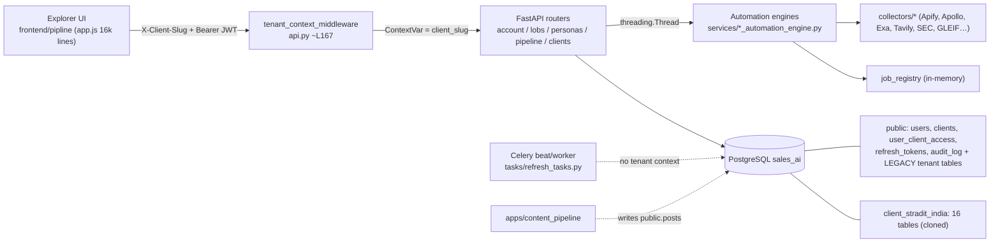
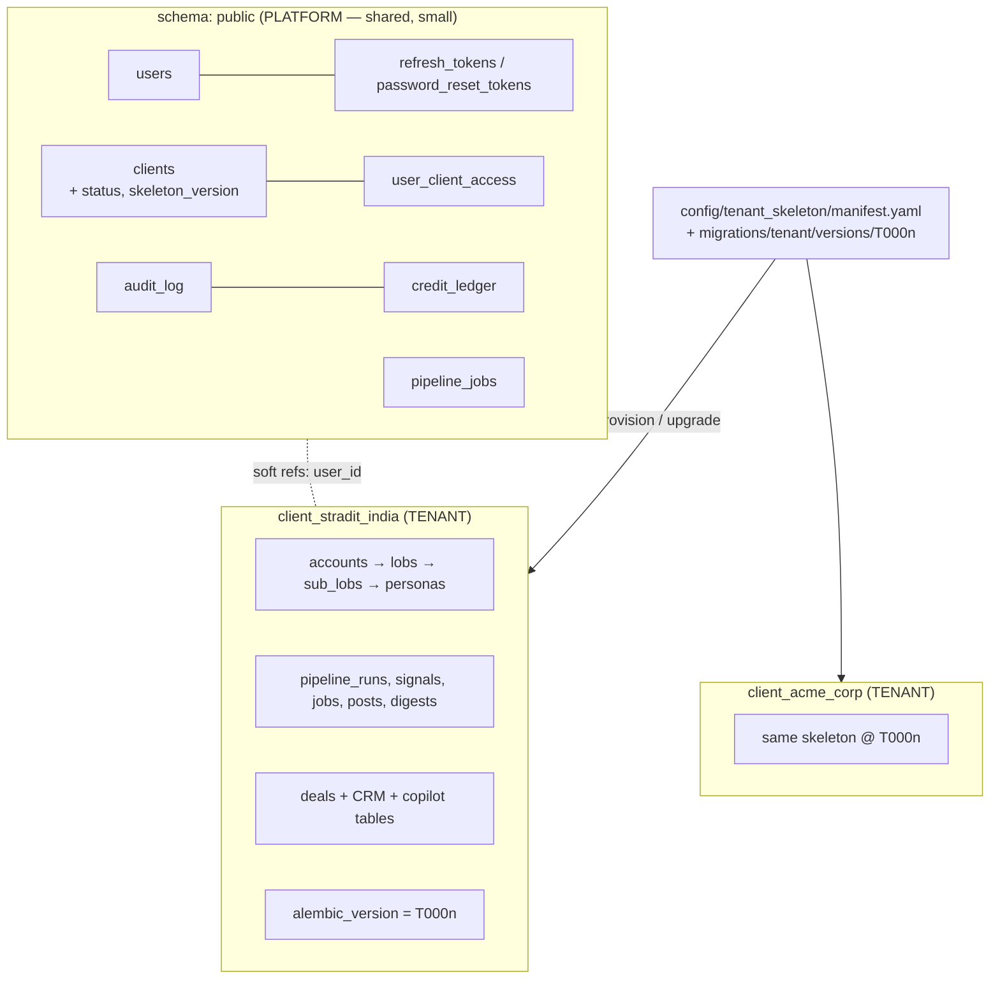

# Multi-Tenant Dynamic DB — Audit, Architecture & Implementation Plan

Scope: Sales AI Agent → **Pipeline Explorer** (`api.py`, `db/`, `routes/client_router.py`, `services/`, `tasks/`, `frontend/pipline/`).
Written: 2026-10-30. Basis: a read of the code in this repository (not a run against the live database).

**Evidence legend** — ✅ verified in code I read · ⚠️ inferred from code, needs a dry run to confirm · ❓ not verified (not read / needs DB access)

---

## 0. Executive summary

**The request is already ~60% built.** Schema-per-client multi-tenancy exists end to end: a `clients` registry, `user_client_access`, a provisioning service that clones 16 tables into `client_<slug>`, a ContextVar + `search_path` router, a tenant middleware, a 20-endpoint `/api/clients` router, a full `ClientWorkspaceManager` UI in the explorer, and five multi-tenant test suites. Stradit India PVT LTD (`stradit_india`) is the seeded default client.

So the job is **not "design dynamic DB from scratch"** — it is to **close the isolation gaps, replace the "skeleton" mechanism, make the scraping system tenant-aware, and polish the module**. The gaps matter because a half-isolated tenant model is worse than none: it looks isolated but leaks.

### Top findings (ranked)

| # | Severity | Finding |
|---|---|---|
| F1 | **P0** | `search_path = "client_x", public` **falls back to `public`**. Any tenant table missing from the client schema silently reads the *old Stradit data still sitting in `public`*. |
| F2 | **P0** | Deals / CRM / Copilot / Search tables are **not** among the 16 cloned tables. They stay shared in `public`, with `deals.account_id REFERENCES accounts(id)` bound to `public.accounts`. Two tenants' `account_id=5` collide; new client-schema accounts cannot get deals (FK to a table they aren't in). |
| F3 | **P0** | The router **fails open**: the pool checkout hook swallows every exception (`except Exception: pass`), and the ContextVar defaults to `client_stradit_india`. Code with no tenant context silently runs as Stradit. |
| F4 | **P0** | **Celery is not tenant-aware** (`tasks/refresh_tasks.py`). The 15-day refresh only ever sees the default tenant's accounts and passes no client. |
| F5 | **P0** | **Content ingestion bypasses tenancy**: `apps/content_pipeline/db.py` writes `posts`/`linkedin_jobs` to `public` with plain `DATABASE_URL`, but `/api/content` reads the *cloned* `client_*.posts`. New scraped content never reaches the client's view. |
| F6 | P1 | The "skeleton" is **the live `public` tables** (`CREATE TABLE … LIKE public.x INCLUDING ALL`), not a versioned config skeleton. It drifts the moment `public` changes, and `public` is also holding legacy data. |
| F7 | P1 | Alembic has **one linear history aimed at `public`**. `env.py` has an `all_clients` mode, but running the baseline (57 tables) inside a client schema would create platform tables (users, clients…) in every tenant. ⚠️ Confirm with a dry run (§6.3). |
| F8 | P1 | Background jobs run in an **in-memory registry** (`services/job_registry.py`): lost on restart, invisible to other workers, and `GET /api/pipeline/job/{id}` has **no tenant check**. |
| F9 | P1 | `AUTH_ENFORCED` defaults to `false`; the middleware's tenant-membership check only runs when it is true. `MULTITENANT_ENABLED` is defined in `config.py` but **referenced nowhere in `api.py`** (0 hits). |
| F10 | P1 | Client credits (`clients.api_credits_used`) are **read** in `api.py` but I found no atomic write path; the account-quota check is count-then-insert (race). |
| F11 | P2 | Output files (`output/YYYY-MM-DD/<company>_<time>/`) and Apify token rotation (module globals in `config.py`) are **shared across tenants**. |
| F12 | P2 | Tests are not hermetic: they create `acme_corp` in the real configured DB. |

### Recommended order
`P0 inventory & freeze → P1 close leaks (fail-closed, archive public copies) → P2 finish table placement → P3 real skeleton + two migration tracks → P4 tenant-aware execution → P5 UI/UX → P6 Stradit cutover & rehearsal → P7 ops`. Estimated **3–4 engineer-weeks** (UI can run in parallel). Details in §9.

### Not verified (be aware)
- The live DB: whether `client_stradit_india` exists, row counts, alembic version. A `backup_sales_ai_pre_cutover_20261030.dump` is in the repo root, suggesting a cutover was started today.
- `git log` shows **no tenant-related commits** (latest are pipeline-explorer automation commits), so this work is likely uncommitted or on another branch. **Commit it before anything else.**
- `apps/sales_crm/schema.sql` and `apps/sales_copilot/schema.sql` were not read (only `apps/sales_deals/schema.sql`); `services/*_automation_engine.py` were not read in full.

---

## 1. System map (what the pipeline explorer actually is)



**Pipeline explorer flow** (`architecture_flow.md`): Account → LOBs/Sub-LOBs → Personas, each as *Fetch (staged JSON, no DB write) → Validate (0–100 score) → Dump to DB (user-approved upsert)*. Output is staged under `output/YYYY-MM-DD/<company>_<HHMMSS>/{raw,enriched}`.

### 1.1 What exists today (✅ verified)

| Area | Where | State |
|---|---|---|
| Client registry | `db/models/client.py`, migration `0008_clients_table` | `clients` (slug, schema_name, plan_tier, is_active, max_accounts, api_credits_total/used). Seeds `stradit_india` (enterprise, 50 accounts, 100 000 credits). |
| User↔client grants | `db/models/user_client_access.py`, `0009` | Roles `client_admin / analyst / viewer`; all active users assigned to Stradit. |
| Provisioning | `db/provisioning.py` | `create_client_schema`, `copy_data_from_public`, `verify_schema_integrity`, `repair_client_schema`, `drop_client_schema`; reserved-slug + regex validation. |
| Routing | `db/routing.py` | ContextVar, `get_client_session`, `scoped_client_session`, pool `checkout` hook. |
| API | `routes/client_router.py` | list/create/get/patch/soft-delete, provision, repair, health, users CRUD, accounts list/add/remove, per-user account grants, credit top-up, overview KPIs. |
| Middleware/deps | `api.py` L167–307 | `tenant_context_middleware`, `get_current_client`, `get_client_db`. |
| Auth | `auth.py` | JWT carries `client_slug`; `get_user_client_grants`, `user_has_client_access`, `require_client_role`. |
| UI | `frontend/pipline/js/app.js` L36–90, 1086–2005, 6400+, 11103+ | `apiFetch` adds `X-Client-Slug`; `ClientWorkspaceManager` (list, KPIs, switcher, add-client modal, health, repair, credits, users, accounts); add-account modal has a client selector; hub shows schema badge. |
| Migrations | `migrations/env.py` | `-x schema=` and `-x all_clients=true`, per-schema `alembic_version`. |
| Tests | `tests/test_multitenant_*`, `test_phase1…6_*` | Isolation, concurrency (50 workers, 2 tenants), cutover checklist. |

---

## 2. Gap analysis (details)

### F1 — `public` fallback in `search_path` (P0)
`db/routing.py` sets `SET search_path = "client_x", public` in three places plus the checkout hook. PostgreSQL resolves an unqualified name in the first schema that has it. After cutover `public` still holds the pre-copy `accounts`, `lobs`, `personas`, `posts`… (`copy_data_from_public` *copies*; Phase-6 test #9 even asserts `public.accounts == client_stradit_india.accounts` row counts, i.e. both remain). Consequences:
- A new client schema missing any table (every table outside the 16 — see F2) resolves it from `public` → **cross-tenant read/write**.
- `repair_client_schema` is the only thing preventing this for the 16; nothing guards the rest.

**Fix:** make `public` contain *only platform tables* (move legacy tenant tables to an archive schema after cutover) and enforce with a CI test. Then the fallback is harmless; later remove it (§5.2).

### F2 — Tables outside the 16 (P0)
`CLIENT_TABLES_ORDERED` = accounts, lobs, sub_lobs, personas, pipeline_runs, user_account_access, opportunity_signals, weekly_digest_snapshots, linkedin_jobs, cxo_movements, action_items, action_item_reminders, system_api_configs, command_center_snapshots, digests, posts.

Not covered (examples from the repo): `deals`, `deal_stakeholders`, `deal_stage_history`, `deal_checklist`, `deal_activity` (`apps/sales_deals/schema.sql`), the 37 tables of `apps/sales_crm/schema.sql` (activities, introductions, saved views, buyer rooms…), `apps/sales_copilot` (RAG chunks/chats), `apps/sales_search` (`search_log`). ❓ exact list needs `scripts/tenant_inventory.py` (§9, P0).

`deals.account_id int NOT NULL REFERENCES accounts(id)` is created with the app's default search path → FK to **`public.accounts`**. Result: (a) all tenants share one `deals` table keyed by per-schema ids that collide; (b) an account created in `client_x.accounts` has an id that may not exist in `public.accounts`, so deal creation fails or attaches to a stranger's account. Also `action_items.deal_id → deals(id)` is cloned *without* its FK (`LIKE … INCLUDING ALL` copies defaults/CHECKs/indexes but **not foreign keys**; the code re-adds only 11 FKs by hand).

### F3 — Fail-open routing (P0)
- `_set_search_path_on_checkout` wraps everything in `try/except: pass`; if `SET` fails, the connection keeps whatever the previous borrower left.
- `_current_client_schema` default is `client_stradit_india`; `get_session()` also silently falls back to `public`. A new thread, Celery task or script with no context = Stradit.
- Session-level `SET` is transactional in PostgreSQL: a `ROLLBACK` reverts it, leaving the previous borrower's value until the next checkout. Works today only because a new checkout re-runs the hook ⚠️ — fragile, and **incompatible with PgBouncer transaction pooling** (see §3).

### F4 — Celery (P0)
`task_refresh_account_hierarchy_and_social(account_key)` and `task_scheduled_15day_refresh()` use `get_session()` with no tenant argument: they read the default tenant, key accounts only by `account.key` (unique per schema, not globally), and write `config.OUTPUT_DIR/<key>_social_and_content.json` (no client folder). Clients 2…N are never refreshed; if the default context ever differs they refresh the wrong tenant.

### F5 — Content pipeline (P0)
`apps/content_pipeline/db.py` creates and writes `targets`, `posts`, `linkedin_jobs` via raw psycopg2 with no schema → `public`. `/api/content` (`api.py` ~L7980) uses `get_session()` → `client_*.posts` (a cloned snapshot). With `search_path = client_x, public` the client copy **shadows** `public`, so fresh posts are invisible, and `linkedin_jobs.target_key → targets(key)` FK (public) does not exist in the clone.

### F6/F7 — Skeleton and migrations
Skeleton-from-live-tables means: (1) no version; (2) a column added to `public.accounts` later does not reach existing tenants; (3) no way to say "tenant X is at skeleton v7". `migrations/env.py` `all_clients` mode runs the single history (0001 baseline = raw SQL for all 57 tables) once per schema with its own `alembic_version`. ⚠️ A fresh client schema has no version row, so it would replay 0001–0009 and create `users`, `clients`, `refresh_tokens`… inside the tenant. Dry-run to confirm:
`alembic -x schema=client_acme upgrade head --sql | findstr /i "CREATE TABLE"`.

### F8–F12
- **Jobs (F8):** `_jobs` dict in `services/job_registry.py`; 24 h retention; `client_slug` stored but never enforced on read; uvicorn restart or multi-worker deploy loses/duplicates state. Threads are `daemon=False` and unbounded (no per-tenant cap).
- **Auth (F9):** with `AUTH_ENFORCED=false`, unauthenticated calls become a synthetic super-admin and the middleware skips membership checks. Fallbacks to `"stradit_india"` appear in login/refresh/me (`api.py` L427, 469, 515), `get_current_client`, `require_client_role`, frontend `getActiveClientSlug()`, and an alias hack `"stradit" → "stradit_india"`.
- **Credits (F10):** `api.py` only *reads* `api_credits_used` (L5852, 6070, 6114). ❓ increments may live in `services/pipeline_run_logger.py`/engines — verify they are atomic. `max_accounts` check in `/api/account/create` and `add_client_account` is `count()` then insert.
- **Shared state (F11):** `config.rotate_apify_token()` mutates module globals — one tenant exhausting a token rotates it for all; `config.get_run_output_dirs()` ignores `get_client_output_dir()`.
- **Roles:** two overlapping role systems — platform `users.role` (includes `client_admin`) and `user_client_access.role`. Endpoints mostly check the *platform* role, so "client_admin of A" is conflated with "client_admin of the platform".
- **Cross-schema FKs:** `client_*.user_account_access.user_id` has no FK to `public.users` (orphans after user deletion).
- **Account count:** you described 5 accounts; `test_phase6_cutover_validation.py` asserts ≥ 6 (BlackRock, BNY…). Reconcile before cutover.

---

## 3. Research: dynamic DB (schema-per-tenant) — what matters for us

**Models.** AWS names three partitioning models for PostgreSQL — *silo, bridge, pool* — and says the pool model (all tenants in shared tables) requires row-level security because there is no logical separation otherwise. Schema-per-tenant sits between silo and pool, giving logical separation without a database per tenant ([AWS Prescriptive Guidance](https://docs.aws.amazon.com/prescriptive-guidance/latest/saas-multitenant-managed-postgresql/best-practices.html)). For ~10–100 clients with heavy, bursty scraping writes and per-client data-export/offboarding needs, schema-per-tenant is a sound choice; RLS-on-shared-tables would put every tenant's rows in the same hot tables and indexes, which is exactly what you wanted to avoid.

**What it does and does not fix (your "no deadlock" goal).**
- ✅ Row/table-level lock contention, autovacuum and bloat become per-tenant (different relations).
- ❌ Still shared: connection pool, CPU/IO, WAL, `public` platform tables (users, audit_log, clients), vendor API quotas, Alembic/DDL locks. The hottest shared row is `clients.api_credits_used` — use atomic updates (§7.5).

**Scale ceilings.** A Command Prompt case study of a ~17 000-schema PostgreSQL cluster describes lock-manager pressure from one transaction touching every tenant's objects, autovacuum falling behind (transaction-ID age reaching ~292 M), no connection pooler, and 12 TB of unmanaged backups ([case study](https://www.commandprompt.com/about/success-stories-case-studies/from-unrecoverable-to-under-control-taming-multi-tenant-postgresql-at-17000-schemas/)). At 10–100 tenants × ~60 tables these are not binding, but they set **design rules we should adopt now**: never loop over all tenants inside one transaction; run per-tenant maintenance in separate transactions; monitor XID age; keep backups tested.

**Connection pooling.** With PgBouncer in *transaction* mode a session-level `SET search_path` is lost or can leak to the next client because the server connection changes between transactions. Recommended fixes: `SET LOCAL` inside an explicit transaction, schema-qualified names, per-role defaults, or session mode for specific pools ([PgBouncer search_path guide](https://www.netdata.cloud/guides/pgbouncer/pgbouncer-set-search-path-lost/)). **Decision:** use `SET LOCAL` at transaction start (§5.2) — correct with or without PgBouncer.

**Migrations at scale.** Pattern: track the revision per tenant, run upgrades with bounded parallelism, return a per-tenant success/error result, and provision a new tenant by upgrading it to head ([fastapi-tenancy migrations guide](https://fastapi-tenancy.readthedocs.io/en/latest/guides/migrations/)). We apply this in §6.

**ORM.** SQLAlchemy supports `schema_translate_map` (per-connection translation of `schema=None` tables) — a stricter alternative to `search_path` that removes the `public` fallback entirely. Plan: Option A (structural guard, fast) now; Option B (translate map / qualified platform tables) as hardening (§5.2).

---

## 4. Target architecture



### 4.1 Table placement rule
| Class | Rule | Examples |
|---|---|---|
| **Platform** (`public`) | identity, access, billing, orchestration across tenants | users, tokens, clients, user_client_access, audit_log, credit_ledger, pipeline_jobs |
| **Tenant** (`client_<slug>`) | anything with an `account_id`, `lob_id`, `persona_id`, or derived from them; anything a client may export or delete | the 16 current tables **plus** deals*, CRM, copilot, search_log |
| **Reference** (`public`, read-only) | vendor rate card, taxonomy, static lookups | rate card, LOB taxonomy |

CI invariant: *`public` contains only Platform + Reference tables* (§8).

### 4.2 The skeleton — "stays in config" done properly
Replace `LIKE public.<table>` with a **versioned tenant migration track**:

```
config/tenant_skeleton/manifest.yaml      # human-readable skeleton contract
migrations/platform/versions/P0001_*.py   # runs on public only
migrations/tenant/versions/T0001_*.py     # runs inside each client schema
alembic_tenant.ini                        # script_location = migrations/tenant
```
```yaml
# config/tenant_skeleton/manifest.yaml
skeleton_version: T0003
tables:                       # creation order = dependency order
  - {name: accounts}
  - {name: lobs,    fks: [{col: account_id, ref: accounts, on_delete: CASCADE}]}
  - {name: sub_lobs, fks: [{col: lob_id, ref: lobs, on_delete: CASCADE}]}
  - {name: personas, fks: [{col: account_id, ref: accounts}, {col: lob_id, ref: lobs, on_delete: SET NULL}]}
  # … deals, deal_*, activities, copilot_*, search_log
platform_refs:                # allowed cross-schema FKs
  - {table: personas, col: owner_user_id, ref: public.users, on_delete: SET NULL}
```
- **Provision** = `CREATE SCHEMA` → run tenant track to head inside it → record `clients.skeleton_version`.
- **Fast path:** generate `skeleton.sql` from head (schema name as a placeholder) in CI; provisioning executes it for new tenants in one transaction.
- **Generate the first tenant migration from reality:** `pg_dump -s -n client_stradit_india` ⇒ `T0001_baseline.sql`, then diff the manifest against it.

### 4.3 Client lifecycle state machine
`pending → provisioning → active ⇄ suspended → archived → deleted`; `failed` reachable from provisioning. Add to `clients`: `status`, `skeleton_version`, `provisioned_at`, `suspended_at`, `deleted_at`, `refresh_cron`, `max_concurrent_jobs`. Provisioning is **idempotent and resumable** (re-run = repair), and the API returns `202` + a job id instead of blocking.

### 4.4 Request path (fail-closed)
```mermaid
sequenceDiagram
  participant UI
  participant MW as Tenant middleware
  participant DEP as TenantSession dep
  participant PG as PostgreSQL
  UI->>MW: GET /api/accounts  (Bearer, X-Client-Slug)
  MW->>MW: verify JWT, membership(user, slug) [always, not only if AUTH_ENFORCED]
  MW->>DEP: bind tenant (ContextVar) — reject if absent
  DEP->>PG: BEGIN; SET LOCAL search_path = "client_x"
  PG-->>DEP: rows (tenant tables only)
  DEP->>PG: COMMIT (setting disappears)
```
Defense in depth (optional, cheap at 10–100 tenants): one `NOLOGIN` role per tenant (`tenant_<slug>`) with privileges only on its schema; the app role runs `SET LOCAL ROLE tenant_<slug>` per transaction, so even a routing bug cannot read another schema.

### 4.5 Tenant-aware execution (scraping system)
- **Run unit:** `(client, account, stage)`. A *Client Run* fans out to all (or selected) accounts as jobs.
- **Jobs in the DB:** `public.pipeline_jobs` replaces `job_registry`; survives restarts, readable by any worker, tenant-checked on read.
- **Celery:** every task takes `client_slug` and runs inside `tenant_scope()`; beat runs a *dispatcher* that iterates active clients (not accounts of one tenant) honoring `clients.refresh_cron`.
- **Fairness:** per-tenant concurrency cap (`max_concurrent_jobs`, Redis semaphore) + global cap so one client's 10 accounts cannot starve another.
- **Vendor keys:** pool per tenant or platform pool with per-tenant quota; no module-global rotation.
- **Storage:** `output/<client_slug>/YYYY-MM-DD/<run>/…` (or S3 prefix `tenant=<slug>/`).
- **Content pipeline:** takes `--client`; writes to `client_<slug>.posts` via `tenant_scope()`; `targets` becomes a tenant table (keyed to `accounts.key`).

---

## 5. Backend implementation (key code)

### 5.1 Tenant context — fail closed (`db/tenant.py`, new)
```python
from contextvars import ContextVar
from contextlib import contextmanager
import re

_SLUG = re.compile(r"^[a-z][a-z0-9_]{1,98}$")
_tenant: ContextVar[str | None] = ContextVar("tenant_schema", default=None)   # NO default tenant

class TenantContextError(RuntimeError): ...

def schema_for(slug: str) -> str:
    if not _SLUG.match(slug): raise ValueError("bad slug")
    return f"client_{slug}"

def current_schema() -> str:
    s = _tenant.get()
    if not s: raise TenantContextError("No tenant bound to this context")
    return s

@contextmanager
def tenant_scope(slug: str):
    tok = _tenant.set(schema_for(slug))
    try: yield
    finally: _tenant.reset(tok)
```

### 5.2 Session binding — `SET LOCAL` per transaction (replace pool `checkout` hook)
```python
from sqlalchemy import event
@event.listens_for(SessionLocal, "after_begin")
def _bind_tenant(session, transaction, connection):
    schema = session.info.get("schema") or current_schema()      # raises if unbound
    connection.exec_driver_sql(f'SET LOCAL search_path = "{schema}", public')   # Option A
    # Option B (strict): f'SET LOCAL search_path = "{schema}"' and qualify platform tables as public.*
```
- `SET LOCAL` ends with the transaction → no leak on rollback, PgBouncer-safe, no swallowed exceptions.
- **Option A (do first):** keep `, public`, but only after F1's archive step guarantees `public` has no tenant tables. **Option B (hardening):** drop `public` from the path; give platform models `__table_args__ = {"schema": "public"}` and qualify raw SQL (`auth.team_user_ids` uses bare `users`, etc.).
- Remove: default ContextVar value, `except: pass`, `DEFAULT_CLIENT_SLUG` fallbacks in login/refresh/me/`get_current_client`/frontend (a user with no grants gets a 403 + "no workspace" screen, not Stradit).

### 5.3 Provisioning v2 (`db/provisioning.py`)
1. `INSERT clients(status='provisioning')` + commit (visible, resumable).
2. `CREATE SCHEMA` + run tenant track to head (`alembic -x schema=… -c alembic_tenant.ini upgrade head` or the generated `skeleton.sql`).
3. Create per-tenant role + grants (optional §4.4).
4. `verify_schema_integrity` — **extend** to compare columns/types/indexes/constraints/sequences against the manifest (today it only checks table existence and an FK *count*).
5. `status='active'`, `skeleton_version=head`; audit log. On failure → `status='failed'` + error, **never auto-DROP** (keep `drop_client_schema` behind `super_admin` + typed confirmation + `ALLOW_SCHEMA_DROP=1`).
6. Seed: default API-config rows, first `client_admin` grant.

### 5.4 Migration fan-out runner (`python -m db.migrate tenants`)
```
python -m db.migrate platform upgrade
python -m db.migrate tenants upgrade [--only slug] [--concurrency 4] [--dry-run]
python -m db.migrate tenants status        # table: slug | version | head | drift
```
Per tenant: its own transaction, `lock_timeout 10s`, result recorded in `clients.skeleton_version`; **continue on failure, exit non-zero at the end**; deploy blocks if any active tenant is behind (extend `/api/health` → `schema: behind`). Compatibility rule stays *expand → migrate → contract* (docs/MIGRATIONS.md).

### 5.5 Credits and quotas (atomic)
```sql
CREATE TABLE public.credit_ledger(
  id bigserial PRIMARY KEY, client_id int NOT NULL REFERENCES public.clients(id),
  account_id int, run_id text, delta int NOT NULL, reason text NOT NULL,
  created_at timestamptz NOT NULL DEFAULT now());

-- reserve before a run (0 rows => insufficient credits => HTTP 402)
UPDATE public.clients SET api_credits_used = api_credits_used + :n
 WHERE id = :cid AND api_credits_used + :n <= api_credits_total RETURNING api_credits_used;
```
Settle actual vs reserved at run end (ledger rows in both directions). Account quota:
```python
conn.execute(text("SELECT pg_advisory_xact_lock(hashtext(:k))"), {"k": f"accounts:{slug}"})
# then count + insert in the same transaction
```

### 5.6 Celery
```python
class TenantTask(Task):
    def __call__(self, *a, client_slug=None, **kw):
        if not client_slug: raise TenantContextError("client_slug required")
        with tenant_scope(client_slug): return super().__call__(*a, client_slug=client_slug, **kw)

@app.task(base=TenantTask, bind=True, name="tasks.refresh_account")
def refresh_account(self, account_id: int, *, client_slug: str): ...

@app.task(name="tasks.dispatch_refresh")           # beat: every hour
def dispatch_refresh():
    for c in active_clients_due():                  # reads clients.refresh_cron
        with tenant_scope(c.slug):
            for acc_id in account_ids(): refresh_account.delay(acc_id, client_slug=c.slug)
```
Use IDs not keys; thread starts in `api.py` (≈ 10 `threading.Thread` sites) move to the same task runner or wrap with `contextvars.copy_context().run`.

### 5.7 Endpoint hygiene
- Add tenant check to `GET /api/pipeline/job/{job_id}` and `/jobs`.
- One shared `TenantSession` dependency for every router; lint rule: no `get_session()` in route handlers (94 call sites today vs 19 `Depends(get_client_*)`).
- Enforce tenant membership **always** in production: fail startup if `ENV=production and AUTH_ENFORCED!=true`.
- Honor or delete `MULTITENANT_ENABLED`.
- Split roles: **platform** (`super_admin`, `staff`) vs **client** (`client_admin|analyst|viewer` from `user_client_access`); JWT carries `client_slug` and `client_role`; authorization checks the client role.
- Add soft-FK cleanup: on user deletion remove `user_account_access` rows in all tenants (job), or add `REFERENCES public.users(id) ON DELETE CASCADE` (valid cross-schema FK).

---

## 6. Stradit India PVT LTD — cutover plan

### 6.1 Preconditions
1. **Commit** all current work on a branch.
2. Reconcile account count (5 vs ≥ 6) and list them: `SELECT id,key,display_name FROM public.accounts`.
3. Verify the backup restores: `pg_restore --list backup_sales_ai_pre_cutover_20261030.dump` and restore into a scratch DB (`sales_ai_rehearsal`). **Rehearse everything below there first.**
4. Run `scripts/tenant_inventory.py` (P0 deliverable): every table in `public` with row count, FKs to `accounts/lobs/personas`, and a proposed class.

### 6.2 Runbook
| Step | Action | Check |
|---|---|---|
| 1 | Maintenance window; stop Celery + content pipeline; put API in read-only | no writers (`pg_stat_activity`) |
| 2 | `pg_dump -Fc` fresh backup | restore test passes |
| 3 | Platform migration `P000x` (clients status columns, ledger, jobs) | `db.migrate status` |
| 4 | Provision/upgrade `client_stradit_india` to skeleton head (tenant track) | integrity report = healthy |
| 5 | Copy **all** tenant tables, including CRM/deals/copilot (FK order from manifest); reset sequences | per-table `count(*)` **and** `md5(string_agg(id::text,','))` hash match |
| 6 | FK/orphan checks (`personas.account_id`, `deals.account_id`, `action_items.deal_id`…) | 0 orphans |
| 7 | Smoke: all explorer tabs, one account fetch→validate→dump, content tab, deals | green |
| 8 | **Archive public copies**: `CREATE SCHEMA legacy_20261030; ALTER TABLE public.<t> SET SCHEMA legacy_20261030` for every tenant table | CI guard (§8) passes: `public` = platform only |
| 9 | Reopen writers; start Celery with tenant-aware tasks | one scheduled refresh succeeds for Stradit |
| 10 | After 14 days stable: `pg_dump` the legacy schema to cold storage, then drop | — |

**Rollback (before step 8):** switch the app back to `public`, drop `client_stradit_india`, restore nothing (public untouched). **After step 8:** `ALTER TABLE legacy…SET SCHEMA public` per table, or restore the step-2 dump.

> Order matters: move deals/CRM into the tenant **before** step 8, because `ALTER … SET SCHEMA` keeps FKs pointing at the archived `accounts`.

### 6.3 Dry runs to settle ⚠️ items
```bash
alembic -x schema=client_acme upgrade head --sql | findstr /i "CREATE TABLE"    # F7: platform tables replayed?
python -m db.migrate status
psql -c "SELECT schemaname,count(*) FROM pg_tables WHERE schemaname IN ('public') GROUP BY 1"
```

---

## 7. UI / UX — Client & Account module in the Pipeline Explorer

The explorer already has a workspace switcher, add-client modal, health, repair, credits and users. Refinements below turn it from "admin modals" into a coherent **workspace-first** experience.

### 7.1 Principles
1. **Never ambiguous which tenant you are in.** Persistent context bar; tenant accent colour (hue from slug hash) on the bar, sidebar edge and favicon badge; switching while jobs run asks for confirmation.
2. **Destructive = deliberate.** Remove account / deactivate client / drop schema → type the slug to confirm; show what will be deleted (rows by table).
3. **Long operations are visible.** Provisioning, bulk onboarding and client runs show progress, can be left and resumed (jobs persisted, §4.5).
4. **Quota and credits before commitment.** Every action that spends credits shows an estimate and the remaining balance first.

### 7.2 Information architecture
```
Topbar:  [● Stradit India PVT LTD ▾]  ·client_stradit_india·  [5/50 accounts] [92,400 credits] [⌘K]
Left nav: Overview · Accounts · Run Center · Content · Personas · ── Admin: Clients · Users · Schema health
```

### 7.3 Screens
**A. Clients console** (super_admin) — table + KPI tiles (already: `overview-kpis`).
```
┌ Clients ──────────────────────────────── [+ Add client] ┐
│ Active 3 · Accounts 17 · Credits used 18% · Drift 0     │
│ ▢ Name              Slug          Plan   Accts  Credits      Schema  Status │
│ ● Stradit India…    stradit_india ENT    5/50   ▓▓░░ 7.6k   ✔ v7    Active │
│ ● Acme Corp         acme_corp     STD    0/20   ░░░░ 0      ⚠ v6    Active │
└─────────────────────────────────────────────────────────┘
```
Row actions: Open workspace · Users · Credits · Health · Suspend. Filter by status/plan; drift badge (`v6 < head v7` → "Upgrade").

**B. Add-client wizard (3 steps, replaces single modal)**
1. *Organization* — name, slug (auto-suggest, live availability check, shows resulting `client_<slug>`), legal name.
2. *Plan & limits* — plan tier, max accounts (stepper), starting credits, refresh schedule, first client admin (pick user / invite).
3. *Review & provision* — summary + **live progress checklist** (registry row → schema → tables n/N → sequences → FKs → verification → ready). Failure keeps the checklist, shows the failing step, buttons **Retry / Repair / Contact support**. On success: "Add first account" CTA.

**C. Client detail (right drawer, tabs):** Overview · Accounts · Users & roles · Credits (ledger + top-up with reason) · Schema health (table matrix, version, drift, "Repair") · Activity (audit log).

**D. Accounts tab**
- Quota meter `5 / 20`; at ≥ 80 % amber, 100 % blocks with upgrade prompt.
- **Add account**: single (name, domain, CIK/ticker, with preflight: credits, duplicates, existing in other clients? — warn only, never reveal other tenants' data) or **bulk CSV** (upload → preview grid → inline validation: duplicates, bad domains, over-quota → import).
- Per-account row: stages status chips (Account · LOB · Persona · Content), last run, credits spent, `Run ▾`.

**E. Run Center** (new) — the "run the whole scraping system for a client" screen.
```
Client: Stradit India   Accounts: [x] all (5)   Stages: [Account][LOB][Persona][Content]
Estimated credits: 1,240   Balance: 92,400   Concurrency: [3]   Mode: (•) Fetch+Validate  ( ) Fetch+Validate+Dump
[ Preflight ✔ ]  [ Run client ▶ ]
─ Live ─ BlackRock  Account ✔  LOB ▓▓▓░ 62%  Persona –   · BNY Mellon … ─ Needs attention (2) ─
```
Preflight shows credits, vendor-key health, quota; per-row retry for failed sources (feature exists: selective source retry); Stop all.

**F. States & copy:** empty (no clients: "Create your first workspace"), no-access (403: "You don't have a workspace yet — ask an admin"), provisioning-failed, suspended (read-only banner), schema-behind (admin-only banner "Upgrade schema to v7").

**G. Accessibility/perf:** focus-trapped modals, `aria-live` for job progress, tenant colour never the only signal (text + icon), cache keys include slug (already `pipeline_accounts_cache_v3_<slug>`), clear all caches on switch.

### 7.4 Front-end tasks (map to code)
- Split `ClientWorkspaceManager` (app.js L1086–2005) into `workspace-store`, `clients-console`, `client-drawer`, `add-client-wizard`; app.js is 16 000 lines — extract before adding more.
- Remove `"stradit_india"` defaults in `getActiveClientSlug()`; if no grant → no-workspace screen.
- On 403 for a slug → drop it from localStorage and reload grants.
- Poll `/api/pipeline/jobs?client_slug=` → switch to SSE/long-poll on persisted jobs.

---

## 8. Testing & quality gates

**Hermetic DB:** run tests against an ephemeral Postgres (testcontainers/`sales_ai_test`), never the configured DB; fixture creates 3 tenants from the skeleton.

| Suite | Asserts |
|---|---|
| **Canary isolation** | each tenant has a canary account/persona/deal/post; crawl every GET in the OpenAPI spec per tenant; no response contains another tenant's canary |
| **Fail-closed** | DB access without tenant context raises `TenantContextError`; a thread/Celery task without `client_slug` fails |
| **Rollback safety** | request that raises/rolls back, then next request on the same pooled connection — correct schema (use pool size 1) |
| **Concurrency** | extend `test_phase5`: 50+ workers, 3 tenants, mixed commit/rollback/exception, writes included |
| **Placement guard** | `test_public_has_only_platform_tables`; every tenant table in manifest exists in every tenant; no tenant table name exists in `public` |
| **Skeleton** | fresh tenant == manifest (columns/types/indexes/constraints); upgrade T000n → T000n+1 on two tenants; failure on one tenant doesn't block others |
| **Quota/credits** | 20 concurrent account creations at quota 5 → exactly 5; concurrent reservations never exceed total |
| **Auth** | production boot fails with `AUTH_ENFORCED=false`; cross-tenant header with valid JWT → 403; job-id of another tenant → 404 |
| **Cutover rehearsal** | restore the real dump to scratch; run §6.2 steps 3–8; hash comparison green |
| **UI (Playwright)** | wizard happy path/failure/retry; switch tenant mid-job; bulk CSV; Run Center preflight |

---

## 9. Phased plan

| Phase | Work | Est. | Exit criteria |
|---|---|---|---|
| **P0 Inventory & freeze** | commit current work; `tenant_inventory.py`; hermetic test DB; decisions (§11) | 1 d | table classification signed off; tests run on scratch DB |
| **P1 Close the leaks** | `db/tenant.py`; `after_begin` + `SET LOCAL`; remove default tenant/fallbacks; tenant check on job endpoints; prod guard for `AUTH_ENFORCED`; per-tenant output dirs | 2–3 d | fail-closed + rollback tests green |
| **P2 Finish table placement** | classify & move deals/CRM/copilot/search tables into tenant track; fix FKs; content pipeline `--client` | 3–4 d | canary crawl green incl. CRM; F2/F5 closed |
| **P3 Real skeleton** | `manifest.yaml`; platform/tenant migration tracks; provisioning v2 (state machine, resumable); `db.migrate tenants`; extended drift check; `skeleton_version` in `clients` | 3–4 d | new tenant == manifest; fan-out upgrade proven on 2 tenants |
| **P4 Tenant-aware execution** | Celery `TenantTask` + dispatcher; `pipeline_jobs` table; per-tenant concurrency; per-tenant vendor-key policy; credit ledger + atomic reserve; quota advisory lock | 3 d | scheduled refresh runs for 2 tenants; jobs survive restart |
| **P5 UI/UX** | §7 (parallel with P3–P4) | 4–5 d | wizard, drawer, bulk add, Run Center, tenant bar shipped |
| **P6 Stradit cutover** | rehearse on restored dump → production runbook §6.2 | 1–2 d | hash-verified; public archived; CI placement guard green |
| **P7 Ops** | per-tenant metrics, XID-age & pool alerts, `pg_dump -n` per-tenant export, offboarding runbook, optional per-tenant DB roles, Option B strict path | 2–3 d | dashboards + restore drill documented |

Critical path: P0 → P1 → P2 → P3 → P6. Total ≈ 3–4 engineer-weeks; UI in parallel.

---

## 10. Bottleneck & risk register

| Risk | L | I | Mitigation |
|---|---|---|---|
| `public` fallback leaks tenant data (F1) | H | H | archive public copies, CI placement guard, Option B |
| Shared deals/CRM IDs collide (F2) | H | H | move to tenant track before enabling client #2 |
| Routing fails open (F3) | M | H | `db/tenant.py` fail-closed, `SET LOCAL`, canary + rollback tests |
| Migration fan-out drift / partial failure | M | M | per-tenant version, continue-on-error, health = `behind`, drift report |
| Pool exhaustion: `pool_size 20 + max_overflow 30` = 50 connections **per process**; N API workers + Celery workers vs RDS `max_connections` | M | H | size per worker; PgBouncer (transaction mode is safe with `SET LOCAL`); per-tenant job caps |
| Hot row `clients.api_credits_used` | M | M | atomic `UPDATE … RETURNING` + ledger; no read-modify-write |
| Noisy neighbour on vendor APIs (shared Apify/Exa/Tavily quotas) | H | M | per-tenant quotas + fair-share semaphore; per-tenant key option |
| Autovacuum / XID age as data grows | L (now) | M | monitor XID age, per-table vacuum settings on `posts`/`personas`; never loop all tenants in one txn |
| Catalog growth (tables × tenants) | L at ≤100 tenants | M | revisit at ~500 tenants; keep tenant table count lean |
| Backup/restore granularity | M | M | nightly full + per-schema `pg_dump -n`; quarterly restore drill |
| Cross-schema FK complicates per-tenant restore | L | M | restore requires `public`; document; or soft refs + cleanup job |
| In-memory jobs / threads lost on restart (F8) | H | M | `pipeline_jobs` table + Celery |
| Vector store (Copilot RAG / Chroma) shared | M | H | collection per tenant (or pgvector table in tenant schema); include in canary test |
| Alembic autogenerate not tenant-aware | M | L | autogenerate only against the tenant track on a scratch tenant |
| Tests pollute real DB (F12) | H | M | hermetic DB |
| Numeric IDs guessable across tenants | L | L | URL-level slug in router later; optional public UUIDs |

---

## 11. Decisions needed from you

1. **Scope of tenancy:** should CRM, Deals, Copilot and Search be per-tenant (recommended) or stay shared for now?
2. **Account list:** confirm the 5 accounts that belong to Stradit (tests assume ≥ 6).
3. **Vendor keys:** shared platform keys with per-tenant quotas, or client-supplied keys (`system_api_configs` already per-tenant)?
4. **Offboarding policy:** retention period before dropping a deactivated client's schema; export format.
5. **Target scale:** 10 clients now — expect ≥ 100 within a year? (Changes how much of P7 to pull forward.)
6. **PgBouncer:** planned on RDS? (Plan works either way thanks to `SET LOCAL`.)
7. **Per-tenant DB roles (§4.4):** yes/no for defense in depth.

---

## 12. Sources
- AWS Prescriptive Guidance — SaaS multi-tenant PostgreSQL best practices: https://docs.aws.amazon.com/prescriptive-guidance/latest/saas-multitenant-managed-postgresql/best-practices.html
- Command Prompt — multi-tenant PostgreSQL at 17,000 schemas: https://www.commandprompt.com/about/success-stories-case-studies/from-unrecoverable-to-under-control-taming-multi-tenant-postgresql-at-17000-schemas/
- PgBouncer and `search_path`: https://www.netdata.cloud/guides/pgbouncer/pgbouncer-set-search-path-lost/
- Per-tenant migration orchestration pattern: https://fastapi-tenancy.readthedocs.io/en/latest/guides/migrations/
- Repo files read: `api.py`, `auth.py`, `config.py`, `celery_app.py`, `db/{provisioning,routing,connection,writer}.py`, `db/models/{client,account,user_client_access,user_account_access}.py`, `routes/client_router.py`, `migrations/{env.py,versions/0008,0009}`, `services/{job_registry,credit_accounting_engine}.py`, `tasks/refresh_tasks.py`, `apps/sales_deals/schema.sql`, `apps/content_pipeline/db.py`, `frontend/pipline/js/app.js`, `tests/test_phase5*`, `tests/test_phase6*`, `docs/{MIGRATIONS,DB_DEPLOYMENT_PLAN}.md`, `MERGE_PLAN.md`, `architecture_flow.md`.
