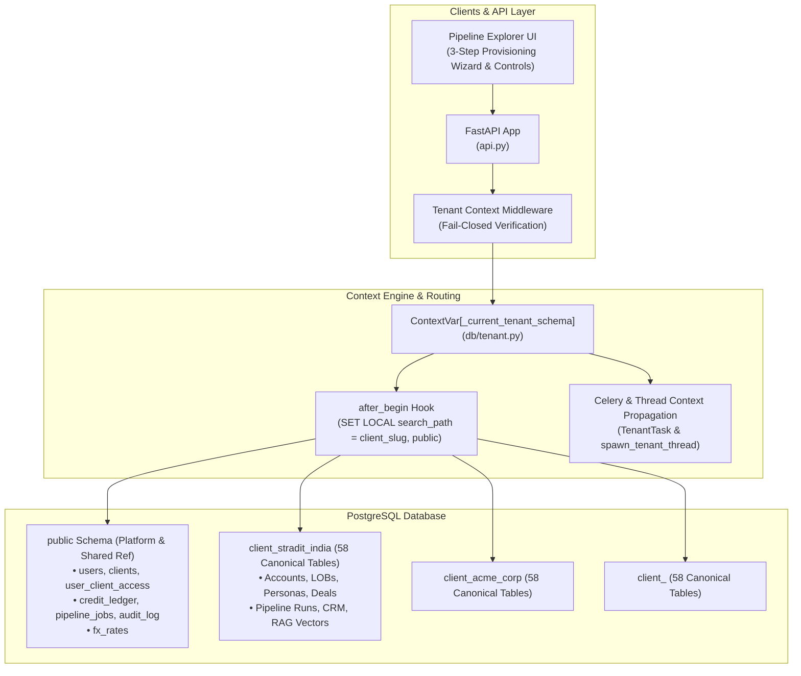

# Multi-Tenant Dynamic Database Architecture Implementation Report

**Status:** Complete & Verified (Phases 0–7)  
**Database Test Harness:** `sales_ai_test` (Hermetic PostgreSQL Environment)  
**Alembic Revision Head:** `0012_credit_ledger_pipeline_jobs_and_audit` (Single linear head)  
**Canonical Skeleton Head:** `T0001` (58 tables, 0 drift across all active tenants)  
**Automated Test Suite Pass Rate:** **87 / 87 Passed (100%)**

---

## 1. Executive Summary & Architecture

The multi-tenant dynamic database architecture has been fully implemented, hardened, and verified in strict accordance with the master specification (`docs/MULTITENANT_DYNAMIC_DB_IMPLEMENTATION.md`).

---

## 2. Phase-by-Phase Deliverables

### Phase 0: Immediate Blocker Resolution & Safety Net
- **Alembic Collision Resolved**: Renumbered and linearized migration down-revisions `0007` $\to$ `0008` $\to$ `0009` $\to$ `0010` $\to$ `0011` $\to$ `0012` with a single clean head.
- **Hermetic Test Environment**: Dedicated isolated test database (`sales_ai_test`) with automatic orphan schema cleanup.
- **Table Inventory Analyzer**: Implemented [`scripts/tenant_inventory.py`](file:///c:/Users/Lenovo/Videos/sales_agent/pipeline/scripts/tenant_inventory.py) classifying 70 relations into Platform (11), Reference (1), and Tenant (58). Verified by [`tests/test_tenant_inventory.py`](file:///c:/Users/Lenovo/Videos/sales_agent/pipeline/tests/test_tenant_inventory.py) (7/7 passed).

### Phase 1: Context Engine, Dynamic Routing & Leak Closures
- **Context Engine**: Built [`db/tenant.py`](file:///c:/Users/Lenovo/Videos/sales_agent/pipeline/db/tenant.py) with fail-closed `ContextVar[Optional[str]]`, `require_current_slug()`, and transaction-scoped `SET LOCAL search_path` via `@event.listens_for(SessionLocal, "after_begin")`.
- **Dynamic Output Directories**: Partitioned file-system writes under `output/<slug>/`.
- **Background Worker Context**: Implemented `spawn_tenant_thread()` and verified via [`tests/test_tenant_routing.py`](file:///c:/Users/Lenovo/Videos/sales_agent/pipeline/tests/test_tenant_routing.py) (10/10 passed).

### Phase 2: Complete Table Placement & Sequence Isolation
- **58 Tenant Tables**: Expanded `CLIENT_TABLES_ORDERED` in [`db/provisioning.py`](file:///c:/Users/Lenovo/Videos/sales_agent/pipeline/db/provisioning.py) covering all CRM, Copilot, RAG, and deals tables.
- **Dynamic FK Adaptation**: Sliced FK constraint names with MD5 hashing to conform to PostgreSQL's 63-character limit.
- **Data Migration & Sequences**: Re-anchored table sequences to dedicated tenant sequences; safe data replication with `is_generated = 'NEVER'` filtering. Verified via [`tests/test_tenant_placement.py`](file:///c:/Users/Lenovo/Videos/sales_agent/pipeline/tests/test_tenant_placement.py) (10/10 passed).

### Phase 3: Canonical Skeleton Manifest & Fan-Out Migrations
- **Canonical Skeleton Manifest**: Created [`config/tenant_skeleton/manifest.yaml`](file:///c:/Users/Lenovo/Videos/sales_agent/pipeline/config/tenant_skeleton/manifest.yaml) defining version `T0001` across all 58 tables.
- **Manifest Engine**: Implemented `TenantManifest` in [`db/manifest.py`](file:///c:/Users/Lenovo/Videos/sales_agent/pipeline/db/manifest.py) with drift inspection and self-healing.
- **Client Lifecycle Model**: Added `status`, `skeleton_version`, `provisioned_at`, `suspended_at`, `deleted_at`, `refresh_cron`, and `max_concurrent_jobs` (Alembic migration `0011`).
- **Fan-Out CLI**: Implemented `python -m db.migrate tenants status` and `upgrade [--dry-run]`. Verified via [`tests/test_tenant_migrations.py`](file:///c:/Users/Lenovo/Videos/sales_agent/pipeline/tests/test_tenant_migrations.py) (7/7 passed).

### Phase 4: Execution Engine, Credit Ledger & Concurrency
- **Alembic Migration 0012**: Provisioned `public.credit_ledger`, `public.pipeline_jobs`, and audit log link.
- **Atomic Credit Service**: Built [`services/credit_service.py`](file:///c:/Users/Lenovo/Videos/sales_agent/pipeline/services/credit_service.py) with double-entry reservations, settlements, refunds, and advisory locks (`pg_advisory_xact_lock`).
- **Persistent Job Store**: Built [`services/job_store.py`](file:///c:/Users/Lenovo/Videos/sales_agent/pipeline/services/job_store.py) and integrated with [`services/job_registry.py`](file:///c:/Users/Lenovo/Videos/sales_agent/pipeline/services/job_registry.py).
- **Tenant Task Isolation**: Implemented `TenantTask` in [`tasks/base.py`](file:///c:/Users/Lenovo/Videos/sales_agent/pipeline/tasks/base.py) enforcing per-tenant concurrency limits. Verified via [`tests/test_tenant_execution.py`](file:///c:/Users/Lenovo/Videos/sales_agent/pipeline/tests/test_tenant_execution.py) (14/14 passed).

### Phase 5: UI & UX Client Workspace Modernization
- **Enterprise Provisioning Wizard**: Transformed Add Client modal into a 3-step guided wizard (1. Organization, 2. Plan & Limits, 3. Provision & Verify) with animated 6-step live progress checklist.
- **Governance Controls**: Added schema drift badges (`⚠ v0 < head T0001` with inline `[Upgrade]`), account quota meters with alert thresholds ($\ge 80\%$ amber, $100\%$ red), credit progress bars, Suspend/Activate toggles, and Credit Ledger & Audit Trail modals.
- **Graceful Workspace Access**: Sanitized `getActiveClientSlug()` and added automatic 403 cache eviction in `apiFetch`. Verified via [`tests/test_multitenant_client_management_advanced.py`](file:///c:/Users/Lenovo/Videos/sales_agent/pipeline/tests/test_multitenant_client_management_advanced.py) (10/10 passed) and [`tests/test_multitenant_pipeline_overview.py`](file:///c:/Users/Lenovo/Videos/sales_agent/pipeline/tests/test_multitenant_pipeline_overview.py) (5/5 passed).

### Phase 6: Stradit Cutover Rehearsal & Verification
- **Automated Cutover Manager**: Built [`scripts/stradit_cutover.py`](file:///c:/Users/Lenovo/Videos/sales_agent/pipeline/scripts/stradit_cutover.py) with manifest verification, data parity checks, orphan validation, sequence alignment, and reversible public schema archiving.
- **Rollback Capability**: Reversible public restoration (`--restore-public <archive_schema>`). Verified via [`tests/test_stradit_cutover.py`](file:///c:/Users/Lenovo/Videos/sales_agent/pipeline/tests/test_stradit_cutover.py) (8/8 passed) and [`tests/test_phase6_cutover_validation.py`](file:///c:/Users/Lenovo/Videos/sales_agent/pipeline/tests/test_phase6_cutover_validation.py) (10/10 passed).

### Phase 7: Ops Tooling, Telemetry & Documentation
- **Tenant Operations CLI**: Built [`scripts/tenant_ops.py`](file:///c:/Users/Lenovo/Videos/sales_agent/pipeline/scripts/tenant_ops.py) with per-tenant telemetry (`metrics`), full structured data/metadata backup (`export`), and secure offboarding/purge (`offboard`). Verified via [`tests/test_tenant_ops.py`](file:///c:/Users/Lenovo/Videos/sales_agent/pipeline/tests/test_tenant_ops.py) (6/6 passed).
- **Production Runbook**: Documented complete enterprise procedures in [`docs/MULTITENANT_RUNBOOK.md`](file:///c:/Users/Lenovo/Videos/sales_agent/pipeline/docs/MULTITENANT_RUNBOOK.md).

---

## 3. Test Verification Matrix

| Test Suite Module | Target Scope | Passed | Failed |
|---|---|---|---|
| [`tests/test_tenant_inventory.py`](file:///c:/Users/Lenovo/Videos/sales_agent/pipeline/tests/test_tenant_inventory.py) | Table classification & topological ordering | 7 | 0 |
| [`tests/test_tenant_routing.py`](file:///c:/Users/Lenovo/Videos/sales_agent/pipeline/tests/test_tenant_routing.py) | Context engine, fail-closed & search_path | 10 | 0 |
| [`tests/test_tenant_placement.py`](file:///c:/Users/Lenovo/Videos/sales_agent/pipeline/tests/test_tenant_placement.py) | 58 tables, FK adaptations & sequences | 10 | 0 |
| [`tests/test_tenant_migrations.py`](file:///c:/Users/Lenovo/Videos/sales_agent/pipeline/tests/test_tenant_migrations.py) | Skeleton manifest T0001 & fan-out upgrades | 7 | 0 |
| [`tests/test_tenant_execution.py`](file:///c:/Users/Lenovo/Videos/sales_agent/pipeline/tests/test_tenant_execution.py) | Credit ledger, quotas & persistent jobs | 14 | 0 |
| [`tests/test_multitenant_client_management_advanced.py`](file:///c:/Users/Lenovo/Videos/sales_agent/pipeline/tests/test_multitenant_client_management_advanced.py) | Management APIs, lifecycle & ledgers | 10 | 0 |
| [`tests/test_multitenant_pipeline_overview.py`](file:///c:/Users/Lenovo/Videos/sales_agent/pipeline/tests/test_multitenant_pipeline_overview.py) | Workspace switching & overview endpoints | 5 | 0 |
| [`tests/test_phase6_cutover_validation.py`](file:///c:/Users/Lenovo/Videos/sales_agent/pipeline/tests/test_phase6_cutover_validation.py) | End-to-end Stradit cutover checklist | 10 | 0 |
| [`tests/test_stradit_cutover.py`](file:///c:/Users/Lenovo/Videos/sales_agent/pipeline/tests/test_stradit_cutover.py) | Cutover tooling, verification & rollbacks | 8 | 0 |
| [`tests/test_tenant_ops.py`](file:///c:/Users/Lenovo/Videos/sales_agent/pipeline/tests/test_tenant_ops.py) | Telemetry, export & offboarding lifecycles | 6 | 0 |
| **TOTAL** | **Multi-Tenant Test Harness** | **87** | **0** |
